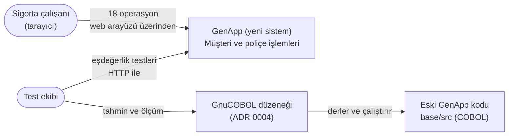
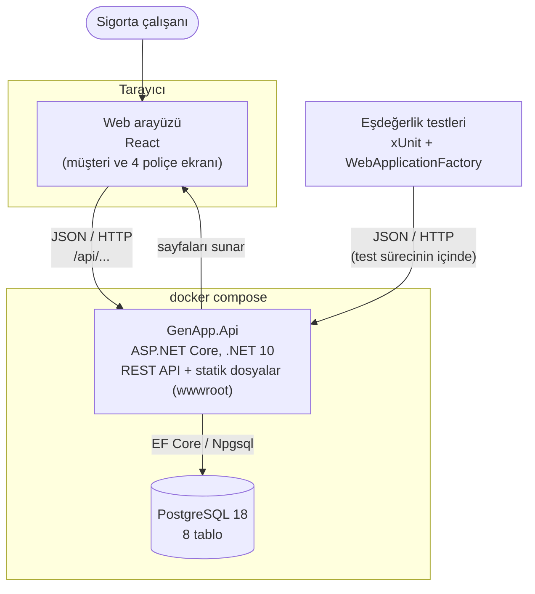
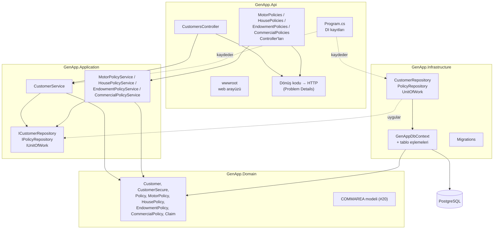
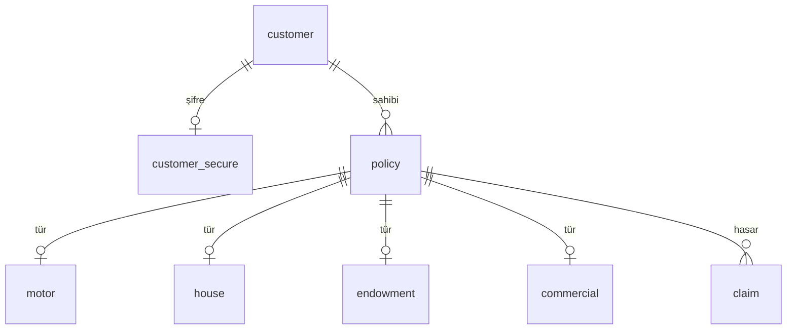

# Mimari belge (SDD)

- **Durum:** Taslak (mimari incelemede gözden geçirilecek)
- **Tarih:** 2026-10-13
- **Yazan:** Efekan
- **İlgili:** #73, [SRS](srs.md), [API tasarımı](api-design.md), [veritabanı şeması](database-schema.md),
  [ADR 0001–0005](#10-adr-listesi)

Bu belge GenApp'in yeni sürümünün mimarisini tek yerde toplar: sistemin çevresi, çalışan parçaları,
katmanları, veri ve API özeti, eski sistemden yeni sisteme eşleme ve test mimarisinin dayandığı karar.
H04'ten itibaren yazılan bütün kod bu belgeye uyar. Kararların ayrıntılı gerekçeleri ADR'lerdedir; bu belge
onları özetler ve bağlantı verir.

## 1. Amaç ve kapsam

Yeni sistem, IBM'in COBOL/CICS örnek uygulaması GenApp'in 18 operasyonunu (müşteri ekle/sorgula/güncelle;
dört poliçe türü için ekle/sorgula/güncelle/sil, ticari poliçede güncelleme yok) ASP.NET Core ve PostgreSQL ile
yeniden yazar. Davranış eski koddan çıkarılır ve eşdeğerlik testleriyle doğrulanır ([SRS](srs.md) 2.4).
Kapsam dışı olanlar SRS bölüm 6'dadır (JCL, LGSETUP, LGWEBST5, web servisleri, claim işlemleri, kullanıcı
girişi...).

## 2. Bağlam diyagramı

Sistem ve onu kullananlar. Tek kullanıcı türü sigorta çalışanıdır ([SRS](srs.md) 2.2). Eski sistemle canlı
bağlantı yoktur; eski kod yalnızca test ekibinin GnuCOBOL çalıştırmalarında kullanılır.



## 3. Konteyner diyagramı

Çalışan parçalar. Sistemin tamamı `docker compose up` ile ayağa kalkar (NFR-07).



| Konteyner | Teknoloji | Görevi |
|---|---|---|
| Web arayüzü | React (`src/GenApp.Web`), derlenmiş hâli `GenApp.Api/wwwroot` | 3270 ekranlarının yerine geçer. Her ekran REST API'yi `fetch` ile çağırır. |
| GenApp.Api | ASP.NET Core (.NET 10) | REST API'yi ve web arayüzünün dosyalarını sunar. Uygulamanın tek süreci. |
| PostgreSQL | PostgreSQL 18 | Db2'nin 8 tablosunun karşılığı; VSAM'ın ayrı bir karşılığı yok (ADR 0003). |

Bugün `docker-compose.yml`'de yalnızca PostgreSQL vardır; API'nin konteynere alınması #38'in işidir.

## 4. Katmanlar ve bağımlılık kuralları

Ayrıntı ve gerekçe: [ADR 0001](adr/0001-layered-architecture.md).

```
GenApp.Api ──────────────► GenApp.Application ──► GenApp.Domain
    │                              ▲                    ▲
    └──► GenApp.Infrastructure ────┴────────────────────┘
```

| Katman | Görevi | Referans verebileceği |
|---|---|---|
| `GenApp.Domain` | Varlıklar ve kendi verisine bakan kurallar; hiçbir pakete bağlı değil | — |
| `GenApp.Application` | Operasyon servisleri, girdi kuralları, dönüş kodu üretimi, transaction sınırı; veri erişim arayüzleri | Domain |
| `GenApp.Infrastructure` | EF Core, `GenAppDbContext`, repository ve unit of work uygulamaları, migration'lar | Application, Domain |
| `GenApp.Api` | Controller'lar, istek/cevap tipleri, dönüş kodu → HTTP eşlemesi, web arayüzü, DI kayıtları | Application, Infrastructure (yalnızca kayıt için) |

Temel kurallar:

- Bağımlılıklar içe, Domain'e doğru akar (NFR-09); kural `ProjectReference`'larla derleyicide korunur.
- Application veri erişimi için arayüz tanımlar, Infrastructure uygular (Dependency Inversion).
- Transaction'ı Application, `IUnitOfWork` üzerinden açar (ADR 0003 Karar 2).
- Dönüş kodunu (`00`, `01`, `02`, `90`...) Application üretir, HTTP'ye Api çevirir (ADR 0002).
- Bütün kayıtlar `Scoped`'dır: bir HTTP isteği = bir operasyon = bir `DbContext` = bir transaction.

## 5. Bileşen diyagramı

Katmanların içindeki ana parçalar. İsimler hedef yapıdır; bugün kodda yalnızca Domain varlıkları ve
Infrastructure'daki `GenAppDbContext`, tablo eşlemeleri ve migration'lar vardır (#15).



| Bileşen | Katman | Görevi | Eski karşılığı |
|---|---|---|---|
| Web arayüzü (`wwwroot`) | Api | Müşteri ve dört poliçe türü için birer ekran (NFR-13) | LGTESTC1, LGTESTP1–P4 |
| `CustomersController`, 4 poliçe controller'ı | Api | Adresler ve HTTP yöntemleri ([API tasarımı](api-design.md) §2); `[ApiController]` doğrulaması eksik/hatalı isteği 400 ile reddeder | — (ekran → iş çağrısı) |
| Dönüş kodu → HTTP eşlemesi | Api | ADR 0002'deki tabloyu tek yerde uygular, `returnCode`'lu Problem Details üretir | — |
| `CustomerService` | Application | Müşteri ekle, sorgula, güncelle | LGACUS01, LGICUS01, LGUCUS01 |
| 4 poliçe servisi | Application | Poliçe türü başına ekle, sorgula, güncelle (ticari hariç), sil | LGAPOL01, LGIPOL01, LGUPOL01, LGDPOL01 |
| `ICustomerRepository`, `IPolicyRepository` | Application (arayüz) / Infrastructure (uygulama) | Operasyona özgü okuma ve yazma metotları | `*DB01`, `*DB02` programları |
| `IUnitOfWork` | Application (arayüz) / Infrastructure (uygulama) | Transaction başlat, kaydet, onayla | CICS unit of work, `SYNCPOINT ROLLBACK` |
| Varlıklar | Domain | Tabloların C# karşılıkları | Db2 tabloları |
| COMMAREA modeli | Domain | `lgcmarea.cpy`'nin nesne modeli (#20) | `LGCMAREA` |
| `GenAppDbContext`, eşlemeler, migration'lar | Infrastructure | Şema ve veritabanı erişimi | `db2cre.jcl` |

### Bu belgede alınan tasarım kararları

1. **Web arayüzü React ile yazılır ve Api tarafından sunulur.** Kaynak kodu `src/GenApp.Web`'dedir
   (React 19, esbuild ile derlenir); derlenmiş dosyalar `GenApp.Api/wwwroot/assets` altına yazılır ve repoya
   eklenir, böylece arayüzü açmak için Node.js gerekmez. Ekranlar yalnızca REST API'yi çağırır; arayüz,
   eşdeğerlik testleriyle aynı sözleşmeyi kullanır (ADR 0002 Bağlam 1). Ayrı bir konteyner gerekmez.
   Razor Pages seçilmedi, çünkü sayfalar Application servislerini doğrudan çağırabilir ve API'yi atlayan
   ikinci bir yol açar. *Değişiklik (2026-10-13):* İlk kararda ekip için ek öğrenme ve ayrı derleme adımı
   gerektirdiği için düz HTML + JavaScript seçilmişti; arayüzün modern bir kullanıcı deneyimi sunması ve
   18 operasyonun ekranlarının bileşenlerle tutarlı yazılabilmesi için proje yöneticisinin kararıyla React'e
   geçildi. Bedeli: arayüzü değiştiren kişinin Node.js kurması ve PR'a derleme çıktısını eklemesi gerekir
   (`src/GenApp.Web/README.md`).
2. **Uç noktalar controller'larla yazılır.** `[ApiController]`, eksik veya hatalı isteği otomatik olarak 400 ve
   hatalı alanların listesiyle reddeder ([API tasarımı](api-design.md) §3, `98` notu). Kaynak başına bir
   controller, adres tablosuyla bire bir eşleşir.
3. **Servisler müşteri ve poliçe türü başına ayrılır.** Eski sistemde LGAPOL01 dört türü birden yönetir; yeni
   sistemde dilimler farklı kişilere dağıtıldığı için (motor, konut, hayat, ticari) her türün servisi ayrı bir
   dosyadır ve aynı dosya üzerinde çakışma oluşmaz. Repository tarafında ise tek `IPolicyRepository` vardır
   (#25); `policy` tablosu dört türde ortaktır.

### Bir isteğin yolculuğu: motor poliçesi güncelle

1. Tarayıcıdaki motor ekranı `PUT /api/customers/{c}/motor-policies/{p}` isteğini, sorgulamada aldığı
   `lastChanged` ile gönderir.
2. `MotorPoliciesController` isteği doğrular (uzunluklar, tipler); hatalıysa 400 döner, servis çağrılmaz.
3. Controller isteği Application'ın girdi tipine çevirip `MotorPolicyService`'i çağırır.
4. Servis `IUnitOfWork` ile transaction açar, `IPolicyRepository` üzerinden poliçeyi okur; yoksa `01`.
5. Servis alanları günceller; repository `last_changed`'in orijinal değerini istemcinin gönderdiğiyle kurar
   (ADR 0003 Karar 3). Kayıt arada değişmişse Infrastructure EF Core hatasını Application'ın hata tipine
   çevirir, servis `02` döner ve hiçbir şey yazılmaz.
6. Başarılıysa transaction onaylanır, servis `00` ve yeni `lastChanged`'i döndürür.
7. Controller `00`'ı 200 + JSON'a, diğer kodları Problem Details'e çevirir.

## 6. Veritabanı özeti

Ayrıntı: [veritabanı şeması](database-schema.md), karar: [ADR 0003](adr/0003-data-and-transactions.md).



- Db2'nin 8 tablosu aynı adlarla PostgreSQL'e taşındı; kolonlar snake_case, `CHAR(n)` → `varchar(n)`,
  `TIMESTAMP` → `timestamp without time zone`.
- Müşteri, poliçe ve hasar numaraları identity kolonudur ve 1000001'den başlar.
- Yedi yabancı anahtarın hepsi `ON DELETE CASCADE`; poliçe silme yalnızca `policy`'den siler (`lgdpdb01.cbl:183-184`).
- `policy.last_changed` EF Core'da concurrency token'dır (iyimser kilitleme, `02`).
- VSAM dosyalarının (`KSDSCUST`, `KSDSPOLY`) ayrı tablosu yoktur; Db2 verisinin kopyasıdırlar.
- `claim` tablosu şemada vardır ama hiçbir operasyon kullanmaz (SRS Karar 2).

## 7. API özeti

Ayrıntı: [API tasarımı](api-design.md), karar: [ADR 0002](adr/0002-rest-api.md).

| Kaynak | Ekle | Sorgula | Güncelle | Sil |
|---|---|---|---|---|
| Müşteri `/api/customers` | `POST` | `GET /{c}` | `PUT /{c}` | — |
| Motor `/api/customers/{c}/motor-policies` | `POST` | `GET /{p}` | `PUT /{p}` | `DELETE /{p}` |
| Konut `/api/customers/{c}/house-policies` | `POST` | `GET /{p}` | `PUT /{p}` | `DELETE /{p}` |
| Hayat `/api/customers/{c}/endowment-policies` | `POST` | `GET /{p}` | `PUT /{p}` | `DELETE /{p}` |
| Ticari `/api/customers/{c}/commercial-policies` | `POST` | 4 biçim (§2.5) | — | `DELETE /{p}` |

| Eski dönüş kodu | HTTP |
|---|---|
| `00` | 200 / 201 / 204 |
| `01`, `70` | 404 |
| `02` | 409 |
| `80`, `81`, `82` (VSAM, pratikte oluşmaz), `88`, `89`, `90` | 500 (kilitlenme/zaman aşımında 503) |
| `98` | 400 (doğrulama hatası, gövdede `returnCode` yok) |
| `99` | oluşmaz |

Hatalar RFC 9457 Problem Details biçimindedir ve eski kodu `returnCode` alanında taşır.

## 8. Eski sistemden yeni sisteme eşleme

### 8.1 Katman ve programlar

| Eski | Yeni | Not |
|---|---|---|
| 3270 ekranları: LGTESTC1 (`SSC1`, müşteri) | Web arayüzünde müşteri ekranı + `CustomersController` | |
| LGTESTP1 (`SSP1`, motor), LGTESTP2 (`SSP2`, hayat), LGTESTP3 (`SSP3`, konut), LGTESTP4 (`SSP4`, ticari) | Poliçe türü başına bir ekran + bir controller | |
| BMS haritası (`ssmap.bms`) | HTML formları | |
| LGACUS01, LGICUS01, LGUCUS01 | `CustomerService` (ekle, sorgula, güncelle) | |
| LGAPOL01, LGIPOL01, LGUPOL01, LGDPOL01 | `MotorPolicyService`, `HousePolicyService`, `EndowmentPolicyService`, `CommercialPolicyService` | Eskide poliçe türü `CA-REQUEST-ID` ile seçilir, yenide adresle |
| LGACDB01, LGACDB02, LGICDB01, LGUCDB01 | `CustomerRepository` | |
| LGAPDB01, LGIPDB01, LGUPDB01, LGDPDB01 | `PolicyRepository` | |
| LGACVS01, LGUCVS01, LGAPVS01, LGUPVS01, LGDPVS01 | karşılığı yok | VSAM yazımı Db2 yazımında zaten var (ADR 0003 Karar 1) |
| LGICVS01, LGIPVS01 | karşılığı yok | Rastgele kayıt seçen test yardımcıları, kapsam dışı |
| LGSTSQ (hata kuyruğu `GENAERRS`) | ASP.NET Core loglama (`ILogger`) | SRS Karar 1, NFR-15 |
| LGASTAT1, LGSETUP, LGWEBST5 | karşılığı yok | Kapsam dışı (SRS 6) |

### 8.2 Kavramlar

| Eski | Yeni | Kaynak |
|---|---|---|
| `EXEC CICS LINK` | Yapıcıya verilen arayüz üzerinden metot çağrısı (DI) | ADR 0001 |
| COMMAREA (`lgcmarea.cpy`, 32.500 bayt, tek ortak alan) | API'de JSON istek/cevap tipleri; Domain'de COMMAREA modeli (#20) | ADR 0002, #20 |
| `CA-REQUEST-ID` (`01AMOT` gibi) | Adres + HTTP yöntemi | ADR 0002 Karar 2 |
| `CA-RETURN-CODE` | Servis sonucundaki dönüş kodu → HTTP durum kodu + `returnCode` | ADR 0002 Karar 5 |
| Db2 | PostgreSQL | ADR 0003 |
| VSAM (`KSDSCUST`, `KSDSPOLY`) | karşılığı yok (`customer`, `policy` + tür tabloları) | ADR 0003 Karar 1 |
| CICS unit of work, iki aşamalı commit, `SYNCPOINT ROLLBACK`, kasıtlı ABEND | Application'da `IUnitOfWork` ile tek PostgreSQL transaction'ı | ADR 0003 Karar 2 |
| `LASTCHANGED` karşılaştırması (`lgupdb01.cbl:278`) | EF Core concurrency token | ADR 0003 Karar 3 |
| CICS named counter (`GENACUSTNUM`) / Db2 identity | PostgreSQL identity (1000001'den) | ADR 0003 Karar 4 |
| CICS transaction kodları (`SSC1`, `SSP1`...) | Web arayüzündeki sayfalar | |
| `EIBCALEN` kontrolü (COMMAREA yoksa ABEND, kısaysa `98`) | ASP.NET Core model doğrulaması (400) | Bölüm 9 |

## 9. Test mimarisi kararı: eşdeğerlik testleri API katmanında çalışır

Ayrıntı: [ADR 0005](adr/0005-test-architecture.md) (Karar 4 ve 7), [ADR 0004](adr/0004-legacy-test-harness.md).
Bu karar mimari incelemede tartışılacaktır.

**Karar.** Eşdeğerlik testleri API katmanında çalışır: testler API'yi dışarıdan, HTTP ile çağırır ve cevabı
eski sistemin dönüş koduyla karşılaştırır. COBOL'daki kurallar ikiye ayrılır:

| Kural türü | Örnek | Nerede test edilir |
|---|---|---|
| **Arayüz (COMMAREA) kuralları** | COMMAREA hiç gelmezse program durur (ABEND); eksik gelirse `98` döner | Yalnızca GnuCOBOL'da (ADR 0004) |
| **İş kuralları** | `01` kayıt bulunamadı, `02` başkası değiştirdi, `90` veritabanı hatası | C# eşdeğerlik testleriyle, API üzerinden |

Arayüz kurallarının yeni sistemde karşılığı yoktur, çünkü yeni sistemde COMMAREA yoktur; istek API'ye JSON
olarak gelir. Bu yüzden arayüz kuralları yalnızca GnuCOBOL'da test edilir. Yeni sistemde bunların yerine
ASP.NET Core'un eksik veya hatalı isteği "geçersiz istek" (400) cevabıyla reddetmesi vardır.

**Gerekçe.**

- **Testler koddan önce derlenmelidir.** Test ekibi testleri, operasyonun kodu yazılmadan önce `main`'e
  birleştirir (ADR 0005 Bağlam 1). Testler yalnızca API'nin `Program` sınıfına ve HTTP adreslerine bağlı
  olduğu için, servisler ve controller'lar henüz yokken de derlenir. Testler servis sınıflarını doğrudan
  çağırsaydı, o sınıflar yazılana kadar test projesi derlenmez ve CI kırılırdı. Kararın asıl sebebi budur.
- **Testler sözleşmeyi ölçer, iç yapıyı değil.** Beklenen sonuç koddan değil belgeden ([API tasarımı](api-design.md)
  §3) çıkar. İç yapı (servis adları, repository metotları) değişse de testler değişmez; web arayüzü de aynı
  sözleşmeyi kullanır.
- **Arayüz kurallarını C#'ta test etmek anlamsızdır.** Bunun için önce C#'ta COMMAREA'yı taklit etmek gerekirdi;
  test yeni sistemi değil o taklidi ölçerdi (ADR 0005, Değerlendirilen seçenekler).

**Sonuçları.**

- `98` için eşdeğerlik ölçülemez: yeni sistemin 400 cevabında `returnCode` yerine hatalı alanların listesi döner.
- Yapım ekibi kendi birim testlerini (sahte repository ile servis testleri) yazabilir; bunlar eşdeğerlik
  ölçümüne sayılmaz (ADR 0001 Sonuçlar).
- Bir operasyonun testleri, kodu hazır olunca `tests/active-operations.txt`'e eklenerek CI'da etkinleşir
  (ADR 0005 Karar 5).

## 10. ADR listesi

| ADR | Konu | Yazan |
|---|---|---|
| [0001](adr/0001-layered-architecture.md) | Katmanlı mimari ve proje yapısı | Efekan |
| [0002](adr/0002-rest-api.md) | REST API ve dönüş kodu eşlemesi | Sertuğ |
| [0003](adr/0003-data-and-transactions.md) | Db2 ve VSAM'den PostgreSQL'e veri ve transaction | Hasan |
| [0004](adr/0004-legacy-test-harness.md) | Eski COBOL kodunu CICS ve Db2 olmadan çalıştırmak için test düzeneği | Oğuz |
| [0005](adr/0005-test-architecture.md) | Test mimarisi ve CI hattı | Sercan |

## 11. Mimari incelemede tartışılacaklar

- Bölüm 9'daki karar (eşdeğerlik testleri API katmanında, arayüz kuralları yalnızca GnuCOBOL'da).
- Bölüm 5'teki üç tasarım kararı (statik web arayüzü, controller'lar, poliçe türü başına servis).
- COMMAREA modelinin (#20) yeni sistemdeki rolü: API'de COMMAREA olmadığına göre model, eski alan
  uzunluklarının ve boşluk doldurma/kesme davranışının tek kaynağı olarak mı kullanılacak?
- ADR 0005'in açık soruları (boş metin, olmayan müşteriye `PUT`, istekte `customerNumber`) controller
  doğrulamasını doğrudan etkiler; müşteri dilimi kodundan önce cevaplanmalıdır.
