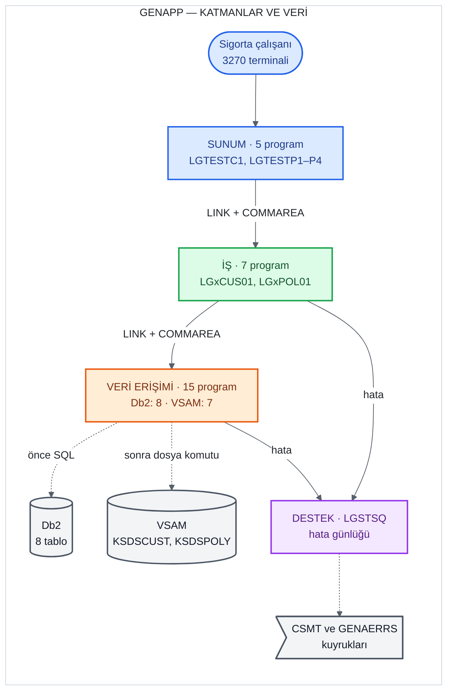

# Eski sistemin analizi

**Yazan:** Hasan Basri Engin (#61)

Bu bölüm, GenApp'in COBOL/CICS sürümünü nasıl incelediğimi ve ne bulduğumu anlatır. Analizin iki amacı vardı.
Birincisi, C# kodunu yazacak kişiye eski sistemin her operasyonda tam olarak ne yaptığını tarif etmek. İkincisi,
yeni sistemin eski sistemden nerede bilerek farklı davranacağına karar verebilmek için eski davranışı kesin olarak
bilmek. Projenin temel ilkesi davranış eşdeğerliği olduğundan ([SRS](../srs.md), 1.2), "eski sistem ne yapıyor?"
sorusunun cevabı bütün sonraki işlerin girdisiydi.

Bölümdeki her sayı ve iddia repodaki bir dosyaya dayanır; dosya yolları bağlantı olarak verilmiştir. Eski
sistemin kaynak kodu `base/` klasöründedir ve bu bölümde değiştirilmemiştir.

## 1. Yöntem

GenApp'i çalışan bir ortamda gözlemleme imkânımız yoktu: gerçek bir z/OS, CICS ya da Db2 erişimimiz bulunmuyor
([ADR 0004](../adr/0004-legacy-test-harness.md), "Değerlendirilen alternatifler"). Bu yüzden analiz tamamen
**statik**: COBOL programlarını, copybook'ları (`LGCMAREA`, `LGPOLICY`), BMS ekran tanımlarını (`ssmap.bms`) ve
veritabanını kuran JCL'i (`db2cre.jcl`) satır satır okuyarak yaptım.

Analizi dört adımda ve her adımı ayrı bir belge olarak yürüttüm:

| Adım | Çıktı | Görev |
|---|---|---|
| 1. Program envanteri | [program-inventory.md](../../legacy-analysis/program-inventory.md): 31 programın katmanı ve görevi | #1 |
| 2. Çağrı grafiği | [call-graph.md](../../legacy-analysis/call-graph.md): hangi programın hangisini çağırdığı, hangi veriye eriştiği | #11 |
| 3. Operasyon analizleri | [use-cases/](../../legacy-analysis/use-cases/): 18 operasyonun her biri için ayrı belge | #17, #22, #27, #33, #40 |
| 4. Veri ve transaction kararı | [ADR 0003](../adr/0003-data-and-transactions.md): Db2 ve VSAM'in yeni sistemde nasıl karşılanacağı | #75 |

Operasyon belgelerinin her birinde aynı bölümler vardır: operasyonun girdisi (COMMAREA'da hangi alanların dolu
geldiği), bir akış diyagramı, adım adım akış, hangi koşulda hangi dönüş kodunun üretildiği, hangi tabloya ve
dosyaya yazıldığı ve "C#'a taşırken dikkat edilecek davranışlar". Her adımın yanında COBOL'daki satırın
bağlantısı bulunur; böylece belgeyi okuyan kişi her iddiayı kaynağında kontrol edebilir.

Üç kural uyguladım:

- **Kod belgeden önce gelir.** IBM'in kendi belgeleriyle kod çeliştiğinde kodu esas aldım ve farkı not ettim.
  Örneğin `base/Architecture.md` yeni müşteri numarasının üretimini iş katmanına bağlıyor gibi yazıyor; kodda
  bu iş veri katmanındaki `LGACDB01`'de yapılıyor ([sistem özeti](../system-overview.md), "Üç katman").
- **Belirlenemeyen, belirlenemez diye yazılır.** Sonucu derleyici ayarına, Db2'ye ya da CICS'in çalışma
  ortamına bağlı olan davranışları tahmin etmedim; olası sonuçları ve neye bağlı olduklarını yazdım (bkz. 5.
  bölüm, `PADDINGDATA`).
- **Analiz, test ekibinin tahminlerinden bağımsızdır.** Test ekibi aynı COBOL kodunu ayrıca okuyup tahmin
  tablolarını yazdı. Analiz görevlerindeki sıra kuralına göre bir dilimin analiz belgesi, o dilimin tahminleri
  `main`'e girmeden onaylanmadı (örneğin #40, "Sıra kuralı"); belgeleri tahmin dosyalarını okumadan yazdım.
  Böylece test ekibinin tahminleri benim okumamdan etkilenmedi. Aynı ilke GnuCOBOL çalıştırmaları için de
  geçerlidir ([ADR 0004](../adr/0004-legacy-test-harness.md), "Kullanım kuralları").

## 2. GenApp'in yapısı

GenApp, IBM'in CICS'i tanıtmak için hazırladığı örnek bir genel sigorta uygulamasıdır. Müşteri kayıtlarını ve
dört türde poliçeyi (motor, konut, hayat sigortası, ticari) yönetir ([SRS](../srs.md), 1.2).

### 2.1 Programlar ve katmanlar

`base/src` altında 31 COBOL programı vardır. Her biri dört katmandan birine girer
([program-inventory.md](../../legacy-analysis/program-inventory.md), "Özet"):

| Katman | Program sayısı | Görevi | Örnek |
|---|---:|---|---|
| Sunum | 5 | 3270 ekranını çizer, kullanıcının seçtiği işleme göre iş programını çağırır | `LGTESTC1` (müşteri), `LGTESTP1`–`P4` (dört poliçe türü) |
| İş | 7 | Gelen COMMAREA'yı kontrol eder ve veri erişim programını çağırır | `LGACUS01`, `LGAPOL01` |
| Veri erişimi | 15 | Db2'ye (8 program) ya da VSAM dosyalarına (7 program) erişir | `LGAPDB01`, `LGAPVS01` |
| Destek | 4 | Hata günlüğü, kurulum ve istatistik | `LGSTSQ` |
| **Toplam** | **31** | | |

Çağrı grafiğinden çıkan dört gözlem yeni sistemin tasarımı için önemliydi
([call-graph.md](../../legacy-analysis/call-graph.md), "Gözlemler"):

- **Katman atlanmıyor.** Ekran yalnızca iş programını, iş programı yalnızca veri erişim programını çağırıyor;
  hiçbir ekran ya da iş programı Db2'ye veya VSAM'e doğrudan gitmiyor.
- **Bütün katmanlar tek bir veri alanını paylaşıyor.** Her çağrıda aynı 32.500 baytlık COMMAREA (`LGCMAREA`)
  aktarılıyor; ayrı girdi ve çıktı parametresi yok, her program aynı alanın üzerine yazıyor.
- **Önce Db2, sonra VSAM.** Ekleme, güncelleme ve silmede veri erişim programı önce Db2 işlemini yapıyor,
  ardından aynı ön eki taşıyan VSAM programını çağırıyor (`LGAPDB01 → LGAPVS01`).
- **Geri alma kararı ekranda.** Ekleme ve silmede bir hata kodu dönerse işlemi `SYNCPOINT ROLLBACK` ile geri
  alan, sunum katmanındaki menü programı.

Dört poliçe türü için ayrı programlar yoktur: dört menü ekranı da aynı iş ve veri erişim programlarını çağırır.
Hangi türün işlendiğini COMMAREA'daki istek kodu (`CA-REQUEST-ID`) belirler; örneğin ekleme için `01AMOT`,
`01AHOU`, `01AEND`, `01ACOM` ([call-graph.md](../../legacy-analysis/call-graph.md), "2. Poliçe işlemleri").

### 2.2 Veri

Eski sistem veriyi iki yerde tutar: Db2 veritabanında ve VSAM dosyalarında.

**Db2: 8 tablo** ([database-schema.md](../database-schema.md), "Tablo eşlemesi"). Tabloların tanımı ve örnek
verisi `db2cre.jcl` dosyasındadır; örnek satır sayıları bu dosyanın `INSERT` deyimlerinden sayılmıştır
(`base/cntl/db2cre.jcl:425-1246`).

| Tablo | İçerik | Örnek satır |
|---|---|---:|
| `customer` | Müşteri bilgileri | 10 |
| `customer_secure` | Müşteri parolası (MD5 özeti) | 10 |
| `policy` | Dört türün ortak poliçe bilgileri | 10 |
| `motor` | Motor poliçesine özgü bilgiler | 3 |
| `house` | Konut poliçesine özgü bilgiler | 3 |
| `endowment` | Hayat sigortasına özgü bilgiler | 2 |
| `commercial` | Ticari poliçeye özgü bilgiler | 2 |
| `claim` | Hasar kayıtları | 0 |

Tür tabloları `policy` tablosuna yabancı anahtarla bağlıdır ve hepsinde `ON DELETE CASCADE` vardır: poliçe
silinirken program yalnızca `policy` satırını siler, tür tablosundaki satırı Db2 siler
([database-schema.md](../database-schema.md), "Korunan davranışlar").

**VSAM: 2 dosya.** `KSDSCUST` müşteri kayıtlarının, `KSDSPOLY` poliçe kayıtlarının bir kopyasını tutar
([database-schema.md](../database-schema.md), "VSAM dosyaları"). Analizde bu kopyaların yeni bilgi taşımadığını,
üstelik eksik olduğunu gördüm: örneğin `KSDSPOLY` konut kaydında ev adının yalnızca ilk 9 karakteri vardır, ev
numarası hiç yoktur ([08-house-add.md](../../legacy-analysis/use-cases/08-house-add.md), "Yazılan data"). IBM de
VSAM'i yalnızca CICS'in iki aşamalı commit'ini göstermek için eklediğini yazıyor (`base/Architecture.md:48-49`,
[database-schema.md](../database-schema.md)'de alıntılanmıştır).

## 3. On sekiz operasyon

GenApp kullanıcıya 18 operasyon sunar ([SRS](../srs.md), 3; [api-design.md](../api-design.md), 2). Her biri için
ayrı bir analiz belgesi yazdım:

| Dilim | Operasyonlar | İstek kodu | Çağrı zinciri | Analiz belgeleri |
|---|---|---|---|---|
| Müşteri | Ekle, sorgula, güncelle | `01ACUS`, `01ICUS`, `01UCUS` | `LGTESTC1` → `LGxCUS01` → `LGxCDB01` (ve VSAM) | [01](../../legacy-analysis/use-cases/01-customer-add.md)–[03](../../legacy-analysis/use-cases/03-customer-update.md) |
| Motor | Ekle, sorgula, güncelle, sil | `01xMOT` | `LGTESTP1` → `LGxPOL01` → `LGxPDB01` (ve VSAM) | [04](../../legacy-analysis/use-cases/04-motor-add.md)–[07](../../legacy-analysis/use-cases/07-motor-delete.md) |
| Konut | Ekle, sorgula, güncelle, sil | `01xHOU` | `LGTESTP3` → aynı programlar | [08](../../legacy-analysis/use-cases/08-house-add.md)–[11](../../legacy-analysis/use-cases/11-house-delete.md) |
| Hayat sigortası | Ekle, sorgula, güncelle, sil | `01xEND` | `LGTESTP2` → aynı programlar | [12](../../legacy-analysis/use-cases/12-endowment-add.md)–[15](../../legacy-analysis/use-cases/15-endowment-delete.md) |
| Ticari | Ekle, sorgula, sil | `01ACOM`, `01ICOM`–`05ICOM`, `01DCOM` | `LGTESTP4` → aynı programlar | [16](../../legacy-analysis/use-cases/16-commercial-add.md)–[18](../../legacy-analysis/use-cases/18-commercial-delete.md) |

`x` yerine işlemin harfi gelir: `A` ekle, `I` sorgula, `U` güncelle, `D` sil. Müşteri ve poliçe numaraları,
tarihler ve metinler COMMAREA'da sabit uzunluklu alanlarda taşınır.

Ticari poliçe sorgulamasının dört biçimi vardır ve hangisinin çalışacağını ekranda doldurulan alanlar belirler:
müşteri ve poliçe numarasıyla (`01ICOM`), yalnızca poliçe numarasıyla (`02ICOM`), yalnızca müşteri numarasıyla
(`03ICOM`) ve yalnızca posta koduyla (`05ICOM`). `04ICOM` yoktur
([17-commercial-inquire.md](../../legacy-analysis/use-cases/17-commercial-inquire.md), "Input").

Güncelleme iki adımda yapılır: ekran önce sorgulama programıyla kaydı getirir, kullanıcı düzenledikten sonra
güncelleme programını çağırır. Poliçe güncellemesi bu arada kaydın değişip değişmediğini zaman damgasıyla
(`LASTCHANGED`) kontrol eder; değiştiyse güncellemeyi yapmaz (iyimser kilitleme,
[06-motor-update.md](../../legacy-analysis/use-cases/06-motor-update.md), "LASTCHANGED kontrolü").

## 4. Eski sistemde olmayan işlemler

Dört tür ve müşteri için beklenebilecek bazı işlemler eski sistemde yoktur. Bunları belgeden değil koddan
doğruladım:

- **Müşteri silme.** Müşteri menüsünde 1 (sorgula), 2 (ekle) ve 4 (güncelle) seçenekleri var; 3. satır boş
  (`base/src/ssmap.bms:19-25`). `LGTESTC1` yalnızca bu üç seçeneği işler (`lgtestc1.cbl:86`, `:113`, `:148`).
  `base/src` içinde müşteri silen bir program ya da `CUSTOMER` tablosundan silen bir SQL deyimi yoktur.
- **Ticari poliçe güncelleme.** Ticari menüde güncelleme satırı yorum satırına çevrilmiş
  (`ssmap.bms:460-461`); `LGTESTP4`'te güncelleme dalı yok; güncelleme programları yalnızca motor, konut ve
  hayat sigortası istek kodlarını tanıyor. `base/` içinde `01UCOM` istek kodu ve `COMMERCIAL` tablosunu
  güncelleyen bir SQL deyimi hiç geçmiyor
  ([16-commercial-add.md](../../legacy-analysis/use-cases/16-commercial-add.md), "Commercial update'i yok").
- **Hasar (claim) işlemleri.** `claim` tablosu oluşturulmuş, COMMAREA'da ve ekran tanımlarında hazırlık izleri
  var, ama hiçbir program bu tabloya erişmiyor ve örnek verisi yok
  ([database-schema.md](../database-schema.md), "`claim` tablosu").

Bu işlemler yeni sistemde de yoktur ([SRS](../srs.md), 6). Böylece yeni sistem, eski sistemin sunmadığı bir
işlemi eşdeğerlik testi olmadan eklemiş olmaz.

## 5. Analizde bulunan önemli davranışlar

Analizin en değerli çıktısı, kodun yorumundan ya da ilk bakışta beklenenden farklı davrandığı yerlerdi. Her
birini ilgili analiz belgesinde satır numaralarıyla anlattım; aşağıdaki tablo özetidir. Yeni sistemin ne
yaptığı ekibin ortak kararıdır. Dönüş kodunu etkileyenler [API tasarımı](../api-design.md), 3. bölümdeki
tabloda kayıtlıdır; diğerlerinin kaynağı tablonun son sütununda verilmiştir.

| Bulgu | Analiz belgesi | Yeni sistemde |
|---|---|---|
| Poliçe güncellemede çakışma (`02`), poliçe yok (`01`) ve okuma hatası (`90`) kodları, imleç kapatılırken `00` ile eziliyor; çağıran "başarılı" görüyor ama kayıt güncellenmemiş | [06](../../legacy-analysis/use-cases/06-motor-update.md), [10](../../legacy-analysis/use-cases/10-house-update.md), [14](../../legacy-analysis/use-cases/14-endowment-update.md) | Kodun yazdığı değer döner: `409`, `404`, `500` (bilinçli sapma) |
| Olmayan poliçeyi silmek `90` (veritabanı hatası) döndürüyor; kodun yorumu ise "bulunamadı başarılı sayılsın" diyor | [07](../../legacy-analysis/use-cases/07-motor-delete.md), [11](../../legacy-analysis/use-cases/11-house-delete.md), [15](../../legacy-analysis/use-cases/15-endowment-delete.md), [18](../../legacy-analysis/use-cases/18-commercial-delete.md) | `500` / `"90"` (korunan davranış) |
| Programlar poliçenin türüne bakmıyor; bir motor poliçesi konut ekranından silinebiliyor ve onu yalnızca ardından gelen VSAM hatası geri aldırıyor | [11](../../legacy-analysis/use-cases/11-house-delete.md), [18](../../legacy-analysis/use-cases/18-commercial-delete.md) | Tür uyuşmazsa işlem yapılmaz: `404` / `"01"` (bilinçli sapma) |
| 10 haneli müşteri ve poliçe numaraları Db2'ye 9 haneli alanla gidiyor, en soldaki hane kesiliyor: `1000000004` müşteri 4 olur | [12](../../legacy-analysis/use-cases/12-endowment-add.md), [16](../../legacy-analysis/use-cases/16-commercial-add.md) | Numara kesilmez (bilinçli sapma) |
| Olmayan müşteriyi güncellemek `01` yazıyor, ama ardından VSAM okuması başarısız oluyor ve program çöküyor (ABEND `LGV1`) | [03](../../legacy-analysis/use-cases/03-customer-update.md) | `404` / `"01"` (bilinçli sapma; yeni sistemde VSAM yok) |
| Ticari poliçeyi müşteri ya da posta koduyla sorgulamada her kayıt bir öncekinin üzerine yazılıyor ve yalnızca son kayıt kalıyor; kayıt yoksa sonuç yine `00`; okuma hatasında döngü bitmiyor | [17](../../legacy-analysis/use-cases/17-commercial-inquire.md) | Bütün kayıtlar liste olarak döner, kayıt yoksa boş liste, hatada `500` (bilinçli sapma) |
| Ticari sorgulama tarihleri `POLICY`'den değil `COMMERCIAL` tablosundan okuyor; örnek verideki iki ticari poliçede bu değerler farklı | [17](../../legacy-analysis/use-cases/17-commercial-inquire.md) | Aynısı yapılır: tarihler `commercial` tablosundan döner ([CommercialPolicyResponse.cs:15](../../src/GenApp.Api/CommercialPolicies/CommercialPolicyResponse.cs#L15)) |
| Konut ve hayat sigortası ekranları ekleme hatası mesajını motor ekranının alanına yazıyor; kullanıcı hata mesajı görmüyor | [08](../../legacy-analysis/use-cases/08-house-add.md), [12](../../legacy-analysis/use-cases/12-endowment-add.md) | Yalnızca eski ekranın hatası; çağırana dönen kod doğru. Web arayüzünde karşılığı yok |
| Hayat sigortası eklemede `PADDINGDATA` kolonuna yazılan veri miktarı derleyicinin `TRUNC` ayarına bağlı (2.348 bayt ya da belleğin taşması); derleme ayarları repoda yok | [12](../../legacy-analysis/use-cases/12-endowment-add.md) | API'de bu alan yok ([api-design.md](../api-design.md), 4.5); eşdeğerlik testleri karşılaştırmaz |
| Poliçe güncellemesi ödemeyi (`payment`) hiç değiştirmiyor | [06](../../legacy-analysis/use-cases/06-motor-update.md) | Aynısı yapılır (korunan davranış) |

[API tasarımının](../api-design.md) 3. bölümündeki tabloda 17 durum var: 13'ü bilinçli sapma, 4'ü korunan
davranış (`api-design.md:127-143`). Kararların gerekçeleri [ADR 0002](../adr/0002-rest-api.md), karar 8 ve
9'dadır. Kural şudur: yeni sistem eski sistemle aynı davranır;
yalnızca eski kodun bir hata yüzünden kendi koyduğu sonucu bozduğu, eski davranışın yeni sistemde oluşamadığı ya
da girdiyi denetlemediği için başka bir kayıt üzerinde işlem yaptığı yerlerde bilerek farklı davranır.

## 6. Analizin yeni sisteme etkisi

- **Veri ve transaction.** VSAM'in yalnızca Db2'deki verinin eksik bir kopyası olduğunu ve iki aşamalı commit'in
  bir gösterim amacı taşıdığını belirledikten sonra ADR 0003'ü yazdım. Bu karara göre 8 Db2 tablosu PostgreSQL'e
  taşınır, VSAM'in karşılığı yazılmaz ve her operasyon tek bir veritabanı transaction'ında çalışır. Eski
  sistemde ekrandaki `SYNCPOINT ROLLBACK`'e ve veri erişimindeki kasıtlı ABEND'lere dağılmış geri alma
  davranışının yerini tek bir rollback alır. `LASTCHANGED` kontrolü, EF Core'un iyimser kilitlemesiyle korunur
  ([ADR 0003](../adr/0003-data-and-transactions.md), karar 1-3).
- **Kod.** Operasyon belgeleri C# kodunun tarifi oldu. Örneğin ticari poliçe eklemede tarihlerin iki tabloya
  birden yazılması, doğrudan analiz belgesine dayanarak kodlandı
  ([PolicyRepository.cs:22-29](../../src/GenApp.Infrastructure/Persistence/PolicyRepository.cs#L22-L29)).
- **Örnek veri.** Örnek verinin kaynağı olarak VSAM dosyaları değil, `db2cre.jcl`'deki Db2 verisi seçildi
  (ADR 0003, karar 1). Müşteri, poliçe ve dört tür tablosunun örnek satırları numaraları korunarak yeni
  veritabanına yüklenir (#51, [GenApp.SampleData](../../tools/GenApp.SampleData/README.md)).

## 7. Sınırlar

- **Analiz statiktir.** Belgelerdeki davranışlar kodun okunmasıyla çıkarıldı; gerçek CICS ve Db2 üzerinde
  çalıştırılmadı. Kodun bir kısmı GnuCOBOL ile ve sahte CICS/Db2 parçalarıyla çalıştırılarak ölçüldü; bunun
  sonuçları raporun GnuCOBOL bölümündedir ([ADR 0004](../adr/0004-legacy-test-harness.md)).
- **Bazı sonuçlar kaynak koddan belirlenemez.** Derleyici ayarına (`TRUNC`), Db2'nin davranışına (örneğin
  `NULL` değerler, kilitlenme) ya da CICS'in çalışma ortamına (ilk alınmamış bellek alanlarının değeri) bağlı
  davranışları ilgili belgelerde "belirlenemez" olarak işaretledim.
- **Kapsam 18 operasyondur.** Destek programları (`LGASTAT1`, `LGSETUP`, `LGWEBST5`) ve VSAM'den rastgele kayıt
  seçen iki test yardımcısı (`LGICVS01`, `LGIPVS01`) çağrı grafiğinde yer alır, ama ayrıntılı olarak analiz
  edilmedi; hiçbiri 18 operasyonun parçası değildir
  ([call-graph.md](../../legacy-analysis/call-graph.md), "Zincirlerin dışında kalan programlar").
