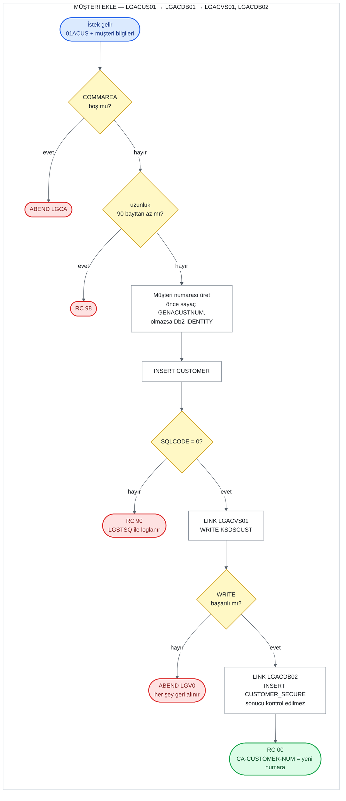

# UC-01 · Müşteri Ekle

Yeni bir müşteriyi Db2'deki `CUSTOMER` tablosuna, şifresini `CUSTOMER_SECURE` tablosuna
ve kaydını `KSDSCUST` VSAM dosyasına yazan operasyon. Bu belge, C# kodunu yazacak kişi
için eski sistemin davranışını satır satır tarif eder. Satır numaraları `base/src`
altındaki dosyalara aittir ve bağlantılar ilgili satırı açar.

## Özet

| | |
|---|---|
| **İstek kodu** (`CA-REQUEST-ID`) | `01ACUS` — ekran bunu gönderir ama zincirdeki hiçbir program kontrol etmez |
| **Giriş programı** | `LGACUS01` (iş katmanı) |
| **Çağrı zinciri** | `LGACUS01` → `LGACDB01` → `LGACVS01`, ardından `LGACDB02` |
| **Yazılan yerler** | Db2 `CUSTOMER`, Db2 `CUSTOMER_SECURE`, VSAM `KSDSCUST` |
| **Çıktı** | Yeni müşteri numarası `CA-CUSTOMER-NUM`'da, `CA-RETURN-CODE = '00'` |
| **Olası dönüş kodları** | `00`, `90`, `98` (ve ABEND `LGCA`, `LGV0`) |

## Akış

## Girdiler (COMMAREA)

Ekran (`LGTESTC1`, menü 2) aşağıdaki alanları doldurup `LGACUS01`'i çağırır
([lgtestc1.cbl:113-131](../../base/src/lgtestc1.cbl#L113-L131)). Alan tanımları
[lgcmarea.cpy](../../base/src/lgcmarea.cpy) içinde.

| Alan | Tip | Gelen değer | Kullanım |
|---|---|---|---|
| `CA-REQUEST-ID` | `X(6)` | `'01ACUS'` | Kontrol edilmiyor |
| `CA-CUSTOMER-NUM` | `9(10)` | `0` | Yok sayılıyor; yeni numara bunun üzerine yazılır |
| `CA-FIRST-NAME` | `X(10)` | ekrandan | `CUSTOMER.FIRSTNAME` |
| `CA-LAST-NAME` | `X(20)` | ekrandan | `CUSTOMER.LASTNAME` |
| `CA-DOB` | `X(10)` | ekrandan | `CUSTOMER.DATEOFBIRTH` (Db2'de `DATE` tipi) |
| `CA-HOUSE-NAME` | `X(20)` | ekrandan | `CUSTOMER.HOUSENAME` |
| `CA-HOUSE-NUM` | `X(4)` | ekrandan | `CUSTOMER.HOUSENUMBER` |
| `CA-POSTCODE` | `X(8)` | ekrandan, **büyük harfe çevrilmiş** | `CUSTOMER.POSTCODE` |
| `CA-PHONE-MOBILE` | `X(20)` | ekrandan | `CUSTOMER.PHONEMOBILE` |
| `CA-PHONE-HOME` | `X(20)` | ekrandan | `CUSTOMER.PHONEHOME` |
| `CA-EMAIL-ADDRESS` | `X(100)` | ekrandan | `CUSTOMER.EMAILADDRESS` |

Ekran iki hazırlık daha yapar ([lgtestc1.cbl:125-127](../../base/src/lgtestc1.cbl#L125-L127)):
COMMAREA'daki `X'00'` (boş/low-value) baytları boşluğa çevirir ve posta kodunu büyük
harfe çevirir. Bunlar iş katmanında değil ekranda yapıldığı için C# tarafında girdi
doğrulamasının parçası olarak ele alınmalı.

## Adım adım

| # | Program | Ne yapıyor | Kaynak |
|---:|---|---|---|
| 1 | `LGACUS01` | COMMAREA hiç gelmediyse (`EIBCALEN = 0`) hata günlüğüne yazar ve `LGCA` koduyla ABEND eder. | [lgacus01.cbl:95-99](../../base/src/lgacus01.cbl#L95-L99) |
| 2 | `LGACUS01` | `CA-RETURN-CODE = '00'`, `CA-NUM-POLICIES = 000` yapar. | [lgacus01.cbl:102-103](../../base/src/lgacus01.cbl#L102-L103) |
| 3 | `LGACUS01` | Gereken minimum uzunluk = başlık 18 + `WS-CUSTOMER-LEN` 72 = **90 bayt**. Daha kısaysa `'98'` ile döner. | [lgacus01.cbl:108-115](../../base/src/lgacus01.cbl#L108-L115), [lgpolicy.cpy:17](../../base/src/lgpolicy.cpy#L17) |
| 4 | `LGACUS01` | `LGACDB01`'i aynı COMMAREA ile `LINK` eder (32.500 bayt). Dönüşte hiçbir şeyi kontrol etmez, doğrudan çağırana döner. | [lgacus01.cbl:119-123](../../base/src/lgacus01.cbl#L119-L123), [134-137](../../base/src/lgacus01.cbl#L134-L137) |
| 5 | `LGACDB01` | 1-3. adımdaki kontrollerin aynısını tekrarlar (ABEND `LGCA`, `'00'`, 90 bayt → `'98'`). | [lgacdb01.cbl:149-168](../../base/src/lgacdb01.cbl#L149-L168) |
| 6 | `LGACDB01` | Müşteri numarasını üretir (aşağıdaki bölüm). | [lgacdb01.cbl:199-211](../../base/src/lgacdb01.cbl#L199-L211) |
| 7 | `LGACDB01` | `CUSTOMER` tablosuna `INSERT` yapar. Hata olursa `'90'`, hata günlüğü ve hemen dönüş; 8-9. adımlar çalışmaz. | [lgacdb01.cbl:215-283](../../base/src/lgacdb01.cbl#L215-L283) |
| 8 | `LGACDB01` | Üretilen numarayı `CA-CUSTOMER-NUM`'a yazar. | [lgacdb01.cbl:285](../../base/src/lgacdb01.cbl#L285) |
| 9 | `LGACDB01` → `LGACVS01` | COMMAREA'yı `LENGTH(225)` ile `LGACVS01`'e verir; o da `KSDSCUST`'e kaydı yazar. Başarısızsa `'80'` yazar ve `LGV0` ile ABEND eder. | [lgacdb01.cbl:174-177](../../base/src/lgacdb01.cbl#L174-L177), [lgacvs01.cbl:68-81](../../base/src/lgacvs01.cbl#L68-L81) |
| 10 | `LGACDB01` → `LGACDB02` | **Ayrı bir COMMAREA** (`CDB2AREA`) hazırlar: istek `'02ACUS'`, yeni numara, sabit şifre özeti, sayaç `'0000'`, durum `'N'`. `LGACDB02`'yi çağırır; o da `CUSTOMER_SECURE`'a `INSERT` yapar. | [lgacdb01.cbl:179-189](../../base/src/lgacdb01.cbl#L179-L189), [lgacdb02.cbl:143-182](../../base/src/lgacdb02.cbl#L143-L182) |
| 11 | `LGACDB01` | Çağırana döner. `CA-RETURN-CODE` hâlâ `'00'`. | [lgacdb01.cbl:192](../../base/src/lgacdb01.cbl#L192) |

## Müşteri numarası nasıl üretilir

`LGACDB01`'in `Obtain-CUSTOMER-Number` paragrafı
([lgacdb01.cbl:199-211](../../base/src/lgacdb01.cbl#L199-L211)) iki yoldan birini seçer.
Hangi yolun kullanılacağını `LGAC-NCS` bayrağı belirler; değeri her çağrıda `'ON'` ile
başlar ([lgacdb01.cbl:73](../../base/src/lgacdb01.cbl#L73)).

**1. yol — CICS sayaç servisi (named counter):**
`EXEC CICS GET COUNTER(GENACUSTNUM) POOL(GENA)` çağrılır
([lgacdb01.cbl:201-205](../../base/src/lgacdb01.cbl#L201-L205)). Sayaç, sıradaki değeri
verir ve kendini bir artırır. Başarılıysa bu değer müşteri numarası olur ve `INSERT`,
numarayı açıkça vererek yapılır
([lgacdb01.cbl:221-249](../../base/src/lgacdb01.cbl#L221-L249)).

**2. yol — Db2 kendisi üretir:**
Sayaç servisi yoksa ya da hata dönerse (`RESP ≠ NORMAL`), bayrak `'NO'` olur
([lgacdb01.cbl:206-208](../../base/src/lgacdb01.cbl#L206-L208)). `INSERT`,
`CUSTOMERNUMBER` için `DEFAULT` verir ve Db2'nin kimlik (identity) kolonu numarayı üretir
([lgacdb01.cbl:251-273](../../base/src/lgacdb01.cbl#L251-L273)). Ardından üretilen
değer `SET :DB2-CUSTOMERNUM-INT = IDENTITY_VAL_LOCAL()` ile geri okunur
([lgacdb01.cbl:280-282](../../base/src/lgacdb01.cbl#L280-L282)). Kimlik kolonu
`1000001`'den başlar ve birer artar
([db2cre.jcl:111-112](../../base/cntl/db2cre.jcl#L111-L112)).

Dikkat edilecekler:
- Kolon `GENERATED BY DEFAULT` olduğu için iki yol aynı tabloya yazabilir; sayaçtan gelen
  numara ile Db2'nin ürettiği numara çakışırsa `INSERT` hata verir ve sonuç `'90'` olur.
  İki kaynağın uyumlu tutulması sistemin dışında (`LGSETUP` sayacı yeniden kurar).
- İkinci yolda `IDENTITY_VAL_LOCAL()` sonrasında `SQLCODE` kontrol edilmiyor.
- Sonraki adımlardan biri başarısız olup işlem geri alınsa bile sayaçtan alınan değer geri
  verilmez; müşteri numaralarında boşluk oluşabilir.

## Dönüş kodları

| Kod | Koşul | Nerede atanıyor | Çağıran ne görür |
|---|---|---|---|
| `00` | Her şey başarılı | [lgacus01.cbl:102](../../base/src/lgacus01.cbl#L102), [lgacdb01.cbl:156](../../base/src/lgacdb01.cbl#L156) | Yeni numara `CA-CUSTOMER-NUM`'da |
| `98` | COMMAREA 90 bayttan kısa | [lgacus01.cbl:112-115](../../base/src/lgacus01.cbl#L112-L115), [lgacdb01.cbl:165-168](../../base/src/lgacdb01.cbl#L165-L168) | `98`; hiçbir yere yazılmaz. Ekran her zaman 32.500 bayt gönderdiği için pratikte oluşmaz. |
| `90` | `CUSTOMER`'a `INSERT` başarısız (her iki yolda) | [lgacdb01.cbl:245-249](../../base/src/lgacdb01.cbl#L245-L249), [274-278](../../base/src/lgacdb01.cbl#L274-L278) | `90`; hata `LGSTSQ` ile `CSMT`/`GENAERRS` kuyruklarına yazılır |
| `80` | `KSDSCUST`'e `WRITE` başarısız | [lgacvs01.cbl:75-81](../../base/src/lgacvs01.cbl#L75-L81) | **Görmez.** `'80'` yazıldıktan hemen sonra `LGV0` ile ABEND olur; işlem (Db2 `INSERT` dahil) geri alınır, ekrana kod değil ABEND gelir. |
| — | COMMAREA hiç yok | [lgacus01.cbl:95-99](../../base/src/lgacus01.cbl#L95-L99) | ABEND `LGCA` |

Ekran tarafı: `CA-RETURN-CODE > 0` ise `SYNCPOINT ROLLBACK` yapar ve
"Error Adding Customer" gösterir; başarılıysa yeni numarayı ve
"New Customer Inserted" mesajını gösterir
([lgtestc1.cbl:132-146](../../base/src/lgtestc1.cbl#L132-L146),
[263-265](../../base/src/lgtestc1.cbl#L263-L265)).

## Yazılan veriler

**Db2 `CUSTOMER`** ([db2cre.jcl:110-124](../../base/cntl/db2cre.jcl#L110-L124)) —
`CUSTOMERNUMBER` (üretilen numara) ve girdi tablosundaki 9 alan.

**Db2 `CUSTOMER_SECURE`** ([db2cre.jcl:130-140](../../base/cntl/db2cre.jcl#L130-L140)) —
müşteri silinince kendisi de silinir (`ON DELETE CASCADE`):

| Kolon | Yazılan değer | Kaynak |
|---|---|---|
| `customerNumber` | yeni müşteri numarası | [lgacdb01.cbl:179](../../base/src/lgacdb01.cbl#L179) |
| `customerPass` | sabit: `5732fec825535eeafb8fac50fee3a8aa` (32 karakterlik özet; her yeni müşteriye aynı varsayılan şifre) | [lgacdb01.cbl:181-182](../../base/src/lgacdb01.cbl#L181-L182) |
| `state_indicator` | `'N'` | [lgacdb01.cbl:184](../../base/src/lgacdb01.cbl#L184) |
| `pass_changes` | `0` (`'0000'` metni sayıya çevrilir) | [lgacdb01.cbl:183](../../base/src/lgacdb01.cbl#L183), [lgacdb02.cbl:147](../../base/src/lgacdb02.cbl#L147) |

**VSAM `KSDSCUST`** ([adef121.jcl:15-27](../../base/cntl/adef121.jcl#L15-L27)) — 225
baytlık sabit uzunlukta kayıt, anahtar ilk 10 bayt (müşteri numarası). Kayıt,
COMMAREA'da `CA-CUSTOMER-NUM`'dan başlayan 225 baytın birebir kopyasıdır: numara (10) +
müşteri alanları (212) + `CA-NUM-POLICIES` (3, her zaman `000`)
([lgacvs01.cbl:68-74](../../base/src/lgacvs01.cbl#L68-L74)). Dosya `LOG(UNDO)` ile
tanımlı, yani işlem geri alınırsa bu yazma da geri alınır.

## C#'a taşırken dikkat edilecek davranışlar

1. **Şifre kaydının hatası sessizce yutuluyor.** `LGACDB02` `INSERT` başarısız olursa
   kendi COMMAREA'sına `'98'` yazar ([lgacdb02.cbl:178-182](../../base/src/lgacdb02.cbl#L178-L182)),
   ama `LGACDB01` bu sonucu hiç okumaz. Müşteri `'00'` ile eklenmiş görünür, şifre kaydı
   eksik kalır. Burada `'98'` "COMMAREA kısa" değil "SQL hatası" anlamında kullanılıyor.
2. **Sıra Db2 → VSAM → şifre.** Db2 `INSERT` başarısızsa VSAM ve şifre adımları hiç
   çalışmaz. VSAM başarısızsa ABEND ile her şey geri alınır. Şifre başarısızsa geri alma
   yok (madde 1).
3. **`CA-REQUEST-ID` kontrol edilmiyor.** Ne `LGACUS01` ne `LGACDB01` istek kodunu
   denetliyor; Güncelle'nin aksine yanlış kodla gelen istek de müşteri ekler.
4. **Girdi doğrulaması yok.** Alanlar boş olabilir. Tek örtük kontrol Db2'nin `DATE`
   tipi: `CA-DOB` geçerli bir tarih değilse `INSERT` başarısız olur → `'90'`.
5. **Uzunluk kontrolü verinin tamamını kapsamıyor.** Kontrol 18 + 72 = 90 bayt istiyor;
   72, ad'dan posta koduna kadar olan alanların toplamı. Müşteri alanları ise COMMAREA'da
   233. bayta kadar uzanıyor, yani telefon ve e-posta alanları kontrolün dışında kalıyor.
6. **Ekranın ek işi:** Başarılı eklemeden sonra `LGTESTC1`, `GENACNTL` geçici kuyruğundaki
   "en yüksek müşteri numarası" kaydını yeni numarayla günceller
   ([lgtestc1.cbl:137](../../base/src/lgtestc1.cbl#L137), [283-347](../../base/src/lgtestc1.cbl#L283-L347)).
   Bu, iş kuralı değil; test/iş yükü simülasyonu için tutulan bir sayaç.
