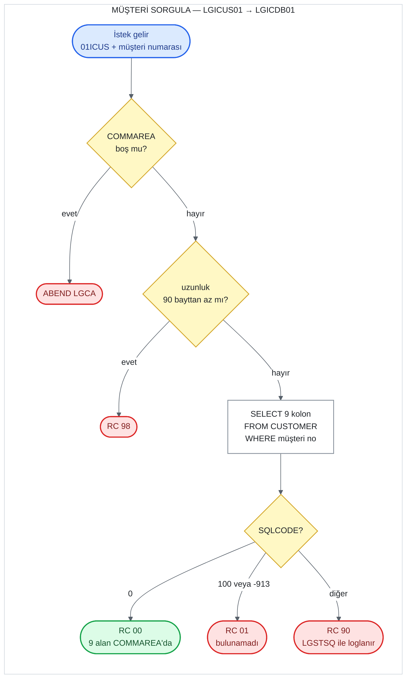

# UC-02 · Müşteri Sorgula

Müşteri numarası verilen bir müşterinin bilgilerini Db2'deki `CUSTOMER` tablosundan okuyan
operasyon. Hiçbir yere yazmaz; VSAM dosyasını da okumaz. Bu belge, C# kodunu yazacak kişi
için eski sistemin davranışını satır satır tarif eder. Satır numaraları `base/src`
altındaki dosyalara aittir ve bağlantılar ilgili satırı açar.

Programların hangi sırayla çağrıldığını ve COMMAREA'nın nasıl taşındığını adım adım
gösteren sıralama diyagramı:
[docs/diagrams/sequence-customer-inquire.md](../../docs/diagrams/sequence-customer-inquire.md).

## Özet

| | |
|---|---|
| **İstek kodu** (`CA-REQUEST-ID`) | `01ICUS` — ekran bunu gönderir ama zincirdeki hiçbir program kontrol etmez |
| **Giriş programı** | `LGICUS01` (iş katmanı) |
| **Çağrı zinciri** | `LGICUS01` → `LGICDB01` |
| **Okunan yer** | Db2 `CUSTOMER` (yazma yok) |
| **Çıktı** | Müşterinin 9 alanı COMMAREA'da, `CA-RETURN-CODE = '00'` |
| **Olası dönüş kodları** | `00`, `01`, `90`, `98` (ve ABEND `LGCA`) |

## Akış

## Girdiler (COMMAREA)

Ekran (`LGTESTC1`, menü 1) sadece iki alan doldurup `LGICUS01`'i çağırır
([lgtestc1.cbl:86-92](../../base/src/lgtestc1.cbl#L86-L92)). Alan tanımları
[lgcmarea.cpy](../../base/src/lgcmarea.cpy) içinde.

| Alan | Tip | Gelen değer | Kullanım |
|---|---|---|---|
| `CA-REQUEST-ID` | `X(6)` | `'01ICUS'` | Kontrol edilmiyor |
| `CA-CUSTOMER-NUM` | `9(10)` | ekranda girilen numara | `WHERE CUSTOMERNUMBER = ...` koşulu |

Diğer bütün alanlar girdi olarak kullanılmaz; çıktı için doldurulur.

## Adım adım

| # | Program | Ne yapıyor | Kaynak |
|---:|---|---|---|
| 1 | `LGICUS01` | COMMAREA hiç gelmediyse (`EIBCALEN = 0`) hata günlüğüne yazar ve `LGCA` koduyla ABEND eder. | [lgicus01.cbl:87-91](../../base/src/lgicus01.cbl#L87-L91) |
| 2 | `LGICUS01` | `CA-RETURN-CODE = '00'`, `CA-NUM-POLICIES = 000` yapar. | [lgicus01.cbl:93-94](../../base/src/lgicus01.cbl#L93-L94) |
| 3 | `LGICUS01` | Gereken minimum uzunluk = 18 + `WS-CUSTOMER-LEN` 72 = **90 bayt**. Daha kısaysa `'98'` ile döner. | [lgicus01.cbl:102-107](../../base/src/lgicus01.cbl#L102-L107), [lgpolicy.cpy:17](../../base/src/lgpolicy.cpy#L17) |
| 4 | `LGICUS01` | `LGICDB01`'i aynı COMMAREA ile `LINK` eder (32.500 bayt), dönüşte hiçbir şeyi değiştirmeden çağırana döner. İş katmanının bu operasyonda başka kuralı yok. | [lgicus01.cbl:109](../../base/src/lgicus01.cbl#L109), [120-125](../../base/src/lgicus01.cbl#L120-L125) |
| 5 | `LGICDB01` | 1-3. adımdaki kontrollerin aynısını tekrarlar (ABEND `LGCA`, `'00'`, 90 bayt → `'98'`). | [lgicdb01.cbl:119-143](../../base/src/lgicdb01.cbl#L119-L143) |
| 6 | `LGICDB01` | `CA-CUSTOMER-NUM`'u Db2 tamsayısına (`DB2-CUSTOMERNUMBER-INT`) çevirir. | [lgicdb01.cbl:146](../../base/src/lgicdb01.cbl#L146) |
| 7 | `LGICDB01` | `SELECT FIRSTNAME, LASTNAME, DATEOFBIRTH, HOUSENAME, HOUSENUMBER, POSTCODE, PHONEMOBILE, PHONEHOME, EMAILADDRESS FROM CUSTOMER WHERE CUSTOMERNUMBER = ...` çalıştırır; sonuç doğrudan COMMAREA alanlarına yazılır. | [lgicdb01.cbl:169-190](../../base/src/lgicdb01.cbl#L169-L190) |
| 8 | `LGICDB01` | `SQLCODE`'a göre dönüş kodunu belirler (aşağıdaki tablo) ve döner. | [lgicdb01.cbl:192-203](../../base/src/lgicdb01.cbl#L192-L203) |

## Çıktılar (COMMAREA)

Başarılı (`'00'`) sorgudan sonra dolu gelen alanlar:

| Alan | Tip | Kaynak kolon |
|---|---|---|
| `CA-FIRST-NAME` | `X(10)` | `FIRSTNAME` |
| `CA-LAST-NAME` | `X(20)` | `LASTNAME` |
| `CA-DOB` | `X(10)` | `DATEOFBIRTH` (Db2 `DATE`, metin olarak döner) |
| `CA-HOUSE-NAME` | `X(20)` | `HOUSENAME` |
| `CA-HOUSE-NUM` | `X(4)` | `HOUSENUMBER` |
| `CA-POSTCODE` | `X(8)` | `POSTCODE` |
| `CA-PHONE-MOBILE` | `X(20)` | `PHONEMOBILE` |
| `CA-PHONE-HOME` | `X(20)` | `PHONEHOME` |
| `CA-EMAIL-ADDRESS` | `X(100)` | `EMAILADDRESS` |
| `CA-NUM-POLICIES` | `9(3)` | hesaplanmaz, her zaman `000` |
| `CA-RETURN-CODE` | `9(2)` | `00` |

## Dönüş kodları

| Kod | Koşul | Nerede atanıyor | Çağıran ne görür |
|---|---|---|---|
| `00` | Müşteri bulundu (`SQLCODE = 0`) | [lgicdb01.cbl:193-194](../../base/src/lgicdb01.cbl#L193-L194) | 9 alan dolu |
| `01` | Müşteri yok (`SQLCODE = 100`) **veya** Db2 kilitlenme/zaman aşımı (`SQLCODE = -913`) | [lgicdb01.cbl:195-198](../../base/src/lgicdb01.cbl#L195-L198) | Ekran "No data was returned." gösterir |
| `90` | Diğer her `SQLCODE` | [lgicdb01.cbl:199-202](../../base/src/lgicdb01.cbl#L199-L202) | Hata `LGSTSQ` ile `CSMT`/`GENAERRS` kuyruklarına yazılır; ekran aynı "No data was returned." mesajını gösterir |
| `98` | COMMAREA 90 bayttan kısa | [lgicus01.cbl:104-107](../../base/src/lgicus01.cbl#L104-L107), [lgicdb01.cbl:140-143](../../base/src/lgicdb01.cbl#L140-L143) | Ekran her zaman 32.500 bayt gönderdiği için pratikte oluşmaz |
| — | COMMAREA hiç yok | [lgicus01.cbl:87-91](../../base/src/lgicus01.cbl#L87-L91) | ABEND `LGCA` |

Ekran tarafı: `CA-RETURN-CODE > 0` ise kodun ne olduğuna bakmadan "No data was returned."
gösterir; yani ekranda `01` ile `90` ayırt edilmez
([lgtestc1.cbl:94-96](../../base/src/lgtestc1.cbl#L94-L96),
[267-269](../../base/src/lgtestc1.cbl#L267-L269)).

## Okunan veri

**Db2 `CUSTOMER`** ([db2cre.jcl:110-124](../../base/cntl/db2cre.jcl#L110-L124)) — anahtar
`CUSTOMERNUMBER`; okunan 9 kolon yukarıdaki çıktı tablosunda. `KSDSCUST` VSAM dosyası bu
operasyonda hiç okunmaz; müşteri bilgisinin tek kaynağı Db2.

## C#'a taşırken dikkat edilecek davranışlar

1. **`-913` "bulunamadı" sayılıyor.** Db2 kilitlenme/zaman aşımı hatası, müşteri yok
   gibi `'01'` döndürülüyor ve günlüğe yazılmıyor. Yeni sistemde bu davranışın korunup
   korunmayacağına karar verilmeli.
2. **Bulunamayınca alanlar temizlenmiyor.** `SELECT ... INTO` satır bulamazsa COMMAREA'daki
   alanlara dokunmaz; içlerinde çağıranın gönderdiği ne varsa kalır. Sadece dönüş kodu
   güvenilir.
3. **`NULL` kolonlar hata verir.** Sorguda gösterge (indicator) değişkeni yok. Tablodaki
   kolonlar `NULL` olabildiği halde ([db2cre.jcl:113-121](../../base/cntl/db2cre.jcl#L113-L121)),
   bu operasyonla eklenen müşteriler her kolonu doldurduğu için pratikte sorun çıkmaz; ama
   dışarıdan `NULL` yazılmış bir satır okunursa Db2 hata döner ve sonuç `'90'` olur.
4. **`CA-REQUEST-ID` kontrol edilmiyor.** Ne `LGICUS01` ne `LGICDB01` istek kodunu
   denetliyor.
5. **`CA-NUM-POLICIES` hesaplanmıyor.** Alanın adı müşterinin poliçe sayısını çağrıştırsa
   da bu operasyon onu her zaman `000` yapıyor.
6. **Hata günlüğündeki etiket yanlış.** `LGICDB01`'in hata mesajı kendini `LGICUS01`
   olarak etiketliyor ([lgicdb01.cbl:44](../../base/src/lgicdb01.cbl#L44)); kuyruklarda
   `LGICUS01` görünen Db2 hataları aslında `LGICDB01`'den geliyor.
