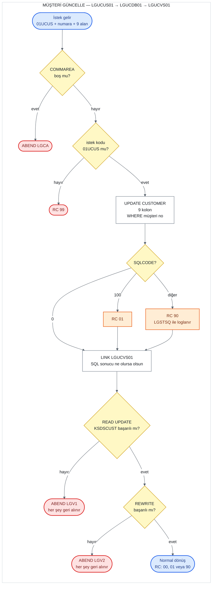

# UC-03 · Müşteri Güncelle

Var olan bir müşterinin bilgilerini Db2'deki `CUSTOMER` tablosunda ve `KSDSCUST` VSAM
dosyasında güncelleyen operasyon. Bu belge, C# kodunu yazacak kişi için eski sistemin
davranışını satır satır tarif eder. Satır numaraları `base/src` altındaki dosyalara aittir
ve bağlantılar ilgili satırı açar.

## Özet

| | |
|---|---|
| **İstek kodu** (`CA-REQUEST-ID`) | `01UCUS` — üç müşteri operasyonu içinde istek kodunu **kontrol eden tek operasyon** |
| **Giriş programı** | `LGUCUS01` (iş katmanı) |
| **Çağrı zinciri** | `LGUCUS01` → `LGUCDB01` → `LGUCVS01` |
| **Yazılan yerler** | Db2 `CUSTOMER` (`UPDATE`), VSAM `KSDSCUST` (`READ UPDATE` + `REWRITE`) |
| **Çıktı** | `CA-RETURN-CODE = '00'`; başka veri dönmez |
| **Olası dönüş kodları** | `00`, `01`, `90`, `99` (ve ABEND `LGCA`, `LGV1`, `LGV2`) |

Ekranda Güncelle iki adımlıdır: menü 4 önce **Müşteri Sorgula**'yı
([02-customer-inquire.md](02-customer-inquire.md)) çağırıp mevcut bilgiyi ekrana getirir,
kullanıcı düzenleyip Enter'a basınca bu operasyonu çağırır
([lgtestc1.cbl:148-193](../../base/src/lgtestc1.cbl#L148-L193)). Bu belge ikinci adımı
anlatır.

## Akış

Turuncu kutular dönüş kodunun belirlendiği ama işlemin **durmadığı** yerlerdir: `UPDATE`
başarısız olsa da akış VSAM adımına devam eder.

## Girdiler (COMMAREA)

Ekran, ikinci adımda aşağıdaki alanları doldurup `LGUCUS01`'i çağırır
([lgtestc1.cbl:176-193](../../base/src/lgtestc1.cbl#L176-L193)). Alan tanımları
[lgcmarea.cpy](../../base/src/lgcmarea.cpy) içinde.

| Alan | Tip | Gelen değer | Kullanım |
|---|---|---|---|
| `CA-REQUEST-ID` | `X(6)` | `'01UCUS'` | `LGUCUS01` kontrol eder; farklıysa `'99'` |
| `CA-CUSTOMER-NUM` | `9(10)` | ekranda o anda yazan numara | `WHERE` koşulu ve VSAM anahtarı |
| `CA-FIRST-NAME` | `X(10)` | ekrandan | `CUSTOMER.FIRSTNAME` |
| `CA-LAST-NAME` | `X(20)` | ekrandan | `CUSTOMER.LASTNAME` |
| `CA-DOB` | `X(10)` | ekrandan | `CUSTOMER.DATEOFBIRTH` (Db2'de `DATE` tipi) |
| `CA-HOUSE-NAME` | `X(20)` | ekrandan | `CUSTOMER.HOUSENAME` |
| `CA-HOUSE-NUM` | `X(4)` | ekrandan | `CUSTOMER.HOUSENUMBER` |
| `CA-POSTCODE` | `X(8)` | ekrandan, **büyük harfe çevrilmiş** | `CUSTOMER.POSTCODE` |
| `CA-PHONE-MOBILE` | `X(20)` | ekrandan | `CUSTOMER.PHONEMOBILE` |
| `CA-PHONE-HOME` | `X(20)` | ekrandan | `CUSTOMER.PHONEHOME` |
| `CA-EMAIL-ADDRESS` | `X(100)` | ekrandan | `CUSTOMER.EMAILADDRESS` |

Ekran, Ekle'deki gibi `X'00'` baytları boşluğa ve posta kodunu büyük harfe çevirir
([lgtestc1.cbl:187-189](../../base/src/lgtestc1.cbl#L187-L189)). Müşteri numarası ilk
adımda sorgulanan numara değil, ekranda o anda yazan numaradır; kullanıcı iki adım arasında
numarayı değiştirirse başka bir müşteri güncellenir.

## Adım adım

| # | Program | Ne yapıyor | Kaynak |
|---:|---|---|---|
| 1 | `LGUCUS01` | COMMAREA hiç gelmediyse (`EIBCALEN = 0`) hata günlüğüne yazar ve `LGCA` koduyla ABEND eder. | [lgucus01.cbl:99-103](../../base/src/lgucus01.cbl#L99-L103) |
| 2 | `LGUCUS01` | `CA-RETURN-CODE = '00'`, `CA-NUM-POLICIES = 000` yapar. | [lgucus01.cbl:105-106](../../base/src/lgucus01.cbl#L105-L106) |
| 3 | `LGUCUS01` | `CA-REQUEST-ID` `'01UCUS'` değilse `'99'` yazar ve döner. | [lgucus01.cbl:110-113](../../base/src/lgucus01.cbl#L110-L113) |
| 4 | `LGUCUS01` | `LGUCDB01`'i aynı COMMAREA ile `LINK` eder (32.500 bayt), dönüşte hiçbir şeyi kontrol etmeden çağırana döner. **Uzunluk kontrolü yok** (Ekle ve Sorgula'nın aksine). | [lgucus01.cbl:116-120](../../base/src/lgucus01.cbl#L116-L120), [126-131](../../base/src/lgucus01.cbl#L126-L131) |
| 5 | `LGUCDB01` | COMMAREA yoksa ABEND `LGCA`; `CA-RETURN-CODE = '00'`. Uzunluk kontrolü bu programda da yok. | [lgucdb01.cbl:117-124](../../base/src/lgucdb01.cbl#L117-L124) |
| 6 | `LGUCDB01` | `CA-CUSTOMER-NUM`'u Db2 tamsayısına çevirir. | [lgucdb01.cbl:129](../../base/src/lgucdb01.cbl#L129) |
| 7 | `LGUCDB01` | `UPDATE CUSTOMER SET` 9 kolon `WHERE CUSTOMERNUMBER = ...` çalıştırır. `SQLCODE = 100` ise `'01'`, başka bir hata ise `'90'` yazar ve hatayı günlüğe yazar; **dönmez, devam eder**. | [lgucdb01.cbl:152-181](../../base/src/lgucdb01.cbl#L152-L181) |
| 8 | `LGUCDB01` → `LGUCVS01` | 7. adımın sonucuna bakmadan, COMMAREA'yı `LENGTH(225)` ile `LGUCVS01`'e verir. | [lgucdb01.cbl:134-139](../../base/src/lgucdb01.cbl#L134-L139) |
| 9 | `LGUCVS01` | `KSDSCUST`'ten müşteri kaydını güncelleme amaçlı okur (`READ UPDATE`, kaydı kilitler). Başarısızsa `'81'` yazar ve `LGV1` ile ABEND eder. | [lgucvs01.cbl:69-83](../../base/src/lgucvs01.cbl#L69-L83) |
| 10 | `LGUCVS01` | Kaydı COMMAREA'daki 225 baytla tamamen yeniden yazar (`REWRITE`). Başarısızsa `'82'` yazar ve `LGV2` ile ABEND eder. | [lgucvs01.cbl:85-96](../../base/src/lgucvs01.cbl#L85-L96) |
| 11 | `LGUCDB01` | Çağırana döner; `CA-RETURN-CODE` 7. adımda ne olduysa o (`00`, `01` veya `90`). | [lgucdb01.cbl:142-143](../../base/src/lgucdb01.cbl#L142-L143) |

## Dönüş kodları

| Kod | Koşul | Nerede atanıyor | Çağıran ne görür |
|---|---|---|---|
| `00` | Db2 `UPDATE` ve VSAM `REWRITE` başarılı | [lgucus01.cbl:105](../../base/src/lgucus01.cbl#L105), [lgucdb01.cbl:124](../../base/src/lgucdb01.cbl#L124) | Ekran "Customer details updated" gösterir |
| `99` | `CA-REQUEST-ID` `'01UCUS'` değil | [lgucus01.cbl:110-113](../../base/src/lgucus01.cbl#L110-L113) | Hiçbir yere yazılmaz. Ekran her zaman `'01UCUS'` gönderdiği için pratikte oluşmaz. |
| `01` | `UPDATE` hiçbir satır bulamadı (`SQLCODE = 100`) | [lgucdb01.cbl:173-174](../../base/src/lgucdb01.cbl#L173-L174) | **Çoğu zaman görmez** — aşağıdaki "dikkat" maddesi 2'ye bakın |
| `90` | `UPDATE` başka bir hatayla başarısız | [lgucdb01.cbl:175-178](../../base/src/lgucdb01.cbl#L175-L178) | `90` görür, ama VSAM kaydı yine de güncellenmiştir (madde 1) |
| `81` | `KSDSCUST`'te `READ UPDATE` başarısız (ör. kayıt yok) | [lgucvs01.cbl:77-83](../../base/src/lgucvs01.cbl#L77-L83) | **Görmez.** Hemen ardından ABEND `LGV1`; işlem (Db2 `UPDATE` dahil) geri alınır |
| `82` | `KSDSCUST`'te `REWRITE` başarısız | [lgucvs01.cbl:90-96](../../base/src/lgucvs01.cbl#L90-L96) | **Görmez.** Hemen ardından ABEND `LGV2`; işlem geri alınır |
| — | COMMAREA hiç yok | [lgucus01.cbl:99-103](../../base/src/lgucus01.cbl#L99-L103) | ABEND `LGCA` |

Ekran tarafı: `CA-RETURN-CODE > 0` ise "Error Updating Customer" gösterir. Ekle'den
farklı olarak burada **`SYNCPOINT ROLLBACK` yapılmaz**
([lgtestc1.cbl:195-197](../../base/src/lgtestc1.cbl#L195-L197),
[259-261](../../base/src/lgtestc1.cbl#L259-L261)); görev normal biter ve yapılan yazmalar
kalıcı olur.

## Yazılan veriler

**Db2 `CUSTOMER`** ([db2cre.jcl:110-124](../../base/cntl/db2cre.jcl#L110-L124)) — girdi
tablosundaki 9 kolonun hepsi gelen değerlerle değiştirilir; `CUSTOMERNUMBER` değişmez.
Kısmi güncelleme yok: boş gelen alan, tablodaki değeri boşlukla ezer.

**VSAM `KSDSCUST`** ([adef121.jcl:15-27](../../base/cntl/adef121.jcl#L15-L27)) — 225
baytlık kayıt, COMMAREA'da `CA-CUSTOMER-NUM`'dan başlayan 225 baytla tamamen değiştirilir:
numara (10) + müşteri alanları (212) + `CA-NUM-POLICIES` (3, her zaman `000`). Dosya
`LOG(UNDO)` ile tanımlı; ABEND olursa bu yazma da geri alınır.

## C#'a taşırken dikkat edilecek davranışlar

1. **Db2 hatasında bile VSAM güncelleniyor.** `UPDATE` `'90'` ile başarısız olunca
   `LGUCDB01` durmuyor; `LGUCVS01` VSAM kaydını yeni değerlerle yeniden yazıyor
   ([lgucdb01.cbl:134-139](../../base/src/lgucdb01.cbl#L134-L139)). Ekran da güncellemede
   geri alma yapmadığı için sonuç: Db2'de eski veri, VSAM'da yeni veri. Bu, eski sistemin
   bir hatası; yeni sistemde tek veritabanı olacağı için bu tutarsızlık taşınmamalı.
2. **"Bulunamadı" (`'01'`) pratikte çağırana ulaşmıyor.** Müşteri Db2'de yoksa normalde
   VSAM'da da yoktur; bu durumda 9. adımdaki `READ UPDATE` başarısız olur ve görev `LGV1`
   ile ABEND eder. `'01'` yalnızca müşteri VSAM'da olup Db2'de olmadığında (iki kaynak
   tutarsızsa) çağırana döner; o durumda da VSAM kaydı yeniden yazılır. Yeni sistemde
   "müşteri yok" durumu net bir sonuç olarak dönmeli (eşleme kararı API tasarımına ait).
3. **İyimser kilitleme yok.** Poliçe güncellemenin aksine müşteri güncellemede zaman damgası
   ya da sürüm kontrolü yok; aynı müşteriyi iki kişi güncellerse son yazan kazanır.
4. **Uzunluk kontrolü yok.** Ekle ve Sorgula'daki 90 bayt kontrolü burada hiçbir programda
   yapılmıyor (`LGUCUS01`'de tanımlı `WS-CA-HEADER-LEN` hiç kullanılmıyor,
   [lgucus01.cbl:57](../../base/src/lgucus01.cbl#L57)).
5. **Girdi doğrulaması yok.** Tek örtük kontrol Db2'nin `DATE` tipi: `CA-DOB` geçerli bir
   tarih değilse `UPDATE` başarısız olur → `'90'` (ve madde 1'deki tutarsızlık).
6. **`CUSTOMER_SECURE` dokunulmuyor.** Güncelleme şifre tablosunu değiştirmez.
