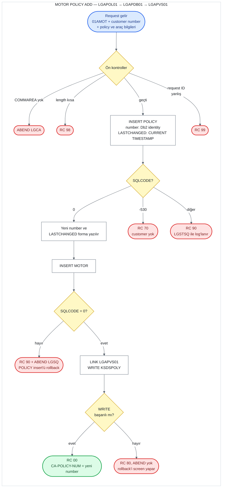

# UC-04 · Motor Policy Add

Bir customer'a yeni bir motor (araç) policy'si ekleyen operasyon. Ortak policy bilgilerini
Db2'deki `POLICY` table'ına, araç bilgilerini `MOTOR` table'ına ve kısaltılmış bir kopyasını
`KSDSPOLY` VSAM dosyasına yazar. Dört policy tipi aynı programları kullandığı için bu belge
yalnızca motor'a ait kısımları ve ortak kısımları anlatır. Bu belge, C# kodunu yazacak kişi
için eski sistemin davranışını satır satır tarif eder. Satır numaraları `base/src` altındaki
dosyalara aittir ve linkler ilgili satırı açar.

## Özet

| | |
|---|---|
| **Request ID** (`CA-REQUEST-ID`) | `01AMOT`. `LGAPOL01` kontrol etmez; `LGAPDB01` kontrol eder ve tanımazsa `99` döner |
| **Entry program** | `LGAPOL01` (business layer) |
| **Call chain** | `LGAPOL01` → `LGAPDB01` → `LGAPVS01` |
| **Yazıldığı yerler** | Db2 `POLICY` table, Db2 `MOTOR` table, VSAM `KSDSPOLY` |
| **Output** | Yeni policy number `CA-POLICY-NUM`'da, yeni timestamp `CA-LASTCHANGED`'de, `CA-RETURN-CODE = '00'` |
| **Olası return code'lar** | `00`, `70`, `80`, `90`, `98`, `99` (ve ABEND `LGCA`, `LGSQ`) |

## Flow

## Input (COMMAREA)

Screen (`LGTESTP1`, menu 2) aşağıdaki field'ları doldurup `LGAPOL01`'i call eder
([lgtestp1.cbl:97-118](../../base/src/lgtestp1.cbl#L97-L118)). Field tanımları
[lgcmarea.cpy](../../base/src/lgcmarea.cpy) içinde: ortak policy field'ları satır 37-43,
motor field'ları satır 65-75.

| Field | Type | Gelen value | Kullanım |
|---|---|---|---|
| `CA-REQUEST-ID` | `X(6)` | `'01AMOT'` | `LGAPDB01`'de policy tipini (`'M'`) ve gereken length'i seçer |
| `CA-CUSTOMER-NUM` | `9(10)` | screen'den | `POLICY.CUSTOMERNUMBER`. Customer yoksa `70` |
| `CA-POLICY-NUM` | `9(10)` | screen set etmez | Yok sayılır; yeni number bunun üzerine yazılır |
| `CA-ISSUE-DATE` | `X(10)` | screen'den | `POLICY.ISSUEDATE` (Db2'de `DATE` type) |
| `CA-EXPIRY-DATE` | `X(10)` | screen'den | `POLICY.EXPIRYDATE` (Db2'de `DATE` type) |
| `CA-LASTCHANGED` | `X(26)` | screen set etmez | Input değil; insert'ten sonra yeni timestamp buraya yazılır |
| `CA-BROKERID` | `9(10)` | **her zaman `0`** | `POLICY.BROKERID` |
| `CA-BROKERSREF` | `X(10)` | **her zaman space** | `POLICY.BROKERSREFERENCE` |
| `CA-PAYMENT` | `9(6)` | **her zaman `0`** | `POLICY.PAYMENT` |
| `CA-M-MAKE` | `X(15)` | screen'den | `MOTOR.MAKE` |
| `CA-M-MODEL` | `X(15)` | screen'den | `MOTOR.MODEL` |
| `CA-M-VALUE` | `9(6)` | screen'den | `MOTOR.VALUE` (integer) |
| `CA-M-REGNUMBER` | `X(7)` | screen'den | `MOTOR.REGNUMBER` |
| `CA-M-COLOUR` | `X(8)` | screen'den | `MOTOR.COLOUR` |
| `CA-M-CC` | `9(4)` | screen'den | `MOTOR.CC` (smallint) |
| `CA-M-MANUFACTURED` | `X(10)` | screen'den | `MOTOR.YEAROFMANUFACTURE`. Adı "year" olsa da Db2'de tam bir `DATE` |
| `CA-M-PREMIUM` | `9(6)` | screen'den | `MOTOR.PREMIUM` (integer) |
| `CA-M-ACCIDENTS` | `9(6)` | screen'den | `MOTOR.ACCIDENTS` (integer) |

COMMAREA'daki numeric field'lar işaretsizdir (`PIC 9`), yani negatif bir value taşıyamaz.

**Length hesabı.** Policy operasyonlarının header'ı 28 byte'tır: request ID (6) + return
code (2) + customer number (10) + policy number (10). Motor data'sı bundan sonra gelir:

| Byte | İçerik | Uzunluk |
|---|---|---:|
| 1-28 | Header ve policy number | 28 |
| 29-100 | Ortak policy field'ları (`CA-POLICY-COMMON`) | 72 |
| 101-165 | Motor field'ları, make'ten manufactured'a kadar | 65 |
| 166-177 | `CA-M-PREMIUM` ve `CA-M-ACCIDENTS` | 12 |

`LGAPDB01`'in istediği minimum length 28 + `WS-FULL-MOTOR-LEN` 137 = **165 byte**
([lgpolicy.cpy:26](../../base/src/lgpolicy.cpy#L26)). Bu sayı premium ve accidents
field'larını kapsamaz (bkz. "C#'a taşırken" madde 5).

## Adım adım

| # | Program | Ne yapıyor | Kaynak |
|---:|---|---|---|
| 1 | `LGAPOL01` | COMMAREA hiç gelmediyse (`EIBCALEN = 0`) error log'a yazar ve `LGCA` koduyla ABEND eder. | [lgapol01.cbl:98-102](../../base/src/lgapol01.cbl#L98-L102) |
| 2 | `LGAPOL01` | `CA-RETURN-CODE = '00'` yapar. | [lgapol01.cbl:105](../../base/src/lgapol01.cbl#L105) |
| 3 | `LGAPOL01` | COMMAREA 28 byte'tan kısaysa `'98'` ile return eder. Request ID'ye bakmaz. | [lgapol01.cbl:109-116](../../base/src/lgapol01.cbl#L109-L116) |
| 4 | `LGAPOL01` | `LGAPDB01`'i aynı COMMAREA ile `LINK` eder, dönünce hiçbir şeye bakmadan return eder. | [lgapol01.cbl:121-126](../../base/src/lgapol01.cbl#L121-L126) |
| 5 | `LGAPDB01` | 1-2. adımları tekrarlar (ABEND `LGCA`, `'00'`). | [lgapdb01.cbl:165-172](../../base/src/lgapdb01.cbl#L165-L172) |
| 6 | `LGAPDB01` | Request ID `'01AMOT'` ise policy tipini `'M'` yapar ve gereken length'e 137 ekler. Tanımadığı bir request ID'de `'99'` ile return eder. | [lgapdb01.cbl:184-207](../../base/src/lgapdb01.cbl#L184-L207) |
| 7 | `LGAPDB01` | COMMAREA 165 byte'tan kısaysa `'98'` ile return eder. | [lgapdb01.cbl:210-213](../../base/src/lgapdb01.cbl#L210-L213) |
| 8 | `LGAPDB01` | `POLICY` table'ına `INSERT` yapar. Policy number'ı Db2 identity column'u generate eder (`DEFAULT`), `LASTCHANGED` = `CURRENT TIMESTAMP`. | [lgapdb01.cbl:261-288](../../base/src/lgapdb01.cbl#L261-L288) |
| 9 | `LGAPDB01` | `SQLCODE` -530 ise (foreign key: customer yok) `'70'`, başka bir error'da `'90'` yazar, error log'a yazar ve return eder. 10-14. adımlar çalışmaz. | [lgapdb01.cbl:290-305](../../base/src/lgapdb01.cbl#L290-L305) |
| 10 | `LGAPDB01` | Generate edilen number'ı `IDENTITY_VAL_LOCAL()` ile okuyup `CA-POLICY-NUM`'a yazar. | [lgapdb01.cbl:308-311](../../base/src/lgapdb01.cbl#L308-L311) |
| 11 | `LGAPDB01` | Yeni row'un `LASTCHANGED` value'sunu `SELECT` ile `CA-LASTCHANGED`'e okur. | [lgapdb01.cbl:316-321](../../base/src/lgapdb01.cbl#L316-L321) |
| 12 | `LGAPDB01` | `MOTOR` table'ına `INSERT` yapar. Başarısızsa `'90'` yazar, error log'a yazar ve `LGSQ` koduyla ABEND eder. ABEND, 8. adımdaki `POLICY` insert'ünü de rollback eder. | [lgapdb01.cbl:440-479](../../base/src/lgapdb01.cbl#L440-L479) |
| 13 | `LGAPDB01` → `LGAPVS01` | `LGAPVS01`'i call eder; o da `KSDSPOLY`'ye 64 byte'lık bir record yazar. Başarısızsa `'80'` yazar ve return eder. **ABEND etmez.** | [lgapdb01.cbl:243-246](../../base/src/lgapdb01.cbl#L243-L246), [lgapvs01.cbl:135-147](../../base/src/lgapvs01.cbl#L135-L147) |
| 14 | `LGAPDB01` | Caller'a return eder. | [lgapdb01.cbl:250](../../base/src/lgapdb01.cbl#L250) |

`LGAPDB01`'in ikinci `EVALUATE`'indeki `WHEN OTHER` dalı
([lgapdb01.cbl:237-239](../../base/src/lgapdb01.cbl#L237-L239)) hiç çalışmaz, çünkü
tanınmayan bir request ID 6. adımda zaten return etmiştir.

## Return code'lar

| Code | Koşul | Nerede set ediliyor | Caller ne görür |
|---|---|---|---|
| `00` | Her şey başarılı | [lgapdb01.cbl:172](../../base/src/lgapdb01.cbl#L172), [293](../../base/src/lgapdb01.cbl#L293) | Yeni number `CA-POLICY-NUM`'da, timestamp `CA-LASTCHANGED`'de |
| `70` | `POLICY` insert'ü -530 verdi: `CA-CUSTOMER-NUM` `CUSTOMER` table'ında yok | [lgapdb01.cbl:295-298](../../base/src/lgapdb01.cbl#L295-L298) | `70`. Hiçbir yere yazılmaz. Screen "Customer does not exist" gösterir. |
| `90` | `POLICY` insert'ü başka bir error verdi (örneğin geçersiz date, Db2 deadlock/timeout -913) | [lgapdb01.cbl:300-303](../../base/src/lgapdb01.cbl#L300-L303) | `90`. Hiçbir yere yazılmaz. Error `LGSTSQ` ile log'lanır. |
| `90` | `MOTOR` insert'ü başarısız (örneğin geçersiz `CA-M-MANUFACTURED` date'i) | [lgapdb01.cbl:473-479](../../base/src/lgapdb01.cbl#L473-L479) | **Görmez.** `'90'` yazıldıktan hemen sonra `LGSQ` ile ABEND olur; `POLICY` insert'ü dahil her şey rollback edilir. |
| `80` | `KSDSPOLY`'ye `WRITE` başarısız | [lgapvs01.cbl:142-147](../../base/src/lgapvs01.cbl#L142-L147) | `80`. Db2'deki iki insert **bu noktada hâlâ duruyor**; onları screen'in `SYNCPOINT ROLLBACK`'i geri alır. `CA-POLICY-NUM`'da geri alınan number kalır. |
| `98` | COMMAREA 28 byte'tan (`LGAPOL01`) ya da 165 byte'tan (`LGAPDB01`) kısa | [lgapol01.cbl:113-116](../../base/src/lgapol01.cbl#L113-L116), [lgapdb01.cbl:210-213](../../base/src/lgapdb01.cbl#L210-L213) | `98`. Screen her zaman 32.500 byte gönderdiği için pratikte oluşmaz. |
| `99` | Request ID dört add kodundan biri değil | [lgapdb01.cbl:202-205](../../base/src/lgapdb01.cbl#L202-L205) | `99`. Hiçbir yere yazılmaz. |
| — | COMMAREA hiç yok | [lgapol01.cbl:98-102](../../base/src/lgapol01.cbl#L98-L102) | ABEND `LGCA` |

Screen tarafı: `CA-RETURN-CODE > 0` ise `SYNCPOINT ROLLBACK` yapar. Code `70` ise
"Customer does not exist", diğer code'larda "Error Adding Motor Policy" gösterir. Başarılıysa
customer number'ı, yeni policy number'ı ve "New Motor Policy Inserted" mesajını gösterir
([lgtestp1.cbl:119-133](../../base/src/lgtestp1.cbl#L119-L133),
[286-294](../../base/src/lgtestp1.cbl#L286-L294)).

## Yazılan data

**Db2 `POLICY` table** ([db2cre.jcl:161-176](../../base/cntl/db2cre.jcl#L161-L176)) —
`CUSTOMER`'a foreign key ile bağlı; customer silinince policy de silinir:

| Column | Yazılan value | Kaynak |
|---|---|---|
| `POLICYNUMBER` | Db2 identity column'u generate eder: `1000001`'den başlar, birer artar, 20'şerlik cache | [lgapdb01.cbl:279](../../base/src/lgapdb01.cbl#L279), [db2cre.jcl:162-163](../../base/cntl/db2cre.jcl#L162-L163) |
| `CUSTOMERNUMBER` | `CA-CUSTOMER-NUM` | [lgapdb01.cbl:280](../../base/src/lgapdb01.cbl#L280) |
| `ISSUEDATE`, `EXPIRYDATE` | `CA-ISSUE-DATE`, `CA-EXPIRY-DATE` | [lgapdb01.cbl:281-282](../../base/src/lgapdb01.cbl#L281-L282) |
| `POLICYTYPE` | `'M'` | [lgapdb01.cbl:196](../../base/src/lgapdb01.cbl#L196), [283](../../base/src/lgapdb01.cbl#L283) |
| `LASTCHANGED` | `CURRENT TIMESTAMP` | [lgapdb01.cbl:284](../../base/src/lgapdb01.cbl#L284) |
| `BROKERID`, `BROKERSREFERENCE`, `PAYMENT` | `CA-BROKERID`, `CA-BROKERSREF`, `CA-PAYMENT` (screen'den gelirse `0`, space, `0`) | [lgapdb01.cbl:285-287](../../base/src/lgapdb01.cbl#L285-L287) |
| `COMMISSION` | Yazılmaz, `NULL` kalır | [db2cre.jcl:172](../../base/cntl/db2cre.jcl#L172) |

**Db2 `MOTOR` table** ([db2cre.jcl:275-288](../../base/cntl/db2cre.jcl#L275-L288)) — key
`POLICYNUMBER`, `POLICY`'ye foreign key ile bağlı (`ON DELETE CASCADE`). Input table'ındaki
9 motor field'ı yazılır; `POLICYNUMBER` 10. adımda okunan yeni number'dır
([lgapdb01.cbl:449-471](../../base/src/lgapdb01.cbl#L449-L471)).

**VSAM `KSDSPOLY`** ([adef121.jcl:40-52](../../base/cntl/adef121.jcl#L40-L52)) — 64
byte'lık fixed-length record, key ilk 21 byte. Motor record'u yalnızca dört araç field'ını
taşır ([lgapvs01.cbl:25-51](../../base/src/lgapvs01.cbl#L25-L51),
[99-128](../../base/src/lgapvs01.cbl#L99-L128)):

| Byte | İçerik |
|---|---|
| 1 | `'M'` (request ID'nin 4. karakteri) |
| 2-11 | Customer number |
| 12-21 | Policy number |
| 22-64 | Make (15), model (15), value (6), reg number (7) |

Colour, CC, manufactured, premium, accidents ve policy date'leri VSAM'a yazılmaz. Dosya
`LOG(UNDO)` ile tanımlı; transaction rollback edilirse bu write da rollback edilir.

## C#'a taşırken dikkat edilecek davranışlar

1. **Rollback üç farklı yoldan geliyor.**
   - `POLICY` insert'ü başarısızsa geri alınacak bir şey yok.
   - `MOTOR` insert'ü başarısızsa program kendisi ABEND eder.
   - VSAM write'ı başarısızsa program `'80'` ile normal return eder; `POLICY` ve `MOTOR`
     row'larını screen'in `SYNCPOINT ROLLBACK`'i geri alır.

   Yeni sistemde iki insert aynı transaction'da olduğu için bu dağınık yapının karşılığı
   tek bir rollback'tir (ADR 0003, karar 2). VSAM olmadığı için `80` oluşmaz.
2. **Customer'ın varlığı önceden kontrol edilmiyor.** Kontrolü `POLICY`'nin foreign key'i
   yapıyor; -530 `70`'e çevriliyor. C# tarafında aynı sonucu foreign key violation'ı
   `70`'e çevirerek ya da insert'ten önce customer'ı okuyarak üretmek mümkün.
3. **Sıra `POLICY` → `MOTOR` → VSAM.** `MOTOR` row'u için `POLICY`'de generate edilen number
   gerekiyor. Bu yüzden C#'ta da iki ayrı `SaveChanges` ve explicit transaction gerekir
   (ADR 0003, karar 2).
4. **Üç date field'ı Db2'de `DATE`.** `ISSUEDATE`, `EXPIRYDATE` ve `YEAROFMANUFACTURE`
   geçersiz bir date alırsa ilgili insert başarısız olur. İlk ikisi `90` döndürür, üçüncüsü
   `90` + ABEND `LGSQ` ile her şeyi rollback eder. Başka bir input validation yok; örneğin
   expiry date'in issue date'ten önce olması kabul ediliyor.
5. **Length check data'nın tamamını kapsamıyor.** Kontrol 165 byte istiyor, motor data'sı
   ise 177. byte'a kadar uzanıyor; `CA-M-PREMIUM` ve `CA-M-ACCIDENTS` kontrolün dışında.
   Customer Add'deki aynı durum gibi, bu yalnızca COMMAREA seviyesinde anlam taşıyor.
6. **Kontrol edilmeyen iki SQL.** `IDENTITY_VAL_LOCAL()` ve `SELECT LASTCHANGED` sonrasında
   `SQLCODE`'a bakılmıyor ([lgapdb01.cbl:308-321](../../base/src/lgapdb01.cbl#L308-L321)).
7. **Screen broker ve payment field'larını sabit gönderiyor.** `BROKERID = 0`,
   `BROKERSREFERENCE` space, `PAYMENT = 0`. `COMMISSION` column'u hiç yazılmıyor.
8. **Return edilen timestamp.** `CA-LASTCHANGED`, Db2'nin 26 karakterlik timestamp string'i.
   Bu value, sonraki update'te optimistic locking için geri gönderiliyor
   (bkz. [06-motor-update.md](06-motor-update.md)).
9. **Policy number'larında boşluk oluşabilir.** Rollback edilen bir insert'ün aldığı number
   geri verilmez; identity column ayrıca 20'şerlik cache kullanıyor.
