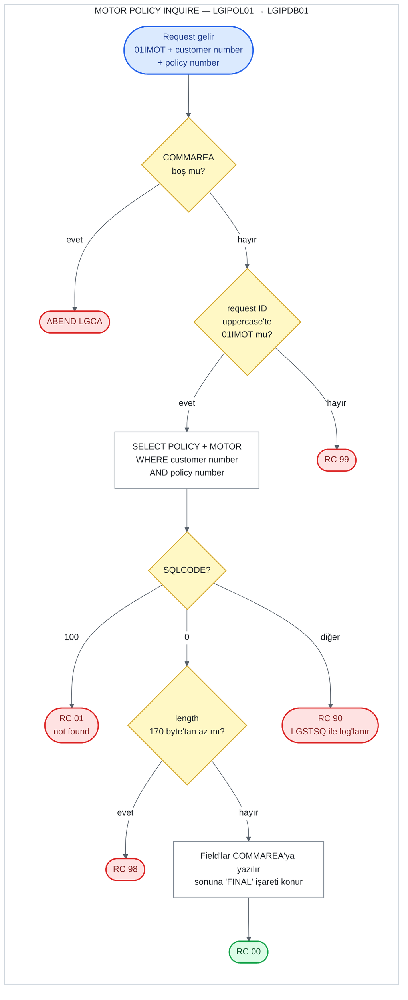

# UC-05 · Motor Policy Inquire

Customer number'ı ve policy number'ı verilen bir motor policy'sinin bilgilerini Db2'deki
`POLICY` ve `MOTOR` table'larını birleştirerek okuyan operasyon. Hiçbir yere yazmaz; VSAM
dosyasını da okumaz. Dört policy tipi aynı programları kullandığı için bu belge yalnızca
motor'a ait kısımları ve ortak kısımları anlatır. Bu belge, C# kodunu yazacak kişi için eski
sistemin davranışını satır satır tarif eder. Satır numaraları `base/src` altındaki dosyalara
aittir ve linkler ilgili satırı açar.

## Özet

| | |
|---|---|
| **Request ID** (`CA-REQUEST-ID`) | `01IMOT`. `LGIPOL01` kontrol etmez; `LGIPDB01` uppercase'e çevirip kontrol eder ve tanımazsa `99` döner |
| **Entry program** | `LGIPOL01` (business layer) |
| **Call chain** | `LGIPOL01` → `LGIPDB01` |
| **Okunduğu yer** | Db2 `POLICY` ve `MOTOR` table'larının join'i (write yok) |
| **Output** | Ortak policy field'ları ve 9 motor field'ı COMMAREA'da, `CA-RETURN-CODE = '00'` |
| **Olası return code'lar** | `00`, `01`, `90`, `98`, `99` (ve ABEND `LGCA`) |

## Flow

## Input (COMMAREA)

Screen (`LGTESTP1`) bu operasyonu iki yerden call eder: menu 1 (sorgula) ve menu 4'ün ilk
adımı (güncellemeden önce mevcut bilgileri getirmek). İkisinde de yalnızca üç field
doldurulur ([lgtestp1.cbl:68-75](../../base/src/lgtestp1.cbl#L68-L75),
[170-176](../../base/src/lgtestp1.cbl#L170-L176)).

| Field | Type | Gelen value | Kullanım |
|---|---|---|---|
| `CA-REQUEST-ID` | `X(6)` | `'01IMOT'` | `LGIPDB01`'de motor dalını seçer |
| `CA-CUSTOMER-NUM` | `9(10)` | screen'den | `WHERE POLICY.CUSTOMERNUMBER = ...` |
| `CA-POLICY-NUM` | `9(10)` | screen'den | `WHERE POLICY.POLICYNUMBER = ...` |

Diğer bütün field'lar input olarak kullanılmaz; output için doldurulur.

## Adım adım

| # | Program | Ne yapıyor | Kaynak |
|---:|---|---|---|
| 1 | `LGIPOL01` | COMMAREA hiç gelmediyse (`EIBCALEN = 0`) error log'a yazar ve `LGCA` koduyla ABEND eder. | [lgipol01.cbl:79-83](../../base/src/lgipol01.cbl#L79-L83) |
| 2 | `LGIPOL01` | `CA-RETURN-CODE = '00'` yapar. Length'e de request ID'ye de bakmaz. | [lgipol01.cbl:86](../../base/src/lgipol01.cbl#L86) |
| 3 | `LGIPOL01` | `LGIPDB01`'i aynı COMMAREA ile `LINK` eder, dönünce hiçbir şeye bakmadan return eder. | [lgipol01.cbl:91-96](../../base/src/lgipol01.cbl#L91-L96) |
| 4 | `LGIPDB01` | 1-2. adımları tekrarlar (ABEND `LGCA`, `'00'`). | [lgipdb01.cbl:251-258](../../base/src/lgipdb01.cbl#L251-L258) |
| 5 | `LGIPDB01` | Customer ve policy number'larını Db2 integer'ına çevirir. | [lgipdb01.cbl:263-264](../../base/src/lgipdb01.cbl#L263-L264) |
| 6 | `LGIPDB01` | Request ID'nin uppercase halini bir değişkene alır ve ona göre dal seçer: `'01IMOT'` motor dalına gider, tanınmayan bir ID `'99'` olur. | [lgipdb01.cbl:275-310](../../base/src/lgipdb01.cbl#L275-L310) |
| 7 | `LGIPDB01` | `POLICY` ile `MOTOR`'u `POLICYNUMBER` üzerinden join eder ve customer number + policy number ile tek row okur: 6 ortak policy column'u ve 9 motor column'u. | [lgipdb01.cbl:529-570](../../base/src/lgipdb01.cbl#L529-L570) |
| 8 | `LGIPDB01` | Row bulunduysa gereken length'i hesaplar: 33 + 137 = **170 byte**. COMMAREA daha kısaysa `'98'` ile return eder. | [lgipdb01.cbl:572-583](../../base/src/lgipdb01.cbl#L572-L583) |
| 9 | `LGIPDB01` | Integer column'ları COMMAREA'nın numeric field'larına çevirir. `NULL` gelen broker ID ve payment'ı atlar. Ortak policy field'larını ve motor field'larını COMMAREA'ya yazar. | [lgipdb01.cbl:588-602](../../base/src/lgipdb01.cbl#L588-L602) |
| 10 | `LGIPDB01` | Policy data'sının bittiği yeri işaretlemek için `CA-M-FILLER`'ın ilk 5 byte'ına `'FINAL'` yazar. | [lgipdb01.cbl:606](../../base/src/lgipdb01.cbl#L606) |
| 11 | `LGIPDB01` | Row bulunamadıysa (`SQLCODE = 100`) `'01'`, başka bir error'da `'90'` yazar ve error'u log'a yazar. | [lgipdb01.cbl:608-620](../../base/src/lgipdb01.cbl#L608-L620) |
| 12 | `LGIPDB01` | Caller'a return eder. | [lgipdb01.cbl:312-313](../../base/src/lgipdb01.cbl#L312-L313) |

**170 byte nereden geliyor.** `WS-CA-HEADERTRAILER-LEN` 33 byte'tır
([lgipdb01.cbl:73](../../base/src/lgipdb01.cbl#L73)): 28 byte'lık header (request ID,
return code, customer number, policy number) ve 5 byte'lık `'FINAL'` işareti. Buna
`WS-FULL-MOTOR-LEN` 137 eklenir ([lgpolicy.cpy:26](../../base/src/lgpolicy.cpy#L26)).

## Output (COMMAREA)

Başarılı (`'00'`) bir query'den sonra dolu gelen field'lar:

| Field | Type | Kaynak column | Not |
|---|---|---|---|
| `CA-ISSUE-DATE` | `X(10)` | `POLICY.ISSUEDATE` | Db2 `DATE`, string olarak döner |
| `CA-EXPIRY-DATE` | `X(10)` | `POLICY.EXPIRYDATE` | |
| `CA-LASTCHANGED` | `X(26)` | `POLICY.LASTCHANGED` | Db2'nin 26 karakterlik timestamp string'i. Update'te değiştirilmeden geri gönderilir |
| `CA-BROKERID` | `9(10)` | `POLICY.BROKERID` | Column `NULL` ise `0` |
| `CA-BROKERSREF` | `X(10)` | `POLICY.BROKERSREFERENCE` | Column `NULL` ise space |
| `CA-PAYMENT` | `9(6)` | `POLICY.PAYMENT` | Column `NULL` ise `0` |
| `CA-M-MAKE` | `X(15)` | `MOTOR.MAKE` | |
| `CA-M-MODEL` | `X(15)` | `MOTOR.MODEL` | |
| `CA-M-VALUE` | `9(6)` | `MOTOR.VALUE` | |
| `CA-M-REGNUMBER` | `X(7)` | `MOTOR.REGNUMBER` | |
| `CA-M-COLOUR` | `X(8)` | `MOTOR.COLOUR` | |
| `CA-M-CC` | `9(4)` | `MOTOR.CC` | |
| `CA-M-MANUFACTURED` | `X(10)` | `MOTOR.YEAROFMANUFACTURE` | Db2 `DATE` |
| `CA-M-PREMIUM` | `9(6)` | `MOTOR.PREMIUM` | |
| `CA-M-ACCIDENTS` | `9(6)` | `MOTOR.ACCIDENTS` | |
| `CA-M-FILLER(1:5)` | `X(5)` | — | Sabit `'FINAL'` |
| `CA-RETURN-CODE` | `9(2)` | — | `00` |

`CA-CUSTOMER-NUM` ve `CA-POLICY-NUM` değişmez. `POLICY.POLICYTYPE` ve `POLICY.COMMISSION`
okunmaz.

## Return code'lar

| Code | Koşul | Nerede set ediliyor | Caller ne görür |
|---|---|---|---|
| `00` | Row bulundu | [lgipdb01.cbl:258](../../base/src/lgipdb01.cbl#L258) | Field'lar dolu |
| `01` | Row yok (`SQLCODE = 100`): policy number yok, customer number policy'ninkiyle eşleşmiyor ya da policy motor değil (`MOTOR`'da row'u yok) | [lgipdb01.cbl:610-612](../../base/src/lgipdb01.cbl#L610-L612) | Screen "No data was returned." gösterir |
| `90` | Diğer her `SQLCODE`. Db2 deadlock/timeout (-913) ve motor column'larından birinin `NULL` olması da buraya düşer | [lgipdb01.cbl:613-617](../../base/src/lgipdb01.cbl#L613-L617) | Error `LGSTSQ` ile log'lanır; screen aynı "No data was returned." mesajını gösterir |
| `98` | Row bulundu ama COMMAREA 170 byte'tan kısa | [lgipdb01.cbl:581-583](../../base/src/lgipdb01.cbl#L581-L583) | Screen her zaman 32.500 byte gönderdiği için pratikte oluşmaz |
| `99` | Request ID tanınmadı | [lgipdb01.cbl:307-308](../../base/src/lgipdb01.cbl#L307-L308) | `99` |
| — | COMMAREA hiç yok | [lgipol01.cbl:79-83](../../base/src/lgipol01.cbl#L79-L83) | ABEND `LGCA` |

Screen tarafı: `CA-RETURN-CODE > 0` ise code'un ne olduğuna bakmadan "No data was returned."
gösterir ([lgtestp1.cbl:76-78](../../base/src/lgtestp1.cbl#L76-L78),
[304-306](../../base/src/lgtestp1.cbl#L304-L306)). Menu 4'te bu durumda güncelleme
adımına hiç geçilmez.

## Okunan data

**Db2 `POLICY`** ([db2cre.jcl:161-176](../../base/cntl/db2cre.jcl#L161-L176)) ve
**`MOTOR`** ([db2cre.jcl:275-288](../../base/cntl/db2cre.jcl#L275-L288)) table'ları, inner
join ile. `KSDSPOLY` VSAM dosyası bu operasyonda hiç okunmaz; policy bilgisinin tek kaynağı
Db2.

## C#'a taşırken dikkat edilecek davranışlar

1. **Policy tipi join ile kontrol ediliyor.** Query `POLICYTYPE`'a bakmıyor; `MOTOR`'la inner
   join yaptığı için motor olmayan bir policy number'ı row döndürmez ve sonuç `01` olur.
   Customer number da eşleşmek zorunda: başka bir customer'ın policy'si `01` döner.
2. **Deadlock/timeout `90`.** Customer Inquire'ın aksine burada -913 `01` sayılmıyor, genel
   error olarak `90` dönüyor. Yeni sistemde iki operasyonda da `503` / `"90"` döner
   (ADR 0002, karar 8).
3. **`NULL` davranışı column'a göre değişiyor.** `BROKERID`, `BROKERSREFERENCE` ve
   `PAYMENT` için indicator variable var: `NULL` ise `0` ya da space döner
   ([lgipdb01.cbl:551-553](../../base/src/lgipdb01.cbl#L551-L553),
   [588-593](../../base/src/lgipdb01.cbl#L588-L593)). Motor column'larının hepsi Db2'de
   `NULL` olabildiği halde indicator'ları yok; biri `NULL` ise Db2 error verir ve sonuç `90`
   olur. Bu operasyonla eklenen policy'ler her column'u doldurduğu için pratikte sorun
   çıkmaz.
4. **Length, query'den sonra kontrol ediliyor.** Kısa bir COMMAREA ile gelen request de
   Db2'ye gidiyor; `98` ancak row bulunduktan sonra veriliyor. Kontrol 170 byte istiyor ama
   program premium, accidents ve `'FINAL'` işaretiyle 182. byte'a kadar yazıyor. Bu yalnızca
   COMMAREA seviyesinde anlam taşıyor.
5. **`'FINAL'` işareti** COMMAREA'ya özgü bir "data burada bitti" işareti; API cevabında
   karşılığı yok.
6. **Not found olunca field'lar temizlenmiyor.** `'01'` ya da `'90'` durumunda COMMAREA'daki
   policy field'larına dokunulmuyor; içlerinde caller'ın gönderdiği ne varsa kalıyor.
   Sadece return code güvenilir.
7. **Request ID küçük harfle de kabul ediliyor.** `LGIPDB01` karşılaştırmadan önce
   uppercase'e çeviriyor (`01imot` çalışır). `LGIPOL01` ise ne length'e ne request ID'ye
   bakıyor.
8. **Numeric field'lar işaretsiz.** COMMAREA'daki `PIC 9` field'ları negatif value
   taşıyamaz; Db2'de negatif bir value varsa işareti kaybolur.
