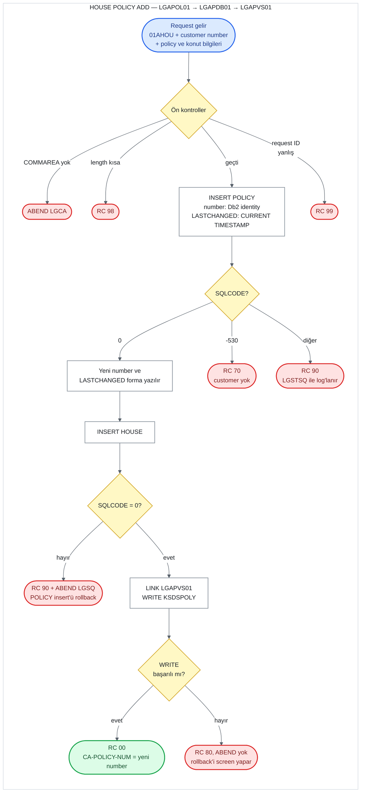

# UC-08 · House Policy Add

Bir customer'a yeni bir house (konut) policy'si ekleyen operasyon. Ortak policy bilgilerini
Db2'deki `POLICY` table'ına, konut bilgilerini `HOUSE` table'ına ve kısaltılmış bir kopyasını
`KSDSPOLY` VSAM dosyasına yazar. Dört policy tipi aynı programları kullandığı için bu belge
yalnızca house'a ait kısımları ve ortak kısımları anlatır; ortak kısımlar
[04-motor-add.md](04-motor-add.md) ile aynıdır. Bu belge, C# kodunu yazacak kişi için eski
sistemin davranışını satır satır tarif eder. Satır numaraları `base/src` altındaki dosyalara
aittir ve linkler ilgili satırı açar.

## Özet

| | |
|---|---|
| **Request ID** (`CA-REQUEST-ID`) | `01AHOU`. `LGAPOL01` kontrol etmez; `LGAPDB01` kontrol eder ve tanımazsa `99` döner |
| **Entry program** | `LGAPOL01` (business layer) |
| **Call chain** | `LGAPOL01` → `LGAPDB01` → `LGAPVS01` |
| **Yazıldığı yerler** | Db2 `POLICY` table, Db2 `HOUSE` table, VSAM `KSDSPOLY` |
| **Output** | Yeni policy number `CA-POLICY-NUM`'da, yeni timestamp `CA-LASTCHANGED`'de, `CA-RETURN-CODE = '00'` |
| **Olası return code'lar** | `00`, `70`, `80`, `90`, `98`, `99` (ve ABEND `LGCA`, `LGSQ`) |

## Flow

Ön kontroller: COMMAREA yoksa ABEND `LGCA`; COMMAREA 28 byte'tan (`LGAPOL01`) ya da 158
byte'tan (`LGAPDB01`) kısaysa `98`; request ID dört add kodundan biri değilse `99`.

## Input (COMMAREA)

Screen (`LGTESTP3`, menu 2) aşağıdaki field'ları doldurup `LGAPOL01`'i call eder
([lgtestp3.cbl:92-109](../../base/src/lgtestp3.cbl#L92-L109)). Field tanımları
[lgcmarea.cpy](../../base/src/lgcmarea.cpy) içinde: ortak policy field'ları satır 37-43,
house field'ları satır 56-63.

| Field | Type | Gelen value | Kullanım |
|---|---|---|---|
| `CA-REQUEST-ID` | `X(6)` | `'01AHOU'` | `LGAPDB01`'de policy tipini (`'H'`) ve gereken length'i seçer |
| `CA-CUSTOMER-NUM` | `9(10)` | screen'den | `POLICY.CUSTOMERNUMBER`. Customer yoksa `70` |
| `CA-POLICY-NUM` | `9(10)` | screen set etmez | Yok sayılır; yeni number bunun üzerine yazılır |
| `CA-ISSUE-DATE` | `X(10)` | screen'den | `POLICY.ISSUEDATE` (Db2'de `DATE` type) |
| `CA-EXPIRY-DATE` | `X(10)` | screen'den | `POLICY.EXPIRYDATE` (Db2'de `DATE` type) |
| `CA-LASTCHANGED` | `X(26)` | screen set etmez | Input değil; insert'ten sonra yeni timestamp buraya yazılır |
| `CA-BROKERID` | `9(10)` | **her zaman `0`** | `POLICY.BROKERID` |
| `CA-BROKERSREF` | `X(10)` | **her zaman space** | `POLICY.BROKERSREFERENCE` |
| `CA-PAYMENT` | `9(6)` | **her zaman `0`** | `POLICY.PAYMENT` |
| `CA-H-PROPERTY-TYPE` | `X(15)` | screen'den | `HOUSE.PROPERTYTYPE` |
| `CA-H-BEDROOMS` | `9(3)` | screen'den | `HOUSE.BEDROOMS` (smallint) |
| `CA-H-VALUE` | `9(8)` | screen'den | `HOUSE.VALUE` (integer) |
| `CA-H-HOUSE-NAME` | `X(20)` | screen'den | `HOUSE.HOUSENAME` |
| `CA-H-HOUSE-NUMBER` | `X(4)` | screen'den | `HOUSE.HOUSENUMBER` |
| `CA-H-POSTCODE` | `X(8)` | screen'den | `HOUSE.POSTCODE` |

COMMAREA'daki numeric field'lar işaretsizdir (`PIC 9`), yani negatif bir value taşıyamaz.

**Length hesabı.** Policy operasyonlarının header'ı 28 byte'tır: request ID (6) + return
code (2) + customer number (10) + policy number (10). House data'sı bundan sonra gelir:

| Byte | İçerik | Uzunluk |
|---|---|---:|
| 1-28 | Header ve policy number | 28 |
| 29-100 | Ortak policy field'ları (`CA-POLICY-COMMON`) | 72 |
| 101-158 | House field'ları, property type'tan postcode'a kadar | 58 |

`LGAPDB01`'in istediği minimum length 28 + `WS-FULL-HOUSE-LEN` 130 = **158 byte**
([lgpolicy.cpy:25](../../base/src/lgpolicy.cpy#L25)). Motor'un aksine bu sayı house
field'larının hepsini kapsar; data tam 158. byte'ta biter.

## Adım adım

| # | Program | Ne yapıyor | Kaynak |
|---:|---|---|---|
| 1 | `LGAPOL01` | COMMAREA hiç gelmediyse (`EIBCALEN = 0`) error log'a yazar ve `LGCA` koduyla ABEND eder. | [lgapol01.cbl:98-102](../../base/src/lgapol01.cbl#L98-L102) |
| 2 | `LGAPOL01` | `CA-RETURN-CODE = '00'` yapar. | [lgapol01.cbl:105](../../base/src/lgapol01.cbl#L105) |
| 3 | `LGAPOL01` | COMMAREA 28 byte'tan kısaysa `'98'` ile return eder. Request ID'ye bakmaz. | [lgapol01.cbl:109-116](../../base/src/lgapol01.cbl#L109-L116) |
| 4 | `LGAPOL01` | `LGAPDB01`'i aynı COMMAREA ile `LINK` eder, dönünce hiçbir şeye bakmadan return eder. | [lgapol01.cbl:121-126](../../base/src/lgapol01.cbl#L121-L126) |
| 5 | `LGAPDB01` | 1-2. adımları tekrarlar (ABEND `LGCA`, `'00'`). | [lgapdb01.cbl:165-172](../../base/src/lgapdb01.cbl#L165-L172) |
| 6 | `LGAPDB01` | Request ID `'01AHOU'` ise policy tipini `'H'` yapar ve gereken length'e 130 ekler. Tanımadığı bir request ID'de `'99'` ile return eder. | [lgapdb01.cbl:184-207](../../base/src/lgapdb01.cbl#L184-L207) |
| 7 | `LGAPDB01` | COMMAREA 158 byte'tan kısaysa `'98'` ile return eder. | [lgapdb01.cbl:210-213](../../base/src/lgapdb01.cbl#L210-L213) |
| 8 | `LGAPDB01` | `POLICY` table'ına `INSERT` yapar. Policy number'ı Db2 identity column'u generate eder (`DEFAULT`), `LASTCHANGED` = `CURRENT TIMESTAMP`. | [lgapdb01.cbl:261-288](../../base/src/lgapdb01.cbl#L261-L288) |
| 9 | `LGAPDB01` | `SQLCODE` -530 ise (foreign key: customer yok) `'70'`, başka bir error'da `'90'` yazar, error log'a yazar ve return eder. 10-14. adımlar çalışmaz. | [lgapdb01.cbl:290-305](../../base/src/lgapdb01.cbl#L290-L305) |
| 10 | `LGAPDB01` | Generate edilen number'ı `IDENTITY_VAL_LOCAL()` ile okuyup `CA-POLICY-NUM`'a yazar. | [lgapdb01.cbl:308-311](../../base/src/lgapdb01.cbl#L308-L311) |
| 11 | `LGAPDB01` | Yeni row'un `LASTCHANGED` value'sunu `SELECT` ile `CA-LASTCHANGED`'e okur. | [lgapdb01.cbl:316-321](../../base/src/lgapdb01.cbl#L316-L321) |
| 12 | `LGAPDB01` | `HOUSE` table'ına `INSERT` yapar. Başarısızsa `'90'` yazar, error log'a yazar ve `LGSQ` koduyla ABEND eder. ABEND, 8. adımdaki `POLICY` insert'ünü de rollback eder. | [lgapdb01.cbl:402-435](../../base/src/lgapdb01.cbl#L402-L435) |
| 13 | `LGAPDB01` → `LGAPVS01` | `LGAPVS01`'i call eder; o da `KSDSPOLY`'ye 64 byte'lık bir record yazar. Başarısızsa `'80'` yazar ve return eder. **ABEND etmez.** | [lgapdb01.cbl:243-246](../../base/src/lgapdb01.cbl#L243-L246), [lgapvs01.cbl:135-147](../../base/src/lgapvs01.cbl#L135-L147) |
| 14 | `LGAPDB01` | Caller'a return eder. | [lgapdb01.cbl:250](../../base/src/lgapdb01.cbl#L250) |

## Return code'lar

| Code | Koşul | Nerede set ediliyor | Caller ne görür |
|---|---|---|---|
| `00` | Her şey başarılı | [lgapdb01.cbl:172](../../base/src/lgapdb01.cbl#L172), [293](../../base/src/lgapdb01.cbl#L293) | Yeni number `CA-POLICY-NUM`'da, timestamp `CA-LASTCHANGED`'de |
| `70` | `POLICY` insert'ü -530 verdi: `CA-CUSTOMER-NUM` `CUSTOMER` table'ında yok | [lgapdb01.cbl:295-298](../../base/src/lgapdb01.cbl#L295-L298) | `70`. Hiçbir yere yazılmaz. Screen'de mesaj görünmez (aşağıya bakın). |
| `90` | `POLICY` insert'ü başka bir error verdi (örneğin geçersiz date, Db2 deadlock/timeout -913) | [lgapdb01.cbl:300-303](../../base/src/lgapdb01.cbl#L300-L303) | `90`. Hiçbir yere yazılmaz. Error `LGSTSQ` ile log'lanır. |
| `90` | `HOUSE` insert'ü başarısız | [lgapdb01.cbl:427-433](../../base/src/lgapdb01.cbl#L427-L433) | **Görmez.** `'90'` yazıldıktan hemen sonra `LGSQ` ile ABEND olur; `POLICY` insert'ü dahil her şey rollback edilir. |
| `80` | `KSDSPOLY`'ye `WRITE` başarısız | [lgapvs01.cbl:142-147](../../base/src/lgapvs01.cbl#L142-L147) | `80`. Db2'deki iki insert **bu noktada hâlâ duruyor**; onları screen'in `SYNCPOINT ROLLBACK`'i geri alır. `CA-POLICY-NUM`'da geri alınan number kalır. |
| `98` | COMMAREA 28 byte'tan (`LGAPOL01`) ya da 158 byte'tan (`LGAPDB01`) kısa | [lgapol01.cbl:113-116](../../base/src/lgapol01.cbl#L113-L116), [lgapdb01.cbl:210-213](../../base/src/lgapdb01.cbl#L210-L213) | `98`. Screen her zaman 32.500 byte gönderdiği için pratikte oluşmaz. |
| `99` | Request ID dört add kodundan biri değil | [lgapdb01.cbl:202-205](../../base/src/lgapdb01.cbl#L202-L205) | `99`. Hiçbir yere yazılmaz. |
| — | COMMAREA hiç yok | [lgapol01.cbl:98-102](../../base/src/lgapol01.cbl#L98-L102) | ABEND `LGCA` |

**Screen tarafı ve mesaj hatası.** `CA-RETURN-CODE > 0` ise screen `SYNCPOINT ROLLBACK` yapar ve
`NO-ADD`'e gider ([lgtestp3.cbl:110-113](../../base/src/lgtestp3.cbl#L110-L113)). `NO-ADD`
code `70` için "Customer does not exist", diğer code'lar için "Error Adding House Policy"
yazar, ama bu mesajları house ekranının alanına (`ERP3FLDO`) değil **motor ekranının
alanına (`ERP1FLDO`)** yazar ([lgtestp3.cbl:267-275](../../base/src/lgtestp3.cbl#L267-L275)).
Ardından ekrana house map'i (`SSMAPP3`) gönderilir
([lgtestp3.cbl:289-293](../../base/src/lgtestp3.cbl#L289-L293)), yani kullanıcı ekleme
başarısız olduğunda **hiçbir hata mesajı görmez**. Başarılıysa customer number'ı, yeni policy
number'ı ve "New House Policy Inserted" mesajını gösterir
([lgtestp3.cbl:114-123](../../base/src/lgtestp3.cbl#L114-L123)).

## Yazılan data

**Db2 `POLICY` table** ([db2cre.jcl:161-176](../../base/cntl/db2cre.jcl#L161-L176)) — Motor
Add ile aynı column'lar yazılır ([04-motor-add.md](04-motor-add.md), "Yazılan data");
tek fark `POLICYTYPE` = `'H'` ([lgapdb01.cbl:192](../../base/src/lgapdb01.cbl#L192)).

**Db2 `HOUSE` table** ([db2cre.jcl:240-252](../../base/cntl/db2cre.jcl#L240-L252)) — key
`POLICYNUMBER`, `POLICY`'ye foreign key ile bağlı (`ON DELETE CASCADE`)
([lgapdb01.cbl:409-425](../../base/src/lgapdb01.cbl#L409-L425)):

| Column | Type | Yazılan value |
|---|---|---|
| `POLICYNUMBER` | `INTEGER` | 10. adımda okunan yeni number |
| `PROPERTYTYPE` | `CHAR(15)` | `CA-H-PROPERTY-TYPE` |
| `BEDROOMS` | `SMALLINT` | `CA-H-BEDROOMS` |
| `VALUE` | `INTEGER` | `CA-H-VALUE` |
| `HOUSENAME` | `CHAR(20)` | `CA-H-HOUSE-NAME` |
| `HOUSENUMBER` | `CHAR(4)` | `CA-H-HOUSE-NUMBER` |
| `POSTCODE` | `CHAR(8)` | `CA-H-POSTCODE` |

**VSAM `KSDSPOLY`** ([adef121.jcl:40-52](../../base/cntl/adef121.jcl#L40-L52)) — 64 byte'lık
fixed-length record, key ilk 21 byte. House record'u konut field'larının bir kısmını taşır
([lgapvs01.cbl:41-46](../../base/src/lgapvs01.cbl#L41-L46),
[117-122](../../base/src/lgapvs01.cbl#L117-L122)):

| Byte | İçerik |
|---|---|
| 1 | `'H'` (request ID'nin 4. karakteri) |
| 2-11 | Customer number |
| 12-21 | Policy number |
| 22-64 | Property type (15), bedrooms (3), value (8), postcode (8), house name'in **ilk 9 karakteri** (9) |

House number ve policy date'leri VSAM'a yazılmaz; house name 20 karakterden 9'a kırpılır.
Dosya `LOG(UNDO)` ile tanımlı; transaction rollback edilirse bu write da rollback edilir.

## C#'a taşırken dikkat edilecek davranışlar

1. **Rollback üç farklı yoldan geliyor.**
   - `POLICY` insert'ü başarısızsa geri alınacak bir şey yok.
   - `HOUSE` insert'ü başarısızsa program kendisi ABEND eder.
   - VSAM write'ı başarısızsa program `'80'` ile normal return eder; `POLICY` ve `HOUSE`
     row'larını screen'in `SYNCPOINT ROLLBACK`'i geri alır.

   Yeni sistemde iki insert aynı transaction'da olduğu için bu dağınık yapının karşılığı
   tek bir rollback'tir (ADR 0003, karar 2). VSAM olmadığı için `80` oluşmaz.
2. **Screen ekleme hatalarını göstermiyor.** `NO-ADD` mesajı yanlış map'in alanına yazıyor;
   `70` ve diğer hatalarda kullanıcı mesaj görmüyor. Bu yalnızca screen'in davranışı; caller'a
   dönen return code doğru. Yeni sistemde web arayüzü `70` için "customer yok" mesajını
   göstermeli.
3. **Customer'ın varlığı önceden kontrol edilmiyor.** Kontrolü `POLICY`'nin foreign key'i
   yapıyor; -530 `70`'e çevriliyor.
4. **Sıra `POLICY` → `HOUSE` → VSAM.** `HOUSE` row'u için `POLICY`'de generate edilen number
   gerekiyor; C#'ta iki ayrı `SaveChanges` ve explicit transaction gerekir (ADR 0003, karar 2).
5. **Date yalnızca `POLICY`'de.** `ISSUEDATE` ve `EXPIRYDATE` geçersizse `POLICY` insert'ü
   `90` döner. `HOUSE` table'ında date column'u yok; `HOUSE` insert'ü pratikte yalnızca Db2
   error'larında başarısız olur. Başka bir input validation yok; örneğin bedrooms `0` ya da
   expiry date issue date'ten önce olabilir.
6. **Length check data'nın tamamını kapsıyor.** 158 byte'lık kontrol house field'larının
   hepsini kapsıyor (motor'da premium ve accidents kontrolün dışındaydı).
7. **Kontrol edilmeyen iki SQL.** `IDENTITY_VAL_LOCAL()` ve `SELECT LASTCHANGED` sonrasında
   `SQLCODE`'a bakılmıyor ([lgapdb01.cbl:308-321](../../base/src/lgapdb01.cbl#L308-L321)).
8. **Screen broker ve payment field'larını sabit gönderiyor.** `BROKERID = 0`,
   `BROKERSREFERENCE` space, `PAYMENT = 0`. `COMMISSION` column'u hiç yazılmıyor.
9. **VSAM kopyası eksik.** House name 9 karaktere kırpılıyor, house number hiç yazılmıyor.
   Yeni sistemde VSAM olmadığı için (ADR 0003) bunun karşılığı yok.
10. **Policy number'larında boşluk oluşabilir.** Rollback edilen bir insert'ün aldığı number
    geri verilmez; identity column ayrıca 20'şerlik cache kullanıyor.
