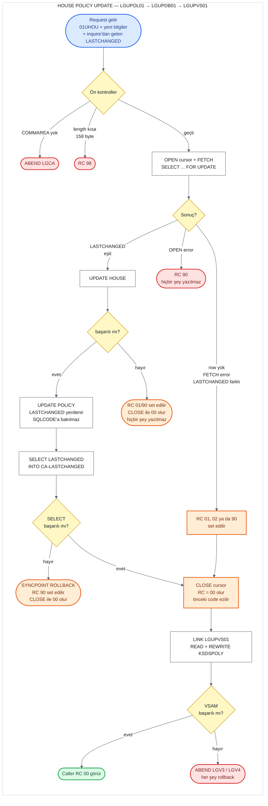

# UC-10 · House Policy Update

Var olan bir house (konut) policy'sinin bilgilerini Db2'deki `HOUSE` ve `POLICY` table'larında
ve `KSDSPOLY` VSAM dosyasında güncelleyen operasyon. Policy'nin, kullanıcı onu sorguladıktan
sonra başkası tarafından değiştirilip değiştirilmediğini `LASTCHANGED` timestamp'i ile
kontrol eder (optimistic locking). Dört policy tipi aynı programları kullandığı için bu belge
yalnızca house'a ait kısımları ve ortak kısımları anlatır; ortak kısımlar
[06-motor-update.md](06-motor-update.md) ile aynıdır. Bu belge, C# kodunu yazacak kişi için
eski sistemin davranışını satır satır tarif eder. Satır numaraları `base/src` altındaki
dosyalara aittir ve linkler ilgili satırı açar.

## Özet

| | |
|---|---|
| **Request ID** (`CA-REQUEST-ID`) | `01UHOU`. `LGUPOL01` length seçimi için kontrol eder; `LGUPDB01` tip table'ını seçmek için kullanır |
| **Entry program** | `LGUPOL01` (business layer) |
| **Call chain** | `LGUPOL01` → `LGUPDB01` → `LGUPVS01` |
| **Yazıldığı yerler** | Db2 `HOUSE` table, Db2 `POLICY` table, VSAM `KSDSPOLY` |
| **Output** | Yeni timestamp `CA-LASTCHANGED`'de, `CA-RETURN-CODE = '00'` |
| **Kodun set ettiği return code'lar** | `00`, `01`, `02`, `90`, `98`, `99`, `81`, `82` |
| **Caller'ın gördüğü return code'lar** | `00`, `90`, `98` (ve ABEND `LGCA`, `LGV3`, `LGV4`). `01`, `02` ve `99` set edilir ama caller'a ulaşmaz; bkz. "Return code'lar" |

## Flow

Turuncu kutular, kodun bir return code set ettiği ama bu code'un caller'a ulaşmadığı yerlerdir.

## Input (COMMAREA)

Menu 4 iki adımlıdır ([lgtestp3.cbl:155-214](../../base/src/lgtestp3.cbl#L155-L214)):

1. Screen önce `01IHOU` ile House Policy Inquire'ı call eder
   ([09-house-inquire.md](09-house-inquire.md)) ve gelen bilgileri ekrana yazar.
2. Kullanıcı bilgileri düzenleyip Enter'a basınca screen, **aynı COMMAREA** üzerinde aşağıdaki
   field'ları doldurur ve `LGUPOL01`'i call eder
   ([lgtestp3.cbl:183-199](../../base/src/lgtestp3.cbl#L183-L199)). `CA-POLICY-NUM` ve
   `CA-LASTCHANGED`'e dokunmaz; ikisi de 1. adımdaki inquire'dan kalır.

Screen bu iki adımı aynı task içinde yapar: `SEND MAP`'ten sonra `RECEIVE MAP` ile
kullanıcının cevabını bekler ([lgtestp3.cbl:175-181](../../base/src/lgtestp3.cbl#L175-L181)).
Bu bekleme sırasında Db2'de hiçbir lock tutulmaz.

| Field | Type | Gelen value | Kullanım |
|---|---|---|---|
| `CA-REQUEST-ID` | `X(6)` | `'01UHOU'` | `LGUPOL01`'de length, `LGUPDB01`'de tip table'ı seçimi |
| `CA-CUSTOMER-NUM` | `9(10)` | screen'den | Cursor'ın `WHERE`'i ve VSAM key |
| `CA-POLICY-NUM` | `9(10)` | inquire'dan | Cursor'ın `WHERE`'i, `HOUSE` update'inin `WHERE`'i ve VSAM key |
| `CA-LASTCHANGED` | `X(26)` | **inquire'dan, değiştirilmeden** | Db2'deki value ile karşılaştırılır |
| `CA-ISSUE-DATE`, `CA-EXPIRY-DATE` | `X(10)` | screen'den | `POLICY.ISSUEDATE`, `POLICY.EXPIRYDATE` |
| `CA-BROKERID` | `9(10)` | **her zaman `0`** | `POLICY.BROKERID` |
| `CA-BROKERSREF` | `X(10)` | **her zaman space** | `POLICY.BROKERSREFERENCE` |
| `CA-PAYMENT` | `9(6)` | **her zaman `0`** | Kullanılmaz; `PAYMENT` update edilmez |
| `CA-H-PROPERTY-TYPE` | `X(15)` | screen'den | `HOUSE.PROPERTYTYPE` ve VSAM |
| `CA-H-BEDROOMS` | `9(3)` | screen'den | `HOUSE.BEDROOMS` ve VSAM |
| `CA-H-VALUE` | `9(8)` | screen'den | `HOUSE.VALUE` ve VSAM |
| `CA-H-HOUSE-NAME` | `X(20)` | screen'den | `HOUSE.HOUSENAME`; VSAM'a ilk 9 karakteri |
| `CA-H-HOUSE-NUMBER` | `X(4)` | screen'den | `HOUSE.HOUSENUMBER`; VSAM'a yazılmaz |
| `CA-H-POSTCODE` | `X(8)` | screen'den | `HOUSE.POSTCODE` ve VSAM |

Minimum length, Add'deki gibi 28 + 130 = **158 byte**
([lgupol01.cbl:123-129](../../base/src/lgupol01.cbl#L123-L129)). House data'sı 158. byte'ta
bittiği için bu kontrol bütün house field'larını kapsar.

## Adım adım

| # | Program | Ne yapıyor | Kaynak |
|---:|---|---|---|
| 1 | `LGUPOL01` | COMMAREA hiç gelmediyse error log'a yazar ve `LGCA` koduyla ABEND eder. | [lgupol01.cbl:99-103](../../base/src/lgupol01.cbl#L99-L103) |
| 2 | `LGUPOL01` | `CA-RETURN-CODE = '00'` yapar. | [lgupol01.cbl:105](../../base/src/lgupol01.cbl#L105) |
| 3 | `LGUPOL01` | Request ID `'01UHOU'` ise gereken length 158 byte; daha kısaysa `'98'` ile return eder. Tanınmayan bir ID'de `'99'` yazar ama **return etmez** (madde 8). | [lgupol01.cbl:113-141](../../base/src/lgupol01.cbl#L113-L141) |
| 4 | `LGUPOL01` | `LGUPDB01`'i aynı COMMAREA ile `LINK` eder, dönünce return eder. | [lgupol01.cbl:143-160](../../base/src/lgupol01.cbl#L143-L160) |
| 5 | `LGUPDB01` | 1-2. adımları tekrarlar (ABEND `LGCA`, `'00'`). Customer ve policy number'larını Db2 integer'ına çevirir. | [lgupdb01.cbl:183-196](../../base/src/lgupdb01.cbl#L183-L196) |
| 6 | `LGUPDB01` | `POLICY_CURSOR`'ı açar. Cursor, customer number ve policy number'a göre `POLICY` row'unu `FOR UPDATE` ile seçer, yani row'u bu task için kilitler. `OPEN` başarısızsa (-913 dahil) `'90'`, error log ve hemen return; VSAM'a gidilmez. | [lgupdb01.cbl:128-143](../../base/src/lgupdb01.cbl#L128-L143), [253-270](../../base/src/lgupdb01.cbl#L253-L270) |
| 7 | `LGUPDB01` | `FETCH` ile row'u okur: issue date, expiry date, `LASTCHANGED`, broker ID, broker's reference. Row yoksa `'01'`, başka bir error'da `'90'` set eder ve 13. adıma atlar. | [lgupdb01.cbl:228-239](../../base/src/lgupdb01.cbl#L228-L239), [273](../../base/src/lgupdb01.cbl#L273), [349-358](../../base/src/lgupdb01.cbl#L349-L358) |
| 8 | `LGUPDB01` | `CA-LASTCHANGED`'i Db2'deki `LASTCHANGED` ile karşılaştırır. Farklıysa `'02'` set eder ve 13. adıma atlar; hiçbir table update edilmez. | [lgupdb01.cbl:278](../../base/src/lgupdb01.cbl#L278), [344-346](../../base/src/lgupdb01.cbl#L344-L346) |
| 9 | `LGUPDB01` | Eşitse `HOUSE` table'ını günceller: 6 house column'u, `WHERE POLICYNUMBER`. Row yoksa `'01'`, başka bir error'da `'90'` set eder ve error'u log'a yazar. | [lgupdb01.cbl:283-300](../../base/src/lgupdb01.cbl#L283-L300), [424-454](../../base/src/lgupdb01.cbl#L424-L454) |
| 10 | `LGUPDB01` | 9. adım `'00'` değilse cursor'ı kapatır ve return eder. `POLICY` ve VSAM'a gidilmez. | [lgupdb01.cbl:302-307](../../base/src/lgupdb01.cbl#L302-L307) |
| 11 | `LGUPDB01` | `POLICY` row'unu cursor üzerinden günceller (`WHERE CURRENT OF`): issue date, expiry date, broker ID, broker's reference ve `LASTCHANGED = CURRENT TIMESTAMP`. Bu `UPDATE`'in `SQLCODE`'u kontrol edilmez. | [lgupdb01.cbl:313-326](../../base/src/lgupdb01.cbl#L313-L326) |
| 12 | `LGUPDB01` | Yeni `LASTCHANGED`'i `SELECT` ile `CA-LASTCHANGED`'e okur. Bu `SELECT` başarısızsa `SYNCPOINT ROLLBACK` yapar, `'90'` set eder ve error'u log'a yazar. | [lgupdb01.cbl:328-342](../../base/src/lgupdb01.cbl#L328-L342) |
| 13 | `LGUPDB01` | `CLOSE-PCURSOR` ile cursor'ı kapatır. `CLOSE` başarılıysa `CA-RETURN-CODE = '00'` yapar. `CLOSE` -501 verirse (cursor zaten kapalı) yine `'00'` yapar ve return eder. Başka bir error'da `'90'` yapar ve return eder. | [lgupdb01.cbl:360-381](../../base/src/lgupdb01.cbl#L360-L381) |
| 14 | `LGUPDB01` → `LGUPVS01` | `LGUPVS01`'i `LENGTH(225)` ile call eder. O da `KSDSPOLY` record'unu `READ UPDATE` ile okur (başarısızsa `'81'` + ABEND `LGV3`), sonra property type, bedrooms, value, postcode ve house name'in ilk 9 karakteriyle `REWRITE` eder (başarısızsa `'82'` + ABEND `LGV4`). | [lgupdb01.cbl:209-212](../../base/src/lgupdb01.cbl#L209-L212), [lgupvs01.cbl:102-166](../../base/src/lgupvs01.cbl#L102-L166) |
| 15 | `LGUPDB01` | Caller'a return eder. | [lgupdb01.cbl:215-216](../../base/src/lgupdb01.cbl#L215-L216) |

## LASTCHANGED kontrolü

Kontrol ortak koddadır ve motor'la birebir aynı çalışır; ayrıntılı anlatım ve örnek senaryo
[06-motor-update.md](06-motor-update.md#lastchanged-kontrolü) belgesinde. Kısaca:

1. **Inquire** `LASTCHANGED`'in o anki value'sunu `CA-LASTCHANGED`'e koyar; screen bu value'yu
   değiştirmeden update'e gönderir.
2. **Update** row'u `FOR UPDATE` cursor'ıyla kilitleyip iki value'yu 26 byte'lık string olarak
   birebir karşılaştırır ([lgupdb01.cbl:278](../../base/src/lgupdb01.cbl#L278)).
3. **Eşitse** `HOUSE` ve `POLICY` güncellenir, `LASTCHANGED` yenilenir ve yeni value
   `CA-LASTCHANGED` ile geri döner ([lgupdb01.cbl:322](../../base/src/lgupdb01.cbl#L322),
   [329-334](../../base/src/lgupdb01.cbl#L329-L334)).
4. **Farklıysa** hiçbir table update edilmez ve `'02'` set edilir
   ([lgupdb01.cbl:346](../../base/src/lgupdb01.cbl#L346)).

**Eski sistemde `'02'` kullanıcıya ulaşmıyor.** `CLOSE-PCURSOR` cursor'ı başarıyla kapattığı
için return code'u `'00'` yapıyor ([lgupdb01.cbl:360](../../base/src/lgupdb01.cbl#L360),
[369-371](../../base/src/lgupdb01.cbl#L369-L371)). Ardından `LGUPVS01` VSAM record'unu
ikinci kullanıcının bilgileriyle yeniden yazıyor ve screen "House Policy Updated" gösteriyor.
Sonuç: Db2'de ilk kullanıcının bilgileri, VSAM'da ikincininkiler duruyor ve ikinci kullanıcı
değişikliğinin kaydedilmediğini bilmiyor. ADR 0002 karar 9 bu durumu bilinçli sapma olarak
kaydediyor: yeni sistem `409` / `"02"` döndürecek.

**Yeni sistemde.** Kontrol, `policy.last_changed` column'u üzerinde EF Core optimistic
locking ile yapılacak (ADR 0003, karar 3). Client inquire cevabındaki `lastChanged` değerini
değiştirmeden geri gönderir; koşullu `UPDATE` hiçbir row'u değiştirmezse
`DbUpdateConcurrencyException` oluşur ve bu `02` / 409'a çevrilir.

## Return code'lar

| Code | Koşul | Nerede set ediliyor | Caller ne görür |
|---|---|---|---|
| `00` | Her şey başarılı | [lgupdb01.cbl:190](../../base/src/lgupdb01.cbl#L190), [371](../../base/src/lgupdb01.cbl#L371) | `00`, yeni timestamp `CA-LASTCHANGED`'de |
| `98` | COMMAREA 158 byte'tan kısa | [lgupol01.cbl:126-129](../../base/src/lgupol01.cbl#L126-L129) | `98`. `LGUPDB01` call edilmez. Screen her zaman 32.500 byte gönderdiği için pratikte oluşmaz. |
| `90` | Cursor açılamadı (Db2 deadlock/timeout -913 dahil) | [lgupdb01.cbl:259-270](../../base/src/lgupdb01.cbl#L259-L270) | `90`. Hiçbir yere yazılmaz. |
| `02` | `LASTCHANGED` uyuşmuyor | [lgupdb01.cbl:344-346](../../base/src/lgupdb01.cbl#L344-L346) | **`00`.** Db2 güncellenmez ama VSAM record'u yeni bilgilerle yeniden yazılır. |
| `01` | `FETCH` row bulamadı: policy yok ya da customer number eşleşmiyor | [lgupdb01.cbl:351-352](../../base/src/lgupdb01.cbl#L351-L352) | `00`'a döner. Ardından VSAM `READ` normalde record'u bulamaz (key aynı customer ve policy number'dan oluşur) ve **ABEND `LGV3`** olur. |
| `90` | `FETCH` başka bir error verdi | [lgupdb01.cbl:353-357](../../base/src/lgupdb01.cbl#L353-L357) | **`00`.** Db2 güncellenmez; VSAM record'u varsa yeniden yazılır. |
| `01` / `90` | `HOUSE` update'i row bulamadı ya da error verdi | [lgupdb01.cbl:444-453](../../base/src/lgupdb01.cbl#L444-L453) | **`00`.** 10. adımda cursor kapatılırken ezilir; hiçbir yere yazılmamıştır. |
| `90` | `POLICY` update'inden sonraki `SELECT` başarısız | [lgupdb01.cbl:336-342](../../base/src/lgupdb01.cbl#L336-L342) | **`00`.** `SYNCPOINT ROLLBACK` cursor'ı da kapattığı için `CLOSE` -501 alır ve -501 `'00'` yapılır ([372-375](../../base/src/lgupdb01.cbl#L372-L375)). Her şey rollback edilmiştir. |
| `90` | `CLOSE` -501 dışında bir error verdi | [lgupdb01.cbl:376-379](../../base/src/lgupdb01.cbl#L376-L379) | `90`. VSAM'a gidilmez. Önceki Db2 update'leri rollback edilmez; screen update'te rollback yapmıyor. |
| `99` | Request ID tanınmadı | [lgupol01.cbl:139-140](../../base/src/lgupol01.cbl#L139-L140) | **`00`.** `LGUPOL01` return etmez; `LGUPDB01` başta `'00'` yazar ve devam eder (madde 8). |
| `81` | VSAM `READ` başarısız | [lgupvs01.cbl:147-153](../../base/src/lgupvs01.cbl#L147-L153) | ABEND `LGV3`. Db2 update'leri dahil her şey rollback edilir. |
| `82` | VSAM `REWRITE` başarısız | [lgupvs01.cbl:160-166](../../base/src/lgupvs01.cbl#L160-L166) | ABEND `LGV4`. Her şey rollback edilir. |
| — | COMMAREA hiç yok | [lgupol01.cbl:99-103](../../base/src/lgupol01.cbl#L99-L103) | ABEND `LGCA` |

Screen tarafı: `CA-RETURN-CODE > 0` ise "Error Updating House Policy" gösterir ve **rollback
yapmaz**. Başarılıysa "House Policy Updated" gösterir
([lgtestp3.cbl:200-214](../../base/src/lgtestp3.cbl#L200-L214),
[277-279](../../base/src/lgtestp3.cbl#L277-L279)). Add'deki hatanın aksine buradaki error
mesajı doğru alana (`ERP3FLDO`) yazılıyor ve ekranda görünüyor.

## Yazılan data

Yazma sırası: önce `HOUSE`, sonra `POLICY`, en son VSAM.

**Db2 `HOUSE` table** ([db2cre.jcl:240-252](../../base/cntl/db2cre.jcl#L240-L252)) — 6 house
column'unun hepsi request'teki value'larla değiştirilir, `WHERE POLICYNUMBER =
CA-POLICY-NUM` ([lgupdb01.cbl:431-442](../../base/src/lgupdb01.cbl#L431-L442)):

| Column | Yazılan value |
|---|---|
| `PROPERTYTYPE` | `CA-H-PROPERTY-TYPE` |
| `BEDROOMS` | `CA-H-BEDROOMS` (integer'a çevrilerek, [lgupdb01.cbl:427](../../base/src/lgupdb01.cbl#L427)) |
| `VALUE` | `CA-H-VALUE` (integer'a çevrilerek, [lgupdb01.cbl:428](../../base/src/lgupdb01.cbl#L428)) |
| `HOUSENAME` | `CA-H-HOUSE-NAME` |
| `HOUSENUMBER` | `CA-H-HOUSE-NUMBER` |
| `POSTCODE` | `CA-H-POSTCODE` |

**Db2 `POLICY` table** ([db2cre.jcl:161-176](../../base/cntl/db2cre.jcl#L161-L176)) — cursor'ın
kilitlediği row ([lgupdb01.cbl:318-326](../../base/src/lgupdb01.cbl#L318-L326)):

| Column | Yazılan value |
|---|---|
| `ISSUEDATE`, `EXPIRYDATE` | `CA-ISSUE-DATE`, `CA-EXPIRY-DATE` |
| `LASTCHANGED` | `CURRENT TIMESTAMP` |
| `BROKERID`, `BROKERSREFERENCE` | `CA-BROKERID`, `CA-BROKERSREF` (screen'den gelirse `0` ve space) |
| `PAYMENT`, `COMMISSION`, `POLICYTYPE`, `CUSTOMERNUMBER` | **Değişmez** ([lgupdb01.cbl:126-127](../../base/src/lgupdb01.cbl#L126-L127)) |

**VSAM `KSDSPOLY`** — key (`'H'` + customer number + policy number) ile okunan record'a
property type, bedrooms, value, postcode ve house name'in ilk 9 karakteri yeniden yazılır
([lgupvs01.cbl:120-125](../../base/src/lgupvs01.cbl#L120-L125),
[139-159](../../base/src/lgupvs01.cbl#L139-L159)). House number VSAM record'unda yok. Record
yapısı için bkz. [08-house-add.md](08-house-add.md).

## C#'a taşırken dikkat edilecek davranışlar

1. **Kodun set ettiği code'u döndür.** `CLOSE-PCURSOR`'ın return code'u ezmesi ADR 0002
   karar 9'da bilinçli sapma olarak kayıtlı: yeni sistem `02` için 409, `01` için 404, `90`
   için 500 döndürecek. ADR'de sayılan satırlar 346, 352 ve 354. Aynı ezilme iki yerde daha
   oluyor ve aynı ilkeyle ele alınmalı:
   - `HOUSE` update'i başarısız olunca ([lgupdb01.cbl:302-307](../../base/src/lgupdb01.cbl#L302-L307)).
   - `SYNCPOINT ROLLBACK`'ten sonraki -501 yolunda ([372-375](../../base/src/lgupdb01.cbl#L372-L375)).
2. **`POLICY` update'inin error'u kontrol edilmiyor.** 12. adımdaki `IF SQLCODE NOT EQUAL 0`,
   `UPDATE`'in değil ondan sonraki `SELECT`'in sonucuna bakıyor. `POLICY` update'i başarısız
   olur ama `SELECT` başarılı olursa:
   - `HOUSE` güncellenmiş, `POLICY` güncellenmemiş kalır.
   - `LASTCHANGED` yenilenmez.
   - Caller `00` görür.

   Örneğin geçersiz bir issue date bu duruma yol açar. Yeni sistemde iki update tek
   transaction'da olacağı için (ADR 0003) bu kısmi update oluşamaz. Geçersiz date'ler zaten
   API validation'ında 400 ile reddedilir.
3. **Policy tipi kontrol edilmiyor.** Cursor `POLICYTYPE`'a bakmıyor. `01UHOU` başka tipte
   bir policy number'ıyla gelirse ve `LASTCHANGED` eşleşirse, `HOUSE` update'i row bulamaz
   ve sonuç `01` olur (eski sistemde ezilip `00`). Screen'den bu duruma gelinemez, çünkü
   inquire adımı house olmayan bir policy'yi zaten `01` ile durduruyor. API'de ise mümkün;
   C# kodu policy'nin house olduğunu kontrol edip `01` / 404 döndürmeli.
4. **Update edilmeyen column'lar.** `PAYMENT` ve `COMMISSION` hiç update edilmiyor.
   `BROKERID` ve `BROKERSREFERENCE` ise gelen value ile eziliyor; screen bunları her zaman
   `0` ve space gönderiyor.
5. **Rollback davranışı.** Screen update hatasında `SYNCPOINT ROLLBACK` yapmıyor;
   `LGUPDB01` yalnızca 12. adımda kendisi rollback yapıyor. VSAM error'larında ise ABEND
   her şeyi geri alıyor. Yeni sistemde bunların karşılığı tek bir transaction.
6. **Timestamp birebir eşit olmalı.** Karşılaştırma 26 karakterlik string üzerinden
   yapılıyor. Yeni sistemde PostgreSQL mikrosaniye tuttuğu için C# tarafında üretilen
   timestamp mikrosaniyeye kırpılmalı; aksi halde client'a dönen value database'dekinden
   farklı olur ve sonraki update haksız yere `02` alır (ADR 0003, karar 3).
7. **Deadlock/timeout.** Cursor açılırken -913 `90` olarak dönüyor. Yeni sistemde `503` /
   `"90"` (ADR 0002, karar 8).
8. **Tanınmayan request ID `00`'a dönüyor.** `LGUPOL01` `99` yazıp return etmediği için
   `LGUPDB01` çalışıyor ve başta `'00'` yazıyor. `LASTCHANGED` eşleşirse tip table'ını
   seçemediği için onu atlayıp doğrudan `POLICY` update'ine geçiyor. Screen her zaman
   `01UHOU` gönderdiğinden bu durum oluşmuyor; yeni sistemde de operasyonu URL belirlediği
   için oluşamaz.
9. **VSAM record'u Db2'nin bir kopyası değil.** VSAM'a house name'in yalnızca ilk 9
   karakteri yazılıyor, house number hiç yazılmıyor. Yeni sistemde VSAM yok (ADR 0003);
   policy bilgisinin tek kaynağı database.
10. **Numeric field'lar.** `CA-H-BEDROOMS` (`9(3)`, en fazla 999) ve `CA-H-VALUE` (`9(8)`,
    en fazla 99.999.999) işaretsiz; Db2'de `SMALLINT` ve `INTEGER` olarak tutuluyor. Yeni
    sistemin validation'ı bu aralıkları korumalı.
