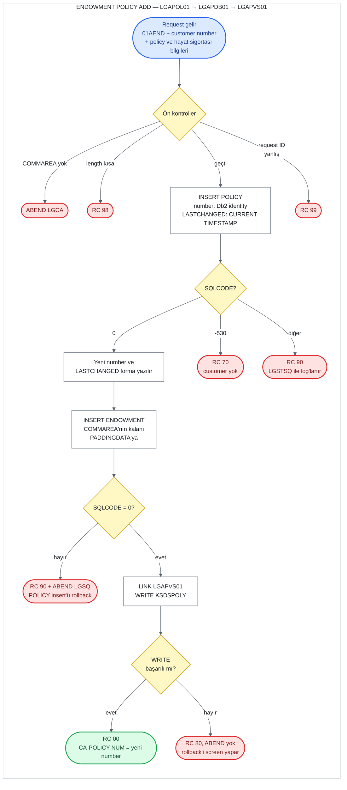

# UC-12 · Endowment Policy Add

Bir customer'a yeni bir endowment (hayat sigortası) policy'si ekleyen operasyon. Ortak policy
bilgilerini Db2'deki `POLICY` table'ına, hayat sigortası bilgilerini `ENDOWMENT` table'ına ve
kısaltılmış bir kopyasını `KSDSPOLY` VSAM dosyasına yazar. Dört policy tipi aynı programları
kullandığı için bu belge yalnızca endowment'a ait kısımları ve ortak kısımları anlatır; ortak
kısımlar [04-motor-add.md](04-motor-add.md) ile aynıdır. Bu belge, C# kodunu yazacak kişi için
eski sistemin davranışını satır satır tarif eder. Satır numaraları `base/src` altındaki
dosyalara aittir ve linkler ilgili satırı açar.

## Özet

| | |
|---|---|
| **Request ID** (`CA-REQUEST-ID`) | `01AEND`. `LGAPOL01` kontrol etmez; `LGAPDB01` kontrol eder ve tanımazsa `99` döner |
| **Entry program** | `LGAPOL01` (business layer) |
| **Call chain** | `LGAPOL01` → `LGAPDB01` → `LGAPVS01` |
| **Yazıldığı yerler** | Db2 `POLICY` table, Db2 `ENDOWMENT` table, VSAM `KSDSPOLY` |
| **Output** | Yeni policy number `CA-POLICY-NUM`'da, yeni timestamp `CA-LASTCHANGED`'de, `CA-RETURN-CODE = '00'` |
| **Olası return code'lar** | `00`, `70`, `80`, `90`, `98`, `99` (ve ABEND `LGCA`, `LGSQ`) |

## Flow

Ön kontroller: COMMAREA yoksa ABEND `LGCA`; COMMAREA 28 byte'tan (`LGAPOL01`) ya da 152
byte'tan (`LGAPDB01`) kısaysa `98`; request ID dört add kodundan biri değilse `99`.

## Input (COMMAREA)

Screen (`LGTESTP2`, menu 2) aşağıdaki field'ları doldurup `LGAPOL01`'i 32.500 byte'lık
COMMAREA ile call eder ([lgtestp2.cbl:90-108](../../base/src/lgtestp2.cbl#L90-L108)). Field
tanımları [lgcmarea.cpy](../../base/src/lgcmarea.cpy) içinde: ortak policy field'ları satır
37-43, endowment field'ları satır 46-54.

| Field | Type | Gelen value | Kullanım |
|---|---|---|---|
| `CA-REQUEST-ID` | `X(6)` | `'01AEND'` | `LGAPDB01`'de policy tipini (`'E'`) ve gereken length'i seçer |
| `CA-CUSTOMER-NUM` | `9(10)` | screen'den | `POLICY.CUSTOMERNUMBER`. Customer yoksa `70` |
| `CA-POLICY-NUM` | `9(10)` | screen set etmez | Yok sayılır; yeni number bunun üzerine yazılır |
| `CA-ISSUE-DATE` | `X(10)` | screen'den | `POLICY.ISSUEDATE` (Db2'de `DATE` type) |
| `CA-EXPIRY-DATE` | `X(10)` | screen'den | `POLICY.EXPIRYDATE` (Db2'de `DATE` type) |
| `CA-LASTCHANGED` | `X(26)` | screen set etmez | Input değil; insert'ten sonra yeni timestamp buraya yazılır |
| `CA-BROKERID` | `9(10)` | **her zaman `0`** | `POLICY.BROKERID` |
| `CA-BROKERSREF` | `X(10)` | **her zaman space** | `POLICY.BROKERSREFERENCE` |
| `CA-PAYMENT` | `9(6)` | **her zaman `0`** | `POLICY.PAYMENT` |
| `CA-E-WITH-PROFITS` | `X(1)` | screen'den | `ENDOWMENT.WITHPROFITS` |
| `CA-E-EQUITIES` | `X(1)` | screen'den | `ENDOWMENT.EQUITIES` |
| `CA-E-MANAGED-FUND` | `X(1)` | screen'den | `ENDOWMENT.MANAGEDFUND` |
| `CA-E-FUND-NAME` | `X(10)` | screen'den | `ENDOWMENT.FUNDNAME` |
| `CA-E-TERM` | `9(2)` | screen'den | `ENDOWMENT.TERM` (smallint) |
| `CA-E-SUM-ASSURED` | `9(6)` | screen'den | `ENDOWMENT.SUMASSURED` (integer) |
| `CA-E-LIFE-ASSURED` | `X(31)` | screen'den, **en fazla 25 karakter** | `ENDOWMENT.LIFEASSURED`. Screen alanı 25 karakter ([ssmap.bms:306](../../base/src/ssmap.bms#L306)) |
| `CA-E-PADDING-DATA` | `X(32348)` | screen set etmez | Bir kısmı `ENDOWMENT.PADDINGDATA`'ya yazılır; bkz. "PADDINGDATA" |

Üç evet/hayır field'ı (`WITHPROFITS`, `EQUITIES`, `MANAGEDFUND`) için hiçbir value kontrolü
yok; screen'de girilen tek karakter neyse o yazılır. COMMAREA'daki numeric field'lar
işaretsizdir (`PIC 9`), yani negatif bir value taşıyamaz.

**Length hesabı.** Policy operasyonlarının header'ı 28 byte'tır: request ID (6) + return
code (2) + customer number (10) + policy number (10). Endowment data'sı bundan sonra gelir:

| Byte | İçerik | Uzunluk |
|---|---|---:|
| 1-28 | Header ve policy number | 28 |
| 29-100 | Ortak policy field'ları (`CA-POLICY-COMMON`) | 72 |
| 101-152 | Endowment field'ları, with profits'ten life assured'a kadar | 52 |
| 153-32500 | `CA-E-PADDING-DATA` | 32.348 |

`LGAPDB01`'in istediği minimum length 28 + `WS-FULL-ENDOW-LEN` 124 = **152 byte**
([lgpolicy.cpy:24](../../base/src/lgpolicy.cpy#L24)). Bu sayı endowment field'larının hepsini
kapsar; padding data'yı kapsamaz.

## Adım adım

| # | Program | Ne yapıyor | Kaynak |
|---:|---|---|---|
| 1 | `LGAPOL01` | COMMAREA hiç gelmediyse (`EIBCALEN = 0`) error log'a yazar ve `LGCA` koduyla ABEND eder. | [lgapol01.cbl:98-102](../../base/src/lgapol01.cbl#L98-L102) |
| 2 | `LGAPOL01` | `CA-RETURN-CODE = '00'` yapar. | [lgapol01.cbl:105](../../base/src/lgapol01.cbl#L105) |
| 3 | `LGAPOL01` | COMMAREA 28 byte'tan kısaysa `'98'` ile return eder. Request ID'ye bakmaz. | [lgapol01.cbl:109-116](../../base/src/lgapol01.cbl#L109-L116) |
| 4 | `LGAPOL01` | `LGAPDB01`'i aynı COMMAREA ile 32.500 byte'lık length vererek `LINK` eder, dönünce hiçbir şeye bakmadan return eder. | [lgapol01.cbl:121-126](../../base/src/lgapol01.cbl#L121-L126) |
| 5 | `LGAPDB01` | 1-2. adımları tekrarlar (ABEND `LGCA`, `'00'`). | [lgapdb01.cbl:165-172](../../base/src/lgapdb01.cbl#L165-L172) |
| 6 | `LGAPDB01` | Request ID `'01AEND'` ise policy tipini `'E'` yapar ve gereken length'e 124 ekler. Tanımadığı bir request ID'de `'99'` ile return eder. | [lgapdb01.cbl:184-207](../../base/src/lgapdb01.cbl#L184-L207) |
| 7 | `LGAPDB01` | COMMAREA 152 byte'tan kısaysa `'98'` ile return eder. | [lgapdb01.cbl:210-213](../../base/src/lgapdb01.cbl#L210-L213) |
| 8 | `LGAPDB01` | `POLICY` table'ına `INSERT` yapar. Policy number'ı Db2 identity column'u generate eder (`DEFAULT`), `LASTCHANGED` = `CURRENT TIMESTAMP`. | [lgapdb01.cbl:261-288](../../base/src/lgapdb01.cbl#L261-L288) |
| 9 | `LGAPDB01` | `SQLCODE` -530 ise (foreign key: customer yok) `'70'`, başka bir error'da `'90'` yazar, error log'a yazar ve return eder. 10-15. adımlar çalışmaz. | [lgapdb01.cbl:290-305](../../base/src/lgapdb01.cbl#L290-L305) |
| 10 | `LGAPDB01` | Generate edilen number'ı `IDENTITY_VAL_LOCAL()` ile okuyup `CA-POLICY-NUM`'a yazar. | [lgapdb01.cbl:308-311](../../base/src/lgapdb01.cbl#L308-L311) |
| 11 | `LGAPDB01` | Yeni row'un `LASTCHANGED` value'sunu `SELECT` ile `CA-LASTCHANGED`'e okur. | [lgapdb01.cbl:316-321](../../base/src/lgapdb01.cbl#L316-L321) |
| 12 | `LGAPDB01` | Padding length'ini hesaplar: `EIBCALEN` − 152. Sonuç 0'dan büyükse `CA-E-PADDING-DATA`'nın o kadar byte'ını `WS-VARY-CHAR`'a taşır ve `PADDINGDATA` dahil 9 column'la `INSERT` yapar. Değilse `PADDINGDATA`'sız 8 column'la `INSERT` yapar. | [lgapdb01.cbl:327-387](../../base/src/lgapdb01.cbl#L327-L387) |
| 13 | `LGAPDB01` | `ENDOWMENT` insert'ü başarısızsa `'90'` yazar, error log'a yazar ve `LGSQ` koduyla ABEND eder. ABEND, 8. adımdaki `POLICY` insert'ünü de rollback eder. | [lgapdb01.cbl:389-395](../../base/src/lgapdb01.cbl#L389-L395) |
| 14 | `LGAPDB01` → `LGAPVS01` | `LGAPVS01`'i call eder; o da `KSDSPOLY`'ye 64 byte'lık bir record yazar. Başarısızsa `'80'` yazar ve return eder. **ABEND etmez.** | [lgapdb01.cbl:243-246](../../base/src/lgapdb01.cbl#L243-L246), [lgapvs01.cbl:135-147](../../base/src/lgapvs01.cbl#L135-L147) |
| 15 | `LGAPDB01` | Caller'a return eder. | [lgapdb01.cbl:250](../../base/src/lgapdb01.cbl#L250) |

## PADDINGDATA

`ENDOWMENT` table'ında diğer tiplerde olmayan bir column var: `PADDINGDATA VARCHAR(32606)`
([db2cre.jcl:212](../../base/cntl/db2cre.jcl#L212)). Programın yorumu, varchar'lı ve
varchar'sız iki `INSERT` olduğunu söylüyor
([lgapdb01.cbl:334-338](../../base/src/lgapdb01.cbl#L334-L338)). Column'a yazılan, COMMAREA'da
endowment field'larından sonra gelen alanın (`CA-E-PADDING-DATA`) bir kısmı. Screen bu alana
hiçbir şey yazmaz; içinde ne olduğu kaynak koddan belirlenemez.

**Kaç byte yazılıyor.**

1. Program padding length'ini `EIBCALEN − 152` ile hesaplar ve sonucu `WS-VARY-LEN`'e yazar
   ([lgapdb01.cbl:339-340](../../base/src/lgapdb01.cbl#L339-L340)). Screen 32.500 byte
   gönderdiği için sonuç **32.348**'dir.
2. `WS-VARY-LEN` `PIC S9(4) COMP` olarak tanımlı, yani 4 haneli; `WS-VARY-CHAR` ise yalnızca
   **3.900 byte** ([lgapdb01.cbl:70-72](../../base/src/lgapdb01.cbl#L70-L72)).
3. Sonuç derleyicinin `TRUNC` ayarına bağlı. Derleme ayarları `base/` içinde yok:
   - **`TRUNC(STD)`** (IBM Enterprise COBOL'un varsayılanı; GnuCOBOL'un varsayılanı da aynı
     davranır): 32.348, 4 haneye kırpılır ve **2.348** olur. `CA-E-PADDING-DATA`'nın ilk
     2.348 byte'ı `PADDINGDATA`'ya yazılır.
   - **`TRUNC(BIN)`**: 32.348 olduğu gibi kalır. `MOVE` 3.900 byte'lık alana 32.348 byte
     taşır ve working storage'ın arkasındaki alanların (Db2 host variable'ları dahil) üzerine
     yazar. Sonuç kaynak koddan belirlenemez.
4. Padding'siz `INSERT` yalnızca COMMAREA tam 152 byte ise çalışır; o zaman `PADDINGDATA`
   `NULL` kalır. Screen'den bu duruma gelinemez.

`PADDINGDATA`'yı yalnızca Inquire geri okur ve COMMAREA'ya koyar
([13-endowment-inquire.md](13-endowment-inquire.md)); screen bu veriyi göstermez, update onu
değiştirmez.

## Return code'lar

| Code | Koşul | Nerede set ediliyor | Caller ne görür |
|---|---|---|---|
| `00` | Her şey başarılı | [lgapdb01.cbl:172](../../base/src/lgapdb01.cbl#L172), [293](../../base/src/lgapdb01.cbl#L293) | Yeni number `CA-POLICY-NUM`'da, timestamp `CA-LASTCHANGED`'de |
| `70` | `POLICY` insert'ü -530 verdi: `CA-CUSTOMER-NUM` `CUSTOMER` table'ında yok | [lgapdb01.cbl:295-298](../../base/src/lgapdb01.cbl#L295-L298) | `70`. Hiçbir yere yazılmaz. Screen'de mesaj görünmez (aşağıya bakın). |
| `90` | `POLICY` insert'ü başka bir error verdi (örneğin geçersiz date, Db2 deadlock/timeout -913) | [lgapdb01.cbl:300-303](../../base/src/lgapdb01.cbl#L300-L303) | `90`. Hiçbir yere yazılmaz. Error `LGSTSQ` ile log'lanır. |
| `90` | `ENDOWMENT` insert'ü başarısız | [lgapdb01.cbl:389-395](../../base/src/lgapdb01.cbl#L389-L395) | **Görmez.** `'90'` yazıldıktan hemen sonra `LGSQ` ile ABEND olur; `POLICY` insert'ü dahil her şey rollback edilir. |
| `80` | `KSDSPOLY`'ye `WRITE` başarısız | [lgapvs01.cbl:142-147](../../base/src/lgapvs01.cbl#L142-L147) | `80`. Db2'deki iki insert **bu noktada hâlâ duruyor**; onları screen'in `SYNCPOINT ROLLBACK`'i geri alır. `CA-POLICY-NUM`'da geri alınan number kalır. |
| `98` | COMMAREA 28 byte'tan (`LGAPOL01`) ya da 152 byte'tan (`LGAPDB01`) kısa | [lgapol01.cbl:113-116](../../base/src/lgapol01.cbl#L113-L116), [lgapdb01.cbl:210-213](../../base/src/lgapdb01.cbl#L210-L213) | `98`. Screen her zaman 32.500 byte gönderdiği için pratikte oluşmaz. |
| `99` | Request ID dört add kodundan biri değil | [lgapdb01.cbl:202-205](../../base/src/lgapdb01.cbl#L202-L205) | `99`. Hiçbir yere yazılmaz. |
| — | COMMAREA hiç yok | [lgapol01.cbl:98-102](../../base/src/lgapol01.cbl#L98-L102) | ABEND `LGCA` |

**Screen tarafı ve mesaj hatası.** `CA-RETURN-CODE > 0` ise screen `SYNCPOINT ROLLBACK` yapar
ve `NO-ADD`'e gider ([lgtestp2.cbl:109-112](../../base/src/lgtestp2.cbl#L109-L112)). `NO-ADD`
code `70` için "Customer does not exist", diğer code'lar için "Error Adding Life Policy"
yazar, ama bu mesajları endowment ekranının alanına (`ERP2FLDO`) değil **motor ekranının
alanına (`ERP1FLDO`)** yazar ([lgtestp2.cbl:268-276](../../base/src/lgtestp2.cbl#L268-L276)).
Ardından ekrana endowment map'i (`SSMAPP2`) gönderilir
([lgtestp2.cbl:290-294](../../base/src/lgtestp2.cbl#L290-L294)), yani kullanıcı ekleme
başarısız olduğunda **hiçbir hata mesajı görmez**. House ekranında da aynı hata var
([08-house-add.md](08-house-add.md)). Başarılıysa customer number'ı, yeni policy number'ı,
fund name'i ve "New Life Policy Inserted" mesajını gösterir
([lgtestp2.cbl:113-123](../../base/src/lgtestp2.cbl#L113-L123)).

## Yazılan data

**Db2 `POLICY` table** ([db2cre.jcl:161-176](../../base/cntl/db2cre.jcl#L161-L176)) — Motor
Add ile aynı column'lar yazılır ([04-motor-add.md](04-motor-add.md), "Yazılan data");
tek fark `POLICYTYPE` = `'E'` ([lgapdb01.cbl:188](../../base/src/lgapdb01.cbl#L188)).

**Db2 `ENDOWMENT` table** ([db2cre.jcl:203-218](../../base/cntl/db2cre.jcl#L203-L218)) — key
`POLICYNUMBER`, `POLICY`'ye foreign key ile bağlı (`ON DELETE CASCADE`)
([lgapdb01.cbl:346-366](../../base/src/lgapdb01.cbl#L346-L366)):

| Column | Type | Yazılan value |
|---|---|---|
| `POLICYNUMBER` | `INTEGER` | 10. adımda okunan yeni number |
| `WITHPROFITS` | `CHAR(1)` | `CA-E-WITH-PROFITS` |
| `EQUITIES` | `CHAR(1)` | `CA-E-EQUITIES` |
| `MANAGEDFUND` | `CHAR(1)` | `CA-E-MANAGED-FUND` |
| `FUNDNAME` | `CHAR(10)` | `CA-E-FUND-NAME` |
| `TERM` | `SMALLINT` | `CA-E-TERM` |
| `SUMASSURED` | `INTEGER` | `CA-E-SUM-ASSURED` |
| `LIFEASSURED` | `CHAR(31)` | `CA-E-LIFE-ASSURED` |
| `PADDINGDATA` | `VARCHAR(32606)` | `CA-E-PADDING-DATA`'nın bir kısmı (bkz. "PADDINGDATA") |

**VSAM `KSDSPOLY`** ([adef121.jcl:40-52](../../base/cntl/adef121.jcl#L40-L52)) — 64 byte'lık
fixed-length record, key ilk 21 byte. Endowment record'u bazı field'ların kopyasını taşır
([lgapvs01.cbl:35-40](../../base/src/lgapvs01.cbl#L35-L40),
[110-115](../../base/src/lgapvs01.cbl#L110-L115)):

| Byte | İçerik |
|---|---|
| 1 | `'E'` (request ID'nin 4. karakteri) |
| 2-11 | Customer number |
| 12-21 | Policy number |
| 22-64 | With profits (1), equities (1), managed fund (1), fund name (10), life assured'ın **ilk 30 karakteri** (30) |

Term, sum assured ve policy date'leri VSAM'a yazılmaz; life assured 31 karakterden 30'a
kırpılır. Dosya `LOG(UNDO)` ile tanımlı; transaction rollback edilirse bu write da rollback
edilir.

## C#'a taşırken dikkat edilecek davranışlar

1. **Rollback üç farklı yoldan geliyor.**
   - `POLICY` insert'ü başarısızsa geri alınacak bir şey yok.
   - `ENDOWMENT` insert'ü başarısızsa program kendisi ABEND eder.
   - VSAM write'ı başarısızsa program `'80'` ile normal return eder; `POLICY` ve `ENDOWMENT`
     row'larını screen'in `SYNCPOINT ROLLBACK`'i geri alır.

   Yeni sistemde iki insert aynı transaction'da olduğu için bu dağınık yapının karşılığı
   tek bir rollback'tir (ADR 0003, karar 2). VSAM olmadığı için `80` oluşmaz.
2. **`PADDINGDATA` iş verisi değil.** Column, COMMAREA'nın kullanılmayan kısmından gelen ve
   kullanıcının hiç görmediği bir veriyi tutuyor; ne kadarının yazıldığı derleyici ayarına
   bağlı. API tasarımında bu alan yok ([api-design.md](../../docs/api-design.md), 2.4); yeni
   şemada column `varchar(32606)` olarak duruyor
   ([database-schema.md](../../docs/database-schema.md)). C# kodunun bu column'a ne yazacağına
   (önerim: `NULL`) ekipçe karar verilmeli. Eşdeğerlik testleri bu alanı karşılaştıramaz.
3. **Screen ekleme hatalarını göstermiyor.** `NO-ADD` mesajı yanlış map'in alanına yazıyor;
   `70` ve diğer hatalarda kullanıcı mesaj görmüyor. Bu yalnızca screen'in davranışı; caller'a
   dönen return code doğru. Yeni sistemde web arayüzü `70` için "customer yok" mesajını
   göstermeli.
4. **Customer'ın varlığı önceden kontrol edilmiyor.** Kontrolü `POLICY`'nin foreign key'i
   yapıyor; -530 `70`'e çevriliyor.
5. **Sıra `POLICY` → `ENDOWMENT` → VSAM.** `ENDOWMENT` row'u için `POLICY`'de generate edilen
   number gerekiyor; C#'ta iki ayrı `SaveChanges` ve explicit transaction gerekir (ADR 0003,
   karar 2).
6. **Input validation yok.** Date yalnızca `POLICY` insert'ünde Db2 tarafından kontrol
   ediliyor (geçersizse `90`). Evet/hayır field'ları herhangi bir karakter alabiliyor; term
   `0` ya da expiry date issue date'ten önce olabilir. ADR 0002 karar 9'a göre eski kodun
   tutarlı biçimde uyguladığı kurallar korunur; bu alanlar için ayrı bir sapma kararı yok.
7. **Life assured screen'de 25, COMMAREA'da ve Db2'de 31 karakter.** API 31 karakteri kabul
   etmeli; 25 sınırı yalnızca eski screen'e ait.
8. **Kontrol edilmeyen iki SQL.** `IDENTITY_VAL_LOCAL()` ve `SELECT LASTCHANGED` sonrasında
   `SQLCODE`'a bakılmıyor ([lgapdb01.cbl:308-321](../../base/src/lgapdb01.cbl#L308-L321)).
9. **Screen broker ve payment field'larını sabit gönderiyor.** `BROKERID = 0`,
   `BROKERSREFERENCE` space, `PAYMENT = 0`. `COMMISSION` column'u hiç yazılmıyor.
10. **Customer number 9 haneye kırpılıyor.** `CA-CUSTOMER-NUM` 10 haneli ama Db2'ye
    `PIC S9(9) COMP` alanla gidiyor ([lgapdb01.cbl:90](../../base/src/lgapdb01.cbl#L90),
    [176](../../base/src/lgapdb01.cbl#L176)); en soldaki hane kesilir. ADR 0002 karar 9'a
    göre yeni sistem numarayı kesmez.
11. **VSAM kopyası eksik.** Term ve sum assured yazılmıyor, life assured 30 karaktere
    kırpılıyor. Yeni sistemde VSAM olmadığı için (ADR 0003) bunun karşılığı yok.
12. **Policy number'larında boşluk oluşabilir.** Rollback edilen bir insert'ün aldığı number
    geri verilmez; identity column ayrıca 20'şerlik cache kullanıyor.
