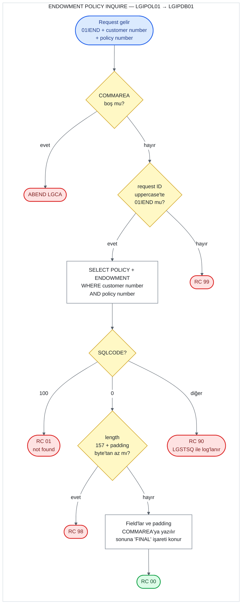

# UC-13 · Endowment Policy Inquire

Customer number'ı ve policy number'ı verilen bir endowment (hayat sigortası) policy'sinin
bilgilerini Db2'deki `POLICY` ve `ENDOWMENT` table'larını birleştirerek okuyan operasyon.
Hiçbir yere yazmaz; VSAM dosyasını da okumaz. Dört policy tipi aynı programları kullandığı
için bu belge yalnızca endowment'a ait kısımları ve ortak kısımları anlatır; ortak kısımlar
[05-motor-inquire.md](05-motor-inquire.md) ile aynıdır. Bu belge, C# kodunu yazacak kişi için
eski sistemin davranışını satır satır tarif eder. Satır numaraları `base/src` altındaki
dosyalara aittir ve linkler ilgili satırı açar.

## Özet

| | |
|---|---|
| **Request ID** (`CA-REQUEST-ID`) | `01IEND`. `LGIPOL01` kontrol etmez; `LGIPDB01` uppercase'e çevirip kontrol eder ve tanımazsa `99` döner |
| **Entry program** | `LGIPOL01` (business layer) |
| **Call chain** | `LGIPOL01` → `LGIPDB01` |
| **Okunduğu yer** | Db2 `POLICY` ve `ENDOWMENT` table'larının join'i (write yok) |
| **Output** | Ortak policy field'ları, 7 endowment field'ı ve padding data COMMAREA'da, `CA-RETURN-CODE = '00'` |
| **Olası return code'lar** | `00`, `01`, `90`, `98`, `99` (ve ABEND `LGCA`) |

## Flow

## Input (COMMAREA)

Screen (`LGTESTP2`) bu operasyonu iki yerden call eder: menu 1 (sorgula) ve menu 4'ün ilk
adımı (güncellemeden önce mevcut bilgileri getirmek). İkisinde de yalnızca üç field
doldurulur ([lgtestp2.cbl:63-70](../../base/src/lgtestp2.cbl#L63-L70),
[155-162](../../base/src/lgtestp2.cbl#L155-L162)).

| Field | Type | Gelen value | Kullanım |
|---|---|---|---|
| `CA-REQUEST-ID` | `X(6)` | `'01IEND'` | `LGIPDB01`'de endowment dalını seçer |
| `CA-CUSTOMER-NUM` | `9(10)` | screen'den | `WHERE POLICY.CUSTOMERNUMBER = ...` |
| `CA-POLICY-NUM` | `9(10)` | screen'den | `WHERE POLICY.POLICYNUMBER = ...` |

Diğer bütün field'lar input olarak kullanılmaz; output için doldurulur.

## Adım adım

| # | Program | Ne yapıyor | Kaynak |
|---:|---|---|---|
| 1 | `LGIPOL01` | COMMAREA hiç gelmediyse (`EIBCALEN = 0`) error log'a yazar ve `LGCA` koduyla ABEND eder. | [lgipol01.cbl:79-83](../../base/src/lgipol01.cbl#L79-L83) |
| 2 | `LGIPOL01` | `CA-RETURN-CODE = '00'` yapar. Length'e de request ID'ye de bakmaz. | [lgipol01.cbl:86](../../base/src/lgipol01.cbl#L86) |
| 3 | `LGIPOL01` | `LGIPDB01`'i aynı COMMAREA ile `LINK` eder, dönünce hiçbir şeye bakmadan return eder. | [lgipol01.cbl:91-96](../../base/src/lgipol01.cbl#L91-L96) |
| 4 | `LGIPDB01` | 1-2. adımları tekrarlar (ABEND `LGCA`, `'00'`). | [lgipdb01.cbl:251-258](../../base/src/lgipdb01.cbl#L251-L258) |
| 5 | `LGIPDB01` | Customer ve policy number'larını Db2 integer'ına çevirir. | [lgipdb01.cbl:263-264](../../base/src/lgipdb01.cbl#L263-L264) |
| 6 | `LGIPDB01` | Request ID'nin uppercase halini bir değişkene alır ve ona göre dal seçer: `'01IEND'` endowment dalına gider, tanınmayan bir ID `'99'` olur. | [lgipdb01.cbl:275-310](../../base/src/lgipdb01.cbl#L275-L310) |
| 7 | `LGIPDB01` | `POLICY` ile `ENDOWMENT`'ı `POLICYNUMBER` üzerinden join eder ve customer number + policy number ile tek row okur: 6 ortak policy column'u, 7 endowment column'u, `PADDINGDATA` ve `LENGTH(PADDINGDATA)`. | [lgipdb01.cbl:327-368](../../base/src/lgipdb01.cbl#L327-L368) |
| 8 | `LGIPDB01` | Row bulunduysa gereken length'i hesaplar: 33 + 124 = 157 byte; `PADDINGDATA` `NULL` değilse onun length'ini de ekler. COMMAREA daha kısaysa `'98'` ile return eder. | [lgipdb01.cbl:374-392](../../base/src/lgipdb01.cbl#L374-L392) |
| 9 | `LGIPDB01` | Integer column'ları COMMAREA'nın numeric field'larına çevirir. `NULL` gelen broker ID ve payment'ı atlar. Ortak policy field'larını, endowment field'larını ve (`NULL` değilse) padding data'yı COMMAREA'ya yazar. | [lgipdb01.cbl:397-413](../../base/src/lgipdb01.cbl#L397-L413) |
| 10 | `LGIPDB01` | Policy data'sının bittiği yeri işaretlemek için padding data'nın hemen arkasına 5 byte'lık `'FINAL'` yazar. | [lgipdb01.cbl:417](../../base/src/lgipdb01.cbl#L417) |
| 11 | `LGIPDB01` | Row bulunamadıysa (`SQLCODE = 100`) `'01'`, başka bir error'da `'90'` yazar ve error'u log'a yazar. | [lgipdb01.cbl:419-431](../../base/src/lgipdb01.cbl#L419-L431) |
| 12 | `LGIPDB01` | Caller'a return eder. | [lgipdb01.cbl:312-313](../../base/src/lgipdb01.cbl#L312-L313) |

**Length nereden geliyor.** `WS-CA-HEADERTRAILER-LEN` 33 byte'tır
([lgipdb01.cbl:73](../../base/src/lgipdb01.cbl#L73)): 28 byte'lık header ve 5 byte'lık
`'FINAL'` işareti. Buna `WS-FULL-ENDOW-LEN` 124 eklenir
([lgpolicy.cpy:24](../../base/src/lgpolicy.cpy#L24)) ve 157 olur. Endowment field'ları 152.
byte'ta biter; padding data 153. byte'tan başlar ve `'FINAL'` onun hemen arkasına yazılır
(`END-POLICY-POS` = 1 + padding length,
[lgipdb01.cbl:78](../../base/src/lgipdb01.cbl#L78),
[385](../../base/src/lgipdb01.cbl#L385)). Yani kontrol yazılan alanın tamamını kapsar.

Örnek: Add `TRUNC(STD)` ile derlenmişse padding 2.348 byte'tır
([12-endowment-add.md](12-endowment-add.md), "PADDINGDATA"). Gereken length 157 + 2.348 =
2.505 byte olur, `'FINAL'` 2.501-2.505. byte'lara yazılır. Screen 32.500 byte gönderdiği için
`98` oluşmaz. Padding 32.348 byte olsaydı gereken length 32.505 olur ve 32.500 byte'lık bir
COMMAREA ile her inquire `98` dönerdi.

## Output (COMMAREA)

Başarılı (`'00'`) bir query'den sonra dolu gelen field'lar:

| Field | Type | Kaynak column | Not |
|---|---|---|---|
| `CA-ISSUE-DATE` | `X(10)` | `POLICY.ISSUEDATE` | Db2 `DATE`, string olarak döner |
| `CA-EXPIRY-DATE` | `X(10)` | `POLICY.EXPIRYDATE` | |
| `CA-LASTCHANGED` | `X(26)` | `POLICY.LASTCHANGED` | Db2'nin 26 karakterlik timestamp string'i. Update'te değiştirilmeden geri gönderilir |
| `CA-BROKERID` | `9(10)` | `POLICY.BROKERID` | Column `NULL` ise `0` |
| `CA-BROKERSREF` | `X(10)` | `POLICY.BROKERSREFERENCE` | Column `NULL` ise space |
| `CA-PAYMENT` | `9(6)` | `POLICY.PAYMENT` | Column `NULL` ise `0` |
| `CA-E-WITH-PROFITS` | `X(1)` | `ENDOWMENT.WITHPROFITS` | |
| `CA-E-EQUITIES` | `X(1)` | `ENDOWMENT.EQUITIES` | |
| `CA-E-MANAGED-FUND` | `X(1)` | `ENDOWMENT.MANAGEDFUND` | |
| `CA-E-FUND-NAME` | `X(10)` | `ENDOWMENT.FUNDNAME` | |
| `CA-E-TERM` | `9(2)` | `ENDOWMENT.TERM` | |
| `CA-E-SUM-ASSURED` | `9(6)` | `ENDOWMENT.SUMASSURED` | |
| `CA-E-LIFE-ASSURED` | `X(31)` | `ENDOWMENT.LIFEASSURED` | |
| `CA-E-PADDING-DATA(1:n)` | `X(n)` | `ENDOWMENT.PADDINGDATA` | `n` = column'un length'i. Column `NULL` ise yazılmaz |
| `CA-E-PADDING-DATA(n+1:5)` | `X(5)` | — | Sabit `'FINAL'` |
| `CA-RETURN-CODE` | `9(2)` | — | `00` |

`CA-CUSTOMER-NUM` ve `CA-POLICY-NUM` değişmez. `POLICY.POLICYTYPE` ve `POLICY.COMMISSION`
okunmaz.

## Return code'lar

| Code | Koşul | Nerede set ediliyor | Caller ne görür |
|---|---|---|---|
| `00` | Row bulundu | [lgipdb01.cbl:258](../../base/src/lgipdb01.cbl#L258) | Field'lar dolu |
| `01` | Row yok (`SQLCODE = 100`): policy number yok, customer number policy'ninkiyle eşleşmiyor ya da policy endowment değil (`ENDOWMENT`'ta row'u yok) | [lgipdb01.cbl:421-423](../../base/src/lgipdb01.cbl#L421-L423) | Screen "No data was returned." gösterir |
| `90` | Diğer her `SQLCODE`. Db2 deadlock/timeout (-913) ve endowment column'larından birinin (padding hariç) `NULL` olması da buraya düşer | [lgipdb01.cbl:424-429](../../base/src/lgipdb01.cbl#L424-L429) | Error `LGSTSQ` ile log'lanır; screen aynı "No data was returned." mesajını gösterir |
| `98` | Row bulundu ama COMMAREA 157 + padding length'inden kısa | [lgipdb01.cbl:390-392](../../base/src/lgipdb01.cbl#L390-L392) | `98` |
| `99` | Request ID tanınmadı | [lgipdb01.cbl:307-308](../../base/src/lgipdb01.cbl#L307-L308) | `99` |
| — | COMMAREA hiç yok | [lgipol01.cbl:79-83](../../base/src/lgipol01.cbl#L79-L83) | ABEND `LGCA` |

Screen tarafı: `CA-RETURN-CODE > 0` ise code'un ne olduğuna bakmadan "No data was returned."
gösterir ([lgtestp2.cbl:71-73](../../base/src/lgtestp2.cbl#L71-L73),
[286-288](../../base/src/lgtestp2.cbl#L286-L288)). Menu 4'te bu durumda güncelleme adımına
hiç geçilmez. Başarılıysa 9 alanı ekrana yazar; padding data'yı göstermez
([lgtestp2.cbl:75-87](../../base/src/lgtestp2.cbl#L75-L87)).

## Okunan data

**Db2 `POLICY`** ([db2cre.jcl:161-176](../../base/cntl/db2cre.jcl#L161-L176)) ve
**`ENDOWMENT`** ([db2cre.jcl:203-218](../../base/cntl/db2cre.jcl#L203-L218)) table'ları,
inner join ile. `KSDSPOLY` VSAM dosyası bu operasyonda hiç okunmaz; policy bilgisinin tek
kaynağı Db2.

## C#'a taşırken dikkat edilecek davranışlar

1. **Policy tipi join ile kontrol ediliyor.** Query `POLICYTYPE`'a bakmıyor; `ENDOWMENT`'la
   inner join yaptığı için endowment olmayan bir policy number'ı row döndürmez ve sonuç `01`
   olur. Customer number da eşleşmek zorunda: başka bir customer'ın policy'si `01` döner.
2. **Padding data API'de yok.** COMMAREA'da dönen padding data'nın API tasarımında karşılığı
   yok ([api-design.md](../../docs/api-design.md), 2.4) ve screen de onu göstermiyor. Cevap
   yalnızca ortak policy field'larını ve 7 endowment field'ını taşımalı. `98`'in padding'e
   bağlı hali de yeni sistemde oluşmaz.
3. **Deadlock/timeout `90`.** Customer Inquire'ın aksine -913 `01` sayılmıyor, genel error
   olarak `90` dönüyor. Yeni sistemde `503` / `"90"` döner (ADR 0002, karar 8).
4. **`NULL` davranışı column'a göre değişiyor.** `BROKERID`, `BROKERSREFERENCE`, `PAYMENT` ve
   `PADDINGDATA` için indicator variable var: `NULL` ise `0`, space ya da hiç yazılmaz
   ([lgipdb01.cbl:349-360](../../base/src/lgipdb01.cbl#L349-L360),
   [397-413](../../base/src/lgipdb01.cbl#L397-L413)). Diğer endowment column'larının hepsi
   Db2'de `NULL` olabildiği halde indicator'ları yok; biri `NULL` ise Db2 error verir ve sonuç
   `90` olur. Add her column'u doldurduğu için pratikte sorun çıkmaz.
5. **Length, query'den sonra kontrol ediliyor.** Kısa bir COMMAREA ile gelen request de
   Db2'ye gidiyor; `98` ancak row bulunduktan sonra veriliyor.
6. **`'FINAL'` işareti** COMMAREA'ya özgü bir "data burada bitti" işareti; padding'in
   length'ine göre yeri değişiyor. API cevabında karşılığı yok.
7. **Not found olunca field'lar temizlenmiyor.** `'01'` ya da `'90'` durumunda COMMAREA'daki
   policy field'larına dokunulmuyor; içlerinde caller'ın gönderdiği ne varsa kalıyor.
   Sadece return code güvenilir.
8. **Request ID küçük harfle de kabul ediliyor.** `LGIPDB01` karşılaştırmadan önce uppercase'e
   çeviriyor (`01iend` çalışır). `LGIPOL01` ise ne length'e ne request ID'ye bakıyor.
9. **Numeric field'lar işaretsiz ve kısa.** `CA-E-TERM` `9(2)` (en fazla 99),
   `CA-E-SUM-ASSURED` `9(6)` (en fazla 999.999). Db2'de `SMALLINT` ve `INTEGER` olduğu için
   daha büyük ya da negatif bir value COMMAREA'ya taşınırken kırpılır ya da işaretini
   kaybeder.
