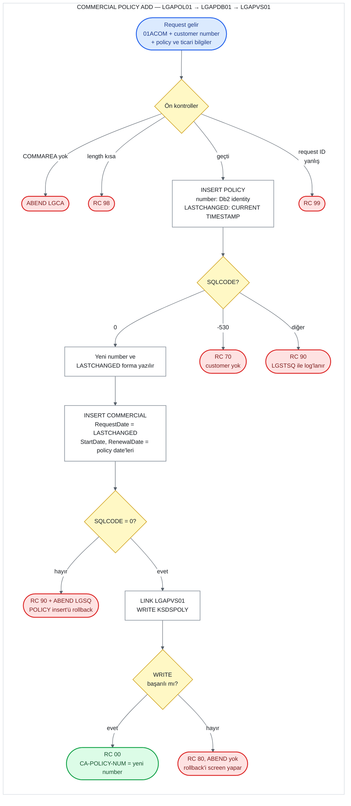

# UC-16 · Commercial Policy Add

Bir customer'a yeni bir commercial (ticari) policy ekleyen operasyon. Ortak policy bilgilerini
Db2'deki `POLICY` table'ına, ticari bilgileri `COMMERCIAL` table'ına ve kısaltılmış bir
kopyasını `KSDSPOLY` VSAM dosyasına yazar. Dört policy tipi aynı programları kullandığı için bu
belge yalnızca commercial'a ait kısımları ve ortak kısımları anlatır; ortak kısımlar
[04-motor-add.md](04-motor-add.md) ile aynıdır. Eski sistemde ticari policy için update
operasyonu yoktur; bkz. "Commercial update'i yok". Bu belge, C# kodunu yazacak kişi için eski
sistemin davranışını satır satır tarif eder. Satır numaraları `base/src` altındaki dosyalara
aittir ve linkler ilgili satırı açar.

## Özet

| | |
|---|---|
| **Request ID** (`CA-REQUEST-ID`) | `01ACOM`. `LGAPOL01` kontrol etmez; `LGAPDB01` kontrol eder ve tanımazsa `99` döner |
| **Entry program** | `LGAPOL01` (business layer) |
| **Call chain** | `LGAPOL01` → `LGAPDB01` → `LGAPVS01` |
| **Yazıldığı yerler** | Db2 `POLICY` table, Db2 `COMMERCIAL` table, VSAM `KSDSPOLY` |
| **Output** | Yeni policy number `CA-POLICY-NUM`'da, yeni timestamp `CA-LASTCHANGED`'de, `CA-RETURN-CODE = '00'` |
| **Olası return code'lar** | `00`, `70`, `80`, `90`, `98`, `99` (ve ABEND `LGCA`, `LGSQ`) |

## Flow

Ön kontroller: COMMAREA yoksa ABEND `LGCA`; COMMAREA 28 byte'tan (`LGAPOL01`) ya da 1.202
byte'tan (`LGAPDB01`) kısaysa `98`; request ID dört add kodundan biri değilse `99`.

## Input (COMMAREA)

Screen (`LGTESTP4`, menu 2) aşağıdaki field'ları doldurup `LGAPOL01`'i 32.500 byte'lık
COMMAREA ile call eder ([lgtestp4.cbl:156-181](../../base/src/lgtestp4.cbl#L156-L181)). Field
tanımları [lgcmarea.cpy](../../base/src/lgcmarea.cpy) içinde: ortak policy field'ları satır
37-43, commercial field'ları satır 77-94.

| Field | Type | Gelen value | Kullanım |
|---|---|---|---|
| `CA-REQUEST-ID` | `X(6)` | `'01ACOM'` | `LGAPDB01`'de policy tipini (`'C'`) ve gereken length'i seçer |
| `CA-CUSTOMER-NUM` | `9(10)` | screen'den | `POLICY.CUSTOMERNUMBER`. Customer yoksa `70` |
| `CA-POLICY-NUM` | `9(10)` | screen set etmez | Yok sayılır; yeni number bunun üzerine yazılır |
| `CA-ISSUE-DATE` | `X(10)` | screen'den ("Start date") | `POLICY.ISSUEDATE` **ve** `COMMERCIAL.STARTDATE` |
| `CA-EXPIRY-DATE` | `X(10)` | screen'den ("Expiry date") | `POLICY.EXPIRYDATE` **ve** `COMMERCIAL.RENEWALDATE` |
| `CA-LASTCHANGED` | `X(26)` | screen set etmez | Input değil; `POLICY` insert'ünden sonra yeni timestamp buraya yazılır ve aynı value `COMMERCIAL.REQUESTDATE`'e gider |
| `CA-BROKERID` | `9(10)` | **screen set etmez** | `POLICY.BROKERID`. Bkz. aşağıdaki not |
| `CA-BROKERSREF` | `X(10)` | **screen set etmez** | `POLICY.BROKERSREFERENCE` |
| `CA-PAYMENT` | `9(6)` | **screen set etmez** | `POLICY.PAYMENT` |
| `CA-B-Address` | `X(255)` | screen'den, **en fazla 25 karakter** | `COMMERCIAL.ADDRESS` |
| `CA-B-Postcode` | `X(8)` | screen'den | `COMMERCIAL.ZIPCODE` |
| `CA-B-Latitude` | `X(11)` | screen'den | `COMMERCIAL.LATITUDEN` (metin) |
| `CA-B-Longitude` | `X(11)` | screen'den | `COMMERCIAL.LONGITUDEW` (metin) |
| `CA-B-Customer` | `X(255)` | screen'den, **en fazla 25 karakter** | `COMMERCIAL.CUSTOMER` (işletme adı) |
| `CA-B-PropType` | `X(255)` | screen'den, **en fazla 25 karakter** | `COMMERCIAL.PROPERTYTYPE` |
| `CA-B-FirePeril` | `9(4)` | screen'den | `COMMERCIAL.FIREPERIL` (smallint) |
| `CA-B-FirePremium` | `9(8)` | screen'den | `COMMERCIAL.FIREPREMIUM` (integer) |
| `CA-B-CrimePeril` | `9(4)` | screen'den | `COMMERCIAL.CRIMEPERIL` (smallint) |
| `CA-B-CrimePremium` | `9(8)` | screen'den | `COMMERCIAL.CRIMEPREMIUM` (integer) |
| `CA-B-FloodPeril` | `9(4)` | screen'den | `COMMERCIAL.FLOODPERIL` (smallint) |
| `CA-B-FloodPremium` | `9(8)` | screen'den | `COMMERCIAL.FLOODPREMIUM` (integer) |
| `CA-B-WeatherPeril` | `9(4)` | screen'den | `COMMERCIAL.WEATHERPERIL` (smallint) |
| `CA-B-WeatherPremium` | `9(8)` | screen'den | `COMMERCIAL.WEATHERPREMIUM` (integer) |
| `CA-B-Status` | `9(4)` | screen'den | `COMMERCIAL.STATUS` (smallint) |
| `CA-B-RejectReason` | `X(255)` | screen'den, **en fazla 25 karakter** | `COMMERCIAL.REJECTIONREASON` |

Screen alanlarının uzunlukları [ssmap.bms:497-588](../../base/src/ssmap.bms#L497-L588)
içinde: address, customer, property type ve reject reason 25'er karakter; COMMAREA ve Db2'de
255. Latitude, longitude ve reject reason alanları `JUSTIFY=(RIGHT,ZERO)` ile tanımlı
([ssmap.bms:512](../../base/src/ssmap.bms#L512), [516](../../base/src/ssmap.bms#L516),
[588](../../base/src/ssmap.bms#L588)). BMS bu alanlara girilen metni sağa yaslar ve solunu
`0` ile doldurur: `-1.398903` `00-1.398903` olarak gelir. Bu yalnızca eski screen'in
davranışı; programlar alanı olduğu gibi yazar.

**Broker ve payment field'ları.** Motor, house ve endowment screen'lerinin aksine `LGTESTP4`
bu üç field'a hiçbir value yazmaz (karşılaştırma için
[lgtestp2.cbl:93-95](../../base/src/lgtestp2.cbl#L93-L95)). Value'ları screen'in working
storage'ındaki `COMM-AREA`'dan gelir:
- Transaction ilk başlatıldığında `INITIALIZE COMM-AREA` çalışır
  ([lgtestp4.cbl:37](../../base/src/lgtestp4.cbl#L37)); `BROKERID` ve `PAYMENT` `0`,
  `BROKERSREF` space olur.
- Sonraki her giriş `RETURN TRANSID('SSP4')` ile yeni bir task'ta başlar ve doğrudan `A-GAIN`'e
  gider ([lgtestp4.cbl:32-33](../../base/src/lgtestp4.cbl#L32-L33),
  [257-261](../../base/src/lgtestp4.cbl#L257-L261)). Program `DFHCOMMAREA` tanımlamadığı için
  geri gelen COMMAREA'yı okumaz; `COMM-AREA` yeni task'ın working storage'ıdır ve
  `INITIALIZE` çalışmaz. Bu üç field'ın value'su kaynak koddan belirlenemez (derleyicinin ve
  çalışma ortamının storage ayarına bağlı); geçerli bir sayı olmayabilir.

**Length hesabı.** Policy operasyonlarının header'ı 28 byte'tır: request ID (6) + return
code (2) + customer number (10) + policy number (10). Commercial data'sı bundan sonra gelir:

| Byte | İçerik | Uzunluk |
|---|---|---:|
| 1-28 | Header ve policy number | 28 |
| 29-100 | Ortak policy field'ları (`CA-POLICY-COMMON`) | 72 |
| 101-1202 | Commercial field'ları, address'ten reject reason'a kadar | 1.102 |
| 1203-32500 | `CA-B-FILLER` | 31.298 |

`LGAPDB01`'in istediği minimum length 28 + `WS-FULL-COMM-LEN` 1.174 = **1.202 byte**
([lgpolicy.cpy:27](../../base/src/lgpolicy.cpy#L27)). Bu sayı commercial field'larının
hepsini kapsar.

## Adım adım

| # | Program | Ne yapıyor | Kaynak |
|---:|---|---|---|
| 1 | `LGAPOL01` | COMMAREA hiç gelmediyse (`EIBCALEN = 0`) error log'a yazar ve `LGCA` koduyla ABEND eder. | [lgapol01.cbl:98-102](../../base/src/lgapol01.cbl#L98-L102) |
| 2 | `LGAPOL01` | `CA-RETURN-CODE = '00'` yapar. | [lgapol01.cbl:105](../../base/src/lgapol01.cbl#L105) |
| 3 | `LGAPOL01` | COMMAREA 28 byte'tan kısaysa `'98'` ile return eder. Request ID'ye bakmaz. | [lgapol01.cbl:109-116](../../base/src/lgapol01.cbl#L109-L116) |
| 4 | `LGAPOL01` | `LGAPDB01`'i aynı COMMAREA ile 32.500 byte'lık length vererek `LINK` eder, dönünce hiçbir şeye bakmadan return eder. | [lgapol01.cbl:121-126](../../base/src/lgapol01.cbl#L121-L126) |
| 5 | `LGAPDB01` | 1-2. adımları tekrarlar (ABEND `LGCA`, `'00'`). | [lgapdb01.cbl:165-172](../../base/src/lgapdb01.cbl#L165-L172) |
| 6 | `LGAPDB01` | Request ID `'01ACOM'` ise policy tipini `'C'` yapar ve gereken length'e 1.174 ekler. Tanımadığı bir request ID'de `'99'` ile return eder. | [lgapdb01.cbl:184-207](../../base/src/lgapdb01.cbl#L184-L207) |
| 7 | `LGAPDB01` | COMMAREA 1.202 byte'tan kısaysa `'98'` ile return eder. | [lgapdb01.cbl:210-213](../../base/src/lgapdb01.cbl#L210-L213) |
| 8 | `LGAPDB01` | `POLICY` table'ına `INSERT` yapar. Policy number'ı Db2 identity column'u generate eder (`DEFAULT`), `LASTCHANGED` = `CURRENT TIMESTAMP`. | [lgapdb01.cbl:261-288](../../base/src/lgapdb01.cbl#L261-L288) |
| 9 | `LGAPDB01` | `SQLCODE` -530 ise (foreign key: customer yok) `'70'`, başka bir error'da `'90'` yazar, error log'a yazar ve return eder. 10-14. adımlar çalışmaz. | [lgapdb01.cbl:290-305](../../base/src/lgapdb01.cbl#L290-L305) |
| 10 | `LGAPDB01` | Generate edilen number'ı `IDENTITY_VAL_LOCAL()` ile okuyup `CA-POLICY-NUM`'a yazar. | [lgapdb01.cbl:308-311](../../base/src/lgapdb01.cbl#L308-L311) |
| 11 | `LGAPDB01` | Yeni row'un `LASTCHANGED` value'sunu `SELECT` ile `CA-LASTCHANGED`'e okur. | [lgapdb01.cbl:316-321](../../base/src/lgapdb01.cbl#L316-L321) |
| 12 | `LGAPDB01` | 9 numeric field'ı Db2 integer'larına çevirir ve `COMMERCIAL` table'ına 20 column'la `INSERT` yapar. `REQUESTDATE`'e `CA-LASTCHANGED` (11. adımda okunan timestamp), `STARTDATE`'e issue date, `RENEWALDATE`'e expiry date yazılır. | [lgapdb01.cbl:486-545](../../base/src/lgapdb01.cbl#L486-L545) |
| 13 | `LGAPDB01` | `COMMERCIAL` insert'ü başarısızsa `'90'` yazar, error log'a yazar ve `LGSQ` koduyla ABEND eder. ABEND, 8. adımdaki `POLICY` insert'ünü de rollback eder. | [lgapdb01.cbl:547-553](../../base/src/lgapdb01.cbl#L547-L553) |
| 14 | `LGAPDB01` → `LGAPVS01` | `LGAPVS01`'i call eder; o da `KSDSPOLY`'ye 64 byte'lık bir record yazar. Başarısızsa `'80'` yazar ve return eder. **ABEND etmez.** | [lgapdb01.cbl:243-246](../../base/src/lgapdb01.cbl#L243-L246), [lgapvs01.cbl:135-147](../../base/src/lgapvs01.cbl#L135-L147) |
| 15 | `LGAPDB01` | Caller'a return eder. | [lgapdb01.cbl:250](../../base/src/lgapdb01.cbl#L250) |

**7. adımdaki kontrol `LGAPOL01` üzerinden tetiklenmez.** `LGAPOL01`, `LGAPDB01`'i her zaman
`LENGTH(32500)` ile call eder ([lgapol01.cbl:121-124](../../base/src/lgapol01.cbl#L121-L124));
`LGAPDB01`'in gördüğü `EIBCALEN` bu yüzden caller'ın gönderdiği length'ten bağımsız olarak
32.500'dür. 1.202 kontrolü yalnızca `LGAPDB01` doğrudan call edilirse çalışır.

## Return code'lar

| Code | Koşul | Nerede set ediliyor | Caller ne görür |
|---|---|---|---|
| `00` | Her şey başarılı | [lgapdb01.cbl:172](../../base/src/lgapdb01.cbl#L172), [293](../../base/src/lgapdb01.cbl#L293) | Yeni number `CA-POLICY-NUM`'da, timestamp `CA-LASTCHANGED`'de |
| `70` | `POLICY` insert'ü -530 verdi: `CA-CUSTOMER-NUM` `CUSTOMER` table'ında yok | [lgapdb01.cbl:295-298](../../base/src/lgapdb01.cbl#L295-L298) | `70`. Hiçbir yere yazılmaz. Screen "Customer does not exist" gösterir. |
| `90` | `POLICY` insert'ü başka bir error verdi (örneğin geçersiz date, Db2 deadlock/timeout -913) | [lgapdb01.cbl:300-303](../../base/src/lgapdb01.cbl#L300-L303) | `90`. Hiçbir yere yazılmaz. Error `LGSTSQ` ile log'lanır. |
| `90` | `COMMERCIAL` insert'ü başarısız | [lgapdb01.cbl:547-553](../../base/src/lgapdb01.cbl#L547-L553) | **Görmez.** `'90'` yazıldıktan hemen sonra `LGSQ` ile ABEND olur; `POLICY` insert'ü dahil her şey rollback edilir. |
| `80` | `KSDSPOLY`'ye `WRITE` başarısız | [lgapvs01.cbl:142-147](../../base/src/lgapvs01.cbl#L142-L147) | `80`. Db2'deki iki insert **bu noktada hâlâ duruyor**; onları screen'in `SYNCPOINT ROLLBACK`'i geri alır. `CA-POLICY-NUM`'da geri alınan number kalır. |
| `98` | COMMAREA 28 byte'tan (`LGAPOL01`) ya da 1.202 byte'tan (`LGAPDB01`) kısa | [lgapol01.cbl:113-116](../../base/src/lgapol01.cbl#L113-L116), [lgapdb01.cbl:210-213](../../base/src/lgapdb01.cbl#L210-L213) | `98`. Screen her zaman 32.500 byte gönderdiği için pratikte oluşmaz; `LGAPDB01`'deki kontrol `LGAPOL01` üzerinden hiç tetiklenmez (bkz. yukarı). |
| `99` | Request ID dört add kodundan biri değil | [lgapdb01.cbl:202-205](../../base/src/lgapdb01.cbl#L202-L205) | `99`. Hiçbir yere yazılmaz. |
| — | COMMAREA hiç yok | [lgapol01.cbl:98-102](../../base/src/lgapol01.cbl#L98-L102) | ABEND `LGCA` |

**Screen tarafı.** `CA-RETURN-CODE > 0` ise screen `SYNCPOINT ROLLBACK` yapar ve `NO-ADD`'e
gider ([lgtestp4.cbl:182-185](../../base/src/lgtestp4.cbl#L182-L185)). `NO-ADD` code `70`
için "Customer does not exist", diğer code'lar için "Error Adding Commercial Policy" yazar
([lgtestp4.cbl:286-294](../../base/src/lgtestp4.cbl#L286-L294)). House ve endowment
screen'lerindeki hatanın aksine mesaj commercial screen'inin kendi alanına (`ERP4FLDO`)
yazılır ve kullanıcı onu görür. Başarılıysa customer number'ı, yeni policy number'ı ve "New
Commercial Policy Inserted" mesajını gösterir
([lgtestp4.cbl:186-195](../../base/src/lgtestp4.cbl#L186-L195)).

## Yazılan data

**Db2 `POLICY` table** ([db2cre.jcl:161-176](../../base/cntl/db2cre.jcl#L161-L176)) — Motor
Add ile aynı column'lar yazılır ([04-motor-add.md](04-motor-add.md), "Yazılan data");
tek fark `POLICYTYPE` = `'C'` ([lgapdb01.cbl:200](../../base/src/lgapdb01.cbl#L200)).

**Db2 `COMMERCIAL` table** ([db2cre.jcl:313-338](../../base/cntl/db2cre.jcl#L313-L338)) — key
`POLICYNUMBER`, `POLICY`'ye foreign key ile bağlı (`ON DELETE CASCADE`)
([lgapdb01.cbl:499-545](../../base/src/lgapdb01.cbl#L499-L545)):

| Column | Type | Yazılan value |
|---|---|---|
| `POLICYNUMBER` | `INTEGER` | 10. adımda okunan yeni number |
| `REQUESTDATE` | `TIMESTAMP` | `CA-LASTCHANGED`: `POLICY.LASTCHANGED` ile aynı value |
| `STARTDATE` | `DATE` | `CA-ISSUE-DATE`: `POLICY.ISSUEDATE` ile aynı value |
| `RENEWALDATE` | `DATE` | `CA-EXPIRY-DATE`: `POLICY.EXPIRYDATE` ile aynı value |
| `ADDRESS` | `CHAR(255)` | `CA-B-Address` |
| `ZIPCODE` | `CHAR(8)` | `CA-B-Postcode` |
| `LATITUDEN` | `CHAR(11)` | `CA-B-Latitude` |
| `LONGITUDEW` | `CHAR(11)` | `CA-B-Longitude` |
| `CUSTOMER` | `CHAR(255)` | `CA-B-Customer` |
| `PROPERTYTYPE` | `CHAR(255)` | `CA-B-PropType` |
| `FIREPERIL` | `SMALLINT` | `CA-B-FirePeril` |
| `FIREPREMIUM` | `INTEGER` | `CA-B-FirePremium` |
| `CRIMEPERIL` | `SMALLINT` | `CA-B-CrimePeril` |
| `CRIMEPREMIUM` | `INTEGER` | `CA-B-CrimePremium` |
| `FLOODPERIL` | `SMALLINT` | `CA-B-FloodPeril` |
| `FLOODPREMIUM` | `INTEGER` | `CA-B-FloodPremium` |
| `WEATHERPERIL` | `SMALLINT` | `CA-B-WeatherPeril` |
| `WEATHERPREMIUM` | `INTEGER` | `CA-B-WeatherPremium` |
| `STATUS` | `SMALLINT` | `CA-B-Status` |
| `REJECTIONREASON` | `CHAR(255)` | `CA-B-RejectReason` |

Üç date column'u Add anında `POLICY`'deki karşılıklarıyla aynıdır. Inquire bu üç value'yu
`POLICY`'den değil `COMMERCIAL`'dan okur ([17-commercial-inquire.md](17-commercial-inquire.md));
örnek data'da ikisi farklıdır (bkz. 17, "C#'a taşırken" madde 1).

**VSAM `KSDSPOLY`** ([adef121.jcl:40-52](../../base/cntl/adef121.jcl#L40-L52)) — 64 byte'lık
fixed-length record, key ilk 21 byte. Commercial record'u üç field'ın kopyasını taşır
([lgapvs01.cbl:31-34](../../base/src/lgapvs01.cbl#L31-L34),
[105-108](../../base/src/lgapvs01.cbl#L105-L108)):

| Byte | İçerik |
|---|---|
| 1 | `'C'` (request ID'nin 4. karakteri) |
| 2-11 | Customer number |
| 12-21 | Policy number |
| 22-29 | Postcode (8) |
| 30-33 | Status (4) |
| 34-64 | Customer (işletme adı) field'ının **ilk 31 karakteri** |

Address, latitude, longitude, property type, peril ve premium value'ları ve reject reason
VSAM'a yazılmaz. Dosya `LOG(UNDO)` ile tanımlı; transaction rollback edilirse bu write da
rollback edilir.

## Commercial update'i yok

Eski sistemde commercial policy'yi güncelleyen bir operasyon **yoktur**:

- **Screen'de seçenek yok.** Commercial menüsünde yalnızca 1 (inquiry), 2 (add) ve 3 (delete)
  var; "4. Policy Update" satırı map'te yorum satırı
  ([ssmap.bms:460-461](../../base/src/ssmap.bms#L460-L461)). `LGTESTP4`'ün `EVALUATE`'inde
  `'4'` için dal yok; başka bir seçenek "Please enter a valid option" mesajına düşer
  ([lgtestp4.cbl:236-247](../../base/src/lgtestp4.cbl#L236-L247)). Programda bir `NO-UPD`
  paragrafı ("Error Updating Commercial Policy") var ama ona hiçbir yerden gidilmez
  ([lgtestp4.cbl:296-298](../../base/src/lgtestp4.cbl#L296-L298)).
- **Update programlarında commercial dalı yok.** `LGUPOL01` yalnızca `01UEND`, `01UHOU` ve
  `01UMOT`'u tanır ([lgupol01.cbl:113-141](../../base/src/lgupol01.cbl#L113-L141));
  `LGUPDB01`'in tip seçen `EVALUATE`'inde de yalnızca bu üçü var
  ([lgupdb01.cbl:283-300](../../base/src/lgupdb01.cbl#L283-L300)). `base/` içinde
  `COMMERCIAL` table'ını güncelleyen bir SQL ve `01UCOM` request ID'si hiç geçmiyor.
- **Ortak update kodunun bir yan etkisi.** `LGUPOL01`'e biri doğrudan `01UCOM` gönderseydi,
  program `'99'` yazar ama return etmez; `LGUPDB01` `'00'` yazar, `LASTCHANGED` eşleşirse tip
  table'ını atlayıp `POLICY`'nin ortak column'larını günceller ve `KSDSPOLY`'deki `'C'`
  record'unu yeniden yazar. Bu, bütün tiplerde ortak olan davranıştır
  ([06-motor-update.md](06-motor-update.md), madde 8). `base/` içindeki hiçbir program
  `01UCOM` göndermediği için oluşmaz.

Yeni sistemde de commercial update adresi yoktur ([api-design.md](../../docs/api-design.md),
2.5; [srs.md](../../docs/srs.md), 3.6).

## C#'a taşırken dikkat edilecek davranışlar

1. **Rollback üç farklı yoldan geliyor.**
   - `POLICY` insert'ü başarısızsa geri alınacak bir şey yok.
   - `COMMERCIAL` insert'ü başarısızsa program kendisi ABEND eder.
   - VSAM write'ı başarısızsa program `'80'` ile normal return eder; `POLICY` ve `COMMERCIAL`
     row'larını screen'in `SYNCPOINT ROLLBACK`'i geri alır.

   Yeni sistemde iki insert aynı transaction'da olduğu için bu dağınık yapının karşılığı
   tek bir rollback'tir (ADR 0003, karar 2). VSAM olmadığı için `80` oluşmaz.
2. **Üç date iki table'a yazılıyor.** `COMMERCIAL.REQUESTDATE` = `POLICY.LASTCHANGED`,
   `STARTDATE` = issue date, `RENEWALDATE` = expiry date. Inquire bu value'ları
   `COMMERCIAL`'dan okuduğu için C# kodu Add'de `commercial` table'ının `request_date`,
   `start_date` ve `renewal_date` column'larını da doldurmalı
   ([database-schema.md](../../docs/database-schema.md)). `request_date`, `policy`'nin
   `last_changed`'i ile aynı value olmalı.
3. **Screen broker ve payment field'larını göndermiyor.** Diğer üç screen'in aksine `0` ve
   space set edilmiyor; value'su belirlenemiyor. API bu field'ları ortak alan olarak alır
   ([api-design.md](../../docs/api-design.md), 4.2); eski screen'in bu davranışının yeni
   sistemde karşılığı yok. `COMMISSION` column'u hiç yazılmıyor.
4. **Metin alanları screen'de 25, COMMAREA'da ve Db2'de 255 karakter.** API 255 karakteri kabul
   etmeli (api-design 4.6); 25 sınırı ve `JUSTIFY=(RIGHT,ZERO)` ile soldan `0` doldurma yalnızca
   eski screen'e ait.
5. **Customer'ın varlığı önceden kontrol edilmiyor.** Kontrolü `POLICY`'nin foreign key'i
   yapıyor; -530 `70`'e çevriliyor.
6. **Sıra `POLICY` → `COMMERCIAL` → VSAM.** `COMMERCIAL` row'u için `POLICY`'de generate edilen
   number ve timestamp gerekiyor; C#'ta iki ayrı `SaveChanges` ve explicit transaction gerekir
   (ADR 0003, karar 2).
7. **Input validation yok.** Date yalnızca Db2 tarafından kontrol ediliyor (geçersizse `90`).
   Latitude ve longitude sayı olarak değil metin olarak saklanıyor ve hiç kontrol edilmiyor.
   Peril, premium ve status için aralık ya da anlam kontrolü yok; renewal date start date'ten
   önce olabilir (örnek data'da policy 9 ve 10 böyle,
   [db2cre.jcl:1186-1187](../../base/cntl/db2cre.jcl#L1186-L1187),
   [1229-1230](../../base/cntl/db2cre.jcl#L1229-L1230)). ADR 0002 karar 9'a göre eski kodun
   tutarlı biçimde uyguladığı kurallar korunur; bu alanlar için ayrı bir sapma kararı yok.
8. **Kontrol edilmeyen iki SQL.** `IDENTITY_VAL_LOCAL()` ve `SELECT LASTCHANGED` sonrasında
   `SQLCODE`'a bakılmıyor ([lgapdb01.cbl:308-321](../../base/src/lgapdb01.cbl#L308-L321)).
   `SELECT` başarısız olursa `REQUESTDATE`'e `CA-LASTCHANGED`'de önceden ne varsa o gider.
9. **Numeric field'lar işaretsiz ve kısa.** Peril ve status `9(4)` (en fazla 9.999), premium
   `9(8)` (en fazla 99.999.999). Negatif bir value COMMAREA'da taşınamaz.
10. **Customer number 9 haneye kırpılıyor.** `CA-CUSTOMER-NUM` 10 haneli ama Db2'ye
    `PIC S9(9) COMP` alanla gidiyor ([lgapdb01.cbl:90](../../base/src/lgapdb01.cbl#L90),
    [176](../../base/src/lgapdb01.cbl#L176)); en soldaki hane kesilir. ADR 0002 karar 9'a
    göre yeni sistem numarayı kesmez.
11. **VSAM kopyası eksik.** Yalnızca postcode, status ve işletme adının ilk 31 karakteri
    yazılıyor. Yeni sistemde VSAM olmadığı için (ADR 0003) bunun karşılığı yok.
12. **Policy number'larında boşluk oluşabilir.** Rollback edilen bir insert'ün aldığı number
    geri verilmez; identity column ayrıca 20'şerlik cache kullanıyor.
