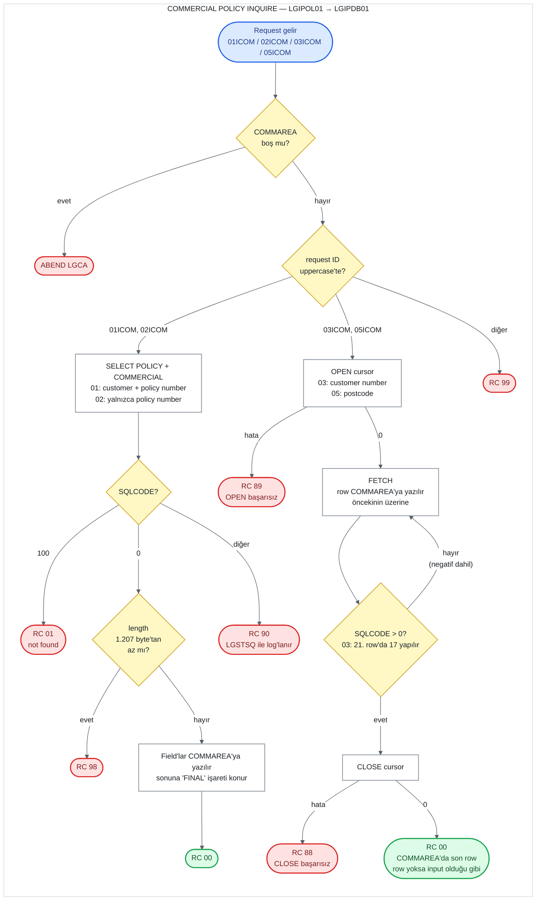

# UC-17 · Commercial Policy Inquire

Commercial (ticari) policy bilgilerini Db2'deki `POLICY` ve `COMMERCIAL` table'larını
birleştirerek okuyan operasyon. Diğer üç tipin aksine dört farklı arama biçimi var; hangisinin
çalışacağını request ID belirler:

| Request ID | Arama | Sonuç |
|---|---|---|
| `01ICOM` | Customer number **ve** policy number | Tek row |
| `02ICOM` | Yalnızca policy number | Tek row; customer number da döner |
| `03ICOM` | Yalnızca customer number | Cursor; COMMAREA'da **yalnızca son okunan row** kalır |
| `05ICOM` | Yalnızca postcode (`COMMERCIAL.ZIPCODE`) | Cursor; COMMAREA'da **yalnızca son okunan row** kalır |

`04ICOM` yoktur. Operasyon hiçbir yere yazmaz; VSAM dosyasını da okumaz. Ortak kısımlar
[05-motor-inquire.md](05-motor-inquire.md) ile aynıdır. Eski sistemde commercial update'i
olmadığı için bu inquire bir update'in ilk adımı olarak da kullanılmaz
([16-commercial-add.md](16-commercial-add.md), "Commercial update'i yok"). Bu belge, C#
kodunu yazacak kişi için eski sistemin davranışını satır satır tarif eder. Satır numaraları
`base/src` altındaki dosyalara aittir ve linkler ilgili satırı açar.

## Özet

| | |
|---|---|
| **Request ID** (`CA-REQUEST-ID`) | `01ICOM`, `02ICOM`, `03ICOM`, `05ICOM`. `LGIPOL01` kontrol etmez; `LGIPDB01` uppercase'e çevirip kontrol eder ve tanımazsa `99` döner |
| **Entry program** | `LGIPOL01` (business layer) |
| **Call chain** | `LGIPOL01` → `LGIPDB01` |
| **Okunduğu yer** | Db2 `POLICY` ve `COMMERCIAL` table'larının join'i (write yok) |
| **Output** | Ortak policy field'ları ve 16 commercial field'ı COMMAREA'da, `CA-RETURN-CODE = '00'` |
| **Olası return code'lar** | `01ICOM`/`02ICOM`: `00`, `01`, `90`, `98`, `99`. `03ICOM`/`05ICOM`: `00`, `88`, `89` (`01` ve `90` yok). Hepsinde ABEND `LGCA` |

## Flow

## Input (COMMAREA)

Screen (`LGTESTP4`, menu 1) request ID'yi hangi alanların dolu olduğuna bakarak seçer
([lgtestp4.cbl:74-120](../../base/src/lgtestp4.cbl#L74-L120)). Bir alan "dolu" sayılır,
eğer space, low-value ya da sıfır değilse. Sıra önemli; ilk uyan seçilir:

| Sıra | Dolu alanlar | Request ID | Doldurulan COMMAREA field'ları |
|---:|---|---|---|
| 1 | Customer number ve policy number | `01ICOM` | `CA-CUSTOMER-NUM`, `CA-POLICY-NUM` |
| 2 | Policy number | `02ICOM` | `CA-POLICY-NUM` |
| 3 | Customer number | `03ICOM` | `CA-CUSTOMER-NUM` |
| 4 | Postcode | `05ICOM` | `CA-B-Postcode` |
| — | Hiçbiri | Değişmez | Hiçbiri; `CA-REQUEST-ID`'de `COMM-AREA`'da önceden ne varsa o gider |

Postcode yalnızca customer number ve policy number ikisi de boşken kullanılır; aksi halde
girilmiş olsa da yok sayılır. Son satırda, transaction'ın ilk task'ında `COMM-AREA` `INITIALIZE`
edildiği için request ID space olur ve `LGIPDB01` `99` döner; sonraki task'larda value
belirlenemez ([16-commercial-add.md](16-commercial-add.md), "Broker ve payment field'ları").

| Field | Type | Kullanıldığı request | Kullanım |
|---|---|---|---|
| `CA-REQUEST-ID` | `X(6)` | hepsi | `LGIPDB01`'de dalı seçer |
| `CA-CUSTOMER-NUM` | `9(10)` | `01ICOM`, `03ICOM` | `WHERE POLICY.CUSTOMERNUMBER = ...` |
| `CA-POLICY-NUM` | `9(10)` | `01ICOM`, `02ICOM` | `WHERE POLICY.POLICYNUMBER = ...` |
| `CA-B-Postcode` | `X(8)` | `05ICOM` | `WHERE COMMERCIAL.ZIPCODE = ...` |

Diğer bütün field'lar input olarak kullanılmaz; output için doldurulur.

## Adım adım

### Ortak başlangıç

| # | Program | Ne yapıyor | Kaynak |
|---:|---|---|---|
| 1 | `LGIPOL01` | COMMAREA hiç gelmediyse (`EIBCALEN = 0`) error log'a yazar ve `LGCA` koduyla ABEND eder. | [lgipol01.cbl:79-83](../../base/src/lgipol01.cbl#L79-L83) |
| 2 | `LGIPOL01` | `CA-RETURN-CODE = '00'` yapar. Length'e de request ID'ye de bakmaz. | [lgipol01.cbl:86](../../base/src/lgipol01.cbl#L86) |
| 3 | `LGIPOL01` | `LGIPDB01`'i aynı COMMAREA ile 32.500 byte'lık length vererek `LINK` eder, dönünce hiçbir şeye bakmadan return eder. | [lgipol01.cbl:91-96](../../base/src/lgipol01.cbl#L91-L96) |
| 4 | `LGIPDB01` | `DB2-POLICY` dahil host variable'ları `INITIALIZE` eder: `DB2-BROKERID` ve `DB2-PAYMENT` `0`, `DB2-BROKERSREF` space olur. | [lgipdb01.cbl:243-245](../../base/src/lgipdb01.cbl#L243-L245) |
| 5 | `LGIPDB01` | 1-2. adımları tekrarlar (ABEND `LGCA`, `'00'`). Customer ve policy number'larını Db2 integer'ına çevirir. | [lgipdb01.cbl:251-264](../../base/src/lgipdb01.cbl#L251-L264) |
| 6 | `LGIPDB01` | Request ID'nin uppercase halini bir değişkene alır ve ona göre dal seçer; tanınmayan bir ID `'99'` olur. | [lgipdb01.cbl:275-310](../../base/src/lgipdb01.cbl#L275-L310) |

### `01ICOM` ve `02ICOM`: tek row

| # | Ne yapıyor | Kaynak |
|---:|---|---|
| 7 | `POLICY` ile `COMMERCIAL`'ı `POLICYNUMBER` üzerinden join eder ve tek row okur. `01ICOM` customer number **ve** policy number ile, `02ICOM` yalnızca policy number ile arar; `02ICOM` ayrıca `POLICY.CUSTOMERNUMBER`'ı okur. | [lgipdb01.cbl:627-678](../../base/src/lgipdb01.cbl#L627-L678), [730-782](../../base/src/lgipdb01.cbl#L730-L782) |
| 8 | Okunan column'lar: `COMMERCIAL.REQUESTDATE`, `STARTDATE`, `RENEWALDATE` ve 16 commercial column'u. `POLICY`'den yalnızca join ve `WHERE` için yararlanılır; `POLICY.ISSUEDATE`, `EXPIRYDATE`, `LASTCHANGED`, `BROKERID`, `BROKERSREFERENCE` ve `PAYMENT` **okunmaz**. | [lgipdb01.cbl:632-670](../../base/src/lgipdb01.cbl#L632-L670) |
| 9 | Row bulunduysa gereken length'i hesaplar: 33 + 1.174 = 1.207 byte. COMMAREA daha kısaysa `'98'` ile return eder. | [lgipdb01.cbl:684-691](../../base/src/lgipdb01.cbl#L684-L691), [788-795](../../base/src/lgipdb01.cbl#L788-L795) |
| 10 | Integer column'ları COMMAREA'nın numeric field'larına çevirir. Ortak policy field'larını (`DB2-POLICY-COMMON`) ve 1.102 byte'lık commercial field'larını COMMAREA'ya yazar. `02ICOM` ayrıca `CA-CUSTOMER-NUM`'a okunan customer number'ı yazar. | [lgipdb01.cbl:693-704](../../base/src/lgipdb01.cbl#L693-L704), [797-809](../../base/src/lgipdb01.cbl#L797-L809) |
| 11 | Commercial field'larının hemen arkasına (`CA-B-FILLER`'ın ilk 5 byte'ı, byte 1.203-1.207) `'FINAL'` yazar. | [lgipdb01.cbl:708](../../base/src/lgipdb01.cbl#L708), [813](../../base/src/lgipdb01.cbl#L813) |
| 12 | Row bulunamadıysa (`SQLCODE = 100`) `'01'`, başka bir error'da `'90'` yazar ve error'u log'a yazar. | [lgipdb01.cbl:710-721](../../base/src/lgipdb01.cbl#L710-L721), [815-826](../../base/src/lgipdb01.cbl#L815-L826) |

### `03ICOM` ve `05ICOM`: cursor

| # | Ne yapıyor | Kaynak |
|---:|---|---|
| 7 | Cursor'ı açar: `03ICOM` için `Cust_Cursor` (`POLICY.CUSTOMERNUMBER = ...`), `05ICOM` için `Zip_Cursor` (`COMMERCIAL.ZIPCODE = CA-B-Postcode`). İkisi de `ORDER BY` içermez. `OPEN` başarısızsa `'89'` yazar, error log'a yazar ve return eder. | [lgipdb01.cbl:89-149](../../base/src/lgipdb01.cbl#L89-L149), [840-847](../../base/src/lgipdb01.cbl#L840-L847), [923-930](../../base/src/lgipdb01.cbl#L923-L930) |
| 8 | `SQLCODE > 0` olana kadar `FETCH` yapar (en az bir kez). Her başarılı `FETCH`'te customer number'ı, policy number'ı, ortak policy field'larını ve commercial field'larını COMMAREA'nın **aynı yerine** yazar; bir önceki row'un üzerine yazılır. | [lgipdb01.cbl:849-850](../../base/src/lgipdb01.cbl#L849-L850), [863-904](../../base/src/lgipdb01.cbl#L863-L904), [932-933](../../base/src/lgipdb01.cbl#L932-L933), [946-986](../../base/src/lgipdb01.cbl#L946-L986) |
| 9 | Yalnızca `03ICOM`: okunan row'ları sayar; sayı 20'yi geçince (21. row'da) `SQLCODE`'a `17` yazarak loop'u bitirir. `05ICOM`'da sınır yok. | [lgipdb01.cbl:838](../../base/src/lgipdb01.cbl#L838), [906-909](../../base/src/lgipdb01.cbl#L906-L909) |
| 10 | Cursor'ı kapatır. `CLOSE` başarısızsa `'88'` yazar, error log'a yazar ve return eder. | [lgipdb01.cbl:852-859](../../base/src/lgipdb01.cbl#L852-L859), [935-942](../../base/src/lgipdb01.cbl#L935-L942) |
| 11 | Return code'a dokunmaz; `'00'` kalır. Length kontrolü ve `'FINAL'` işareti yok. | — |

Linkage'da `ICOM-Record` adında 1.202 byte'lık bir alan tanımlı ama hiç kullanılmıyor
([lgipdb01.cbl:222](../../base/src/lgipdb01.cbl#L222)). Row'ları COMMAREA'ya art arda yazmak
için düşünülmüş olabilir; kodda bunu yapan bir satır yok.

**Length nereden geliyor.** `WS-CA-HEADERTRAILER-LEN` 33 byte'tır
([lgipdb01.cbl:73](../../base/src/lgipdb01.cbl#L73)): 28 byte'lık header ve 5 byte'lık
`'FINAL'` işareti. Buna `WS-FULL-COMM-LEN` 1.174 eklenir
([lgpolicy.cpy:27](../../base/src/lgpolicy.cpy#L27)) ve 1.207 olur. Commercial field'ları
1.202. byte'ta biter, `'FINAL'` 1.203-1.207. byte'lara yazılır; kontrol yazılan alanın
tamamını kapsar. `LGIPOL01`, `LGIPDB01`'i her zaman `LENGTH(32500)` ile call ettiği için
([lgipol01.cbl:91-94](../../base/src/lgipol01.cbl#L91-L94)) bu kontrol `LGIPOL01` üzerinden
gelen bir request'te tetiklenmez.

## Output (COMMAREA)

Başarılı (`'00'`) bir query'den sonra dolu gelen field'lar. Cursor'lı iki request'te bunlar
son okunan row'a aittir.

| Field | Type | Kaynak column | Not |
|---|---|---|---|
| `CA-CUSTOMER-NUM` | `9(10)` | `POLICY.CUSTOMERNUMBER` | Yalnızca `02ICOM`, `03ICOM`, `05ICOM`. `01ICOM`'da değişmez |
| `CA-POLICY-NUM` | `9(10)` | `POLICY.POLICYNUMBER` | Yalnızca `03ICOM`, `05ICOM`. `01ICOM` ve `02ICOM`'da değişmez |
| `CA-ISSUE-DATE` | `X(10)` | **`COMMERCIAL.STARTDATE`** | `POLICY.ISSUEDATE` değil |
| `CA-EXPIRY-DATE` | `X(10)` | **`COMMERCIAL.RENEWALDATE`** | `POLICY.EXPIRYDATE` değil |
| `CA-LASTCHANGED` | `X(26)` | **`COMMERCIAL.REQUESTDATE`** | `POLICY.LASTCHANGED` değil |
| `CA-BROKERID` | `9(10)` | — | Her zaman `0` (4. adımdaki `INITIALIZE`) |
| `CA-BROKERSREF` | `X(10)` | — | Her zaman space |
| `CA-PAYMENT` | `9(6)` | — | Her zaman `0` |
| `CA-B-Address` | `X(255)` | `COMMERCIAL.ADDRESS` | |
| `CA-B-Postcode` | `X(8)` | `COMMERCIAL.ZIPCODE` | |
| `CA-B-Latitude` | `X(11)` | `COMMERCIAL.LATITUDEN` | |
| `CA-B-Longitude` | `X(11)` | `COMMERCIAL.LONGITUDEW` | |
| `CA-B-Customer` | `X(255)` | `COMMERCIAL.CUSTOMER` | |
| `CA-B-PropType` | `X(255)` | `COMMERCIAL.PROPERTYTYPE` | |
| `CA-B-FirePeril` ... `CA-B-WeatherPremium` | `9(4)` / `9(8)` | `COMMERCIAL.FIREPERIL` ... `WEATHERPREMIUM` | 8 field |
| `CA-B-Status` | `9(4)` | `COMMERCIAL.STATUS` | |
| `CA-B-RejectReason` | `X(255)` | `COMMERCIAL.REJECTIONREASON` | |
| `CA-B-FILLER(1:5)` | `X(5)` | — | Sabit `'FINAL'`. Yalnızca `01ICOM`, `02ICOM` |
| `CA-RETURN-CODE` | `9(2)` | — | `00` |

`POLICY.POLICYTYPE` ve `POLICY.COMMISSION` okunmaz.

## Return code'lar

| Code | Request | Koşul | Nerede set ediliyor | Caller ne görür |
|---|---|---|---|---|
| `00` | hepsi | `01`/`02`: row bulundu. `03`/`05`: cursor açılıp kapandı; **row bulunmasa da** | [lgipdb01.cbl:258](../../base/src/lgipdb01.cbl#L258) | `01`/`02`: field'lar dolu. `03`/`05`: son row ya da row yoksa COMMAREA olduğu gibi |
| `01` | `01`, `02` | Row yok (`SQLCODE = 100`): policy number yok, (`01ICOM`'da) customer number policy'ninkiyle eşleşmiyor ya da policy'nin `COMMERCIAL`'da row'u yok | [lgipdb01.cbl:712-714](../../base/src/lgipdb01.cbl#L712-L714), [817-819](../../base/src/lgipdb01.cbl#L817-L819) | Screen "No data was returned." gösterir |
| `90` | `01`, `02` | Diğer her `SQLCODE`. Db2 deadlock/timeout (-913) ve bir commercial column'unun `NULL` olması da buraya düşer | [lgipdb01.cbl:715-720](../../base/src/lgipdb01.cbl#L715-L720), [820-825](../../base/src/lgipdb01.cbl#L820-L825) | Error `LGSTSQ` ile log'lanır; screen "No data was returned." gösterir |
| `98` | `01`, `02` | Row bulundu ama COMMAREA 1.207 byte'tan kısa | [lgipdb01.cbl:689-691](../../base/src/lgipdb01.cbl#L689-L691), [793-795](../../base/src/lgipdb01.cbl#L793-L795) | `98`. `LGIPOL01` üzerinden oluşmaz |
| `89` | `03`, `05` | Cursor `OPEN` başarısız (Db2 deadlock/timeout dahil) | [lgipdb01.cbl:843-847](../../base/src/lgipdb01.cbl#L843-L847), [926-930](../../base/src/lgipdb01.cbl#L926-L930) | `89`; screen "No data was returned." |
| `88` | `03`, `05` | Cursor `CLOSE` başarısız | [lgipdb01.cbl:855-859](../../base/src/lgipdb01.cbl#L855-L859), [938-942](../../base/src/lgipdb01.cbl#L938-L942) | `88`; COMMAREA'da o ana kadar okunan son row durur |
| `99` | — | Request ID tanınmadı | [lgipdb01.cbl:307-308](../../base/src/lgipdb01.cbl#L307-L308) | `99` |
| — | hepsi | COMMAREA hiç yok | [lgipol01.cbl:79-83](../../base/src/lgipol01.cbl#L79-L83) | ABEND `LGCA` |

**`FETCH` error'u.** Cursor'lı iki request'te loop yalnızca `SQLCODE > 0` olunca biter
([lgipdb01.cbl:850](../../base/src/lgipdb01.cbl#L850),
[933](../../base/src/lgipdb01.cbl#L933)). Negatif bir `SQLCODE` loop'u bitirmez; error
log'a yazılmaz ve return code değişmez. Error kalıcıysa (örneğin bağlantı kopması) loop hiç
bitmez. Yalnızca o row'a ait bir error'da (örneğin `NULL` bir column, -305) Db2 bir sonraki
`FETCH`'te devam edebilir; o row sessizce atlanır ve sonuç yine `00` olur. Hangisinin olacağı
Db2'ye bağlıdır, kaynak koddan belirlenemez.

**Screen tarafı.** `CA-RETURN-CODE > 0` ise code'un ne olduğuna bakmadan "No data was
returned." gösterir ([lgtestp4.cbl:126-128](../../base/src/lgtestp4.cbl#L126-L128),
[304-306](../../base/src/lgtestp4.cbl#L304-L306)). Başarılıysa policy number'ı, customer
number'ı, iki date'i ve 16 commercial alanını ekrana yazar
([lgtestp4.cbl:130-153](../../base/src/lgtestp4.cbl#L130-L153)). Ekranda tek bir policy'lik
yer var; `03ICOM` ve `05ICOM`'da kullanıcı yalnızca son row'u görür. Row bulunmadığında
`00` döndüğü için screen hata mesajı göstermez ve COMMAREA'da kalan value'ları ekrana yazar.

## Okunan data

**Db2 `POLICY`** ([db2cre.jcl:161-176](../../base/cntl/db2cre.jcl#L161-L176)) ve
**`COMMERCIAL`** ([db2cre.jcl:313-338](../../base/cntl/db2cre.jcl#L313-L338)) table'ları,
inner join ile. `KSDSPOLY` VSAM dosyası bu operasyonda hiç okunmaz; policy bilgisinin tek
kaynağı Db2.

## C#'a taşırken dikkat edilecek davranışlar

1. **Üç date `COMMERCIAL`'dan geliyor.** `issueDate`, `expiryDate` ve `lastChanged`
   `POLICY`'den değil `COMMERCIAL.STARTDATE`, `RENEWALDATE` ve `REQUESTDATE`'ten okunuyor.
   Add bu value'ları iki table'a aynı yazdığı için yeni eklenen policy'de fark görünmez. Örnek
   data'da ise farklılar:

   | Policy | Kaynak | Issue date | Expiry date | Last changed |
   |---:|---|---|---|---|
   | 10 | `POLICY` ([db2cre.jcl:779-782](../../base/cntl/db2cre.jcl#L779-L782)) | 2011-08-22 | 2012-08-21 | 2011-08-22 12:13:01 |
   | 10 | `COMMERCIAL` ([db2cre.jcl:1185-1187](../../base/cntl/db2cre.jcl#L1185-L1187)) | 2011-08-25 | 2011-08-24 | 2011-08-23 10:44:34 |
   | 9 | `POLICY` ([db2cre.jcl:803-806](../../base/cntl/db2cre.jcl#L803-L806)) | 2011-09-23 | 2012-09-22 | 2011-09-23 17:00:44 |
   | 9 | `COMMERCIAL` ([db2cre.jcl:1228-1230](../../base/cntl/db2cre.jcl#L1228-L1230)) | 2011-08-01 | 2011-07-30 | 2011-07-17 13:13:09 |

   Eski sistem `COMMERCIAL` satırlarını döndürür. ADR 0002 karar 9'un sapma listesinde bu durum
   yok; eşdeğerlik için C# kodu bu üç field'ı `commercial` table'ının `start_date`,
   `renewal_date` ve `request_date` column'larından döndürmeli. API tasarımı alanın kaynak
   column'unu belirtmiyor ([api-design.md](../../docs/api-design.md), 4.2); ekip bu seçimi
   açıkça kaydetmeli.
2. **Broker ve payment okunmuyor.** Dört request'te de `CA-BROKERID` ve `CA-PAYMENT` `0`,
   `CA-BROKERSREF` space döner. Yeni sistem kayıttaki value'ları döndürür (ADR 0002 karar 9,
   bilinçli sapma).
3. **Cursor'lı iki request yalnızca son row'u bırakıyor.** Her `FETCH` bir öncekinin üzerine
   yazıyor; `ORDER BY` olmadığı için hangi row'un son kalacağı da belli değil. `03ICOM` en
   fazla 21 row okuyor, `05ICOM`'da sınır yok. Yeni sistem bulunan bütün row'ları liste olarak
   döndürür (ADR 0002 karar 9, bilinçli sapma; api-design 17c ve 17d).
4. **Row yoksa cursor'lı iki request `00` dönüyor.** `01` hiç oluşmuyor. Yeni sistemde `200`
   ve boş liste (`[]`) (korunan davranış, api-design 3).
5. **`FETCH` error'u loop'u bitirmiyor.** Yeni sistem `500` / `"90"` döner; deadlock/timeout'ta
   `503` (ADR 0002 karar 8 ve 9).
6. **Cursor error'ları `88` ve `89`.** Yeni sistemde bunların karşılığı `500` / `"90"`;
   deadlock/timeout `503` / `"90"` (ADR 0002 karar 8).
7. **Policy tipi join ile kontrol ediliyor.** Query `POLICYTYPE`'a bakmıyor; `COMMERCIAL`'la
   inner join yaptığı için commercial row'u olmayan bir policy `01` döner. Örnek data'daki
   policy 7'nin tipi `'C'` ama `COMMERCIAL`'da değil `HOUSE`'ta row'u var
   ([db2cre.jcl:901](../../base/cntl/db2cre.jcl#L901),
   [1068](../../base/cntl/db2cre.jcl#L1068)); commercial inquire onu bulamaz ve `01` döner.
   Bu policy'nin tipi doğru olduğu için ADR 0002 karar 9'daki tip kontrolü onu yakalamaz; C#
   kodu `commercial` row'u olmayan bir policy için de `404` / `"01"` döndürmeli.
8. **`01ICOM`'da customer number da eşleşmeli,** `02ICOM`'da eşleşmesi gerekmez. Başka bir
   customer'ın policy'si `01ICOM`'da `01` döner, `02ICOM`'da bulunur.
9. **`NULL` hiçbir column için desteklenmiyor.** Commercial query'lerinin hiçbirinde indicator
   variable yok; `COMMERCIAL`'ın bütün column'ları `NULL` olabildiği halde biri `NULL` gelirse
   Db2 error verir. Tek row'lu request'lerde sonuç `90`; cursor'lı request'lerde bkz.
   "`FETCH` error'u". Add her column'u doldurduğu için pratikte sorun çıkmaz.
10. **Length, query'den sonra kontrol ediliyor** ve yalnızca tek row'lu request'lerde. `98`
    `LGIPOL01` üzerinden oluşmuyor.
11. **`'FINAL'` işareti** yalnızca `01ICOM` ve `02ICOM`'da yazılıyor. API cevabında karşılığı
    yok.
12. **Not found olunca field'lar temizlenmiyor.** `'01'`, `'90'` ya da cursor'lı request'te
    row bulunmadığında COMMAREA'daki policy field'larına dokunulmuyor; içlerinde caller'ın
    gönderdiği ne varsa kalıyor. Sadece return code güvenilir.
13. **Request ID küçük harfle de kabul ediliyor.** `LGIPDB01` karşılaştırmadan önce uppercase'e
    çeviriyor (`01icom` çalışır). `LGIPOL01` ise ne length'e ne request ID'ye bakıyor.
14. **Postcode birebir karşılaştırılıyor.** `ZIPCODE = CA-B-Postcode`; büyük/küçük harf ve
    aradaki boşluk fark eder (`SO212JN` ile `SO21 2JN` eşleşmez). Db2 `CHAR` karşılaştırması
    sondaki boşlukları yok sayar.
