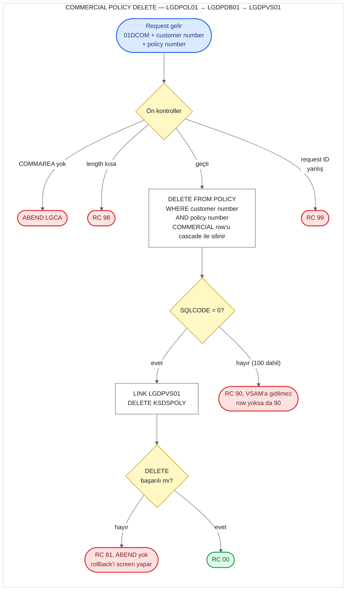

# UC-18 · Commercial Policy Delete

Customer number'ı ve policy number'ı verilen bir commercial (ticari) policy'yi Db2'deki
`POLICY` table'ından ve `KSDSPOLY` VSAM dosyasından silen operasyon. `COMMERCIAL` table'ındaki
row'u program silmez; Db2 foreign key'in `ON DELETE CASCADE` kuralıyla kendisi siler. Dört
policy tipi aynı programları kullandığı için bu belge yalnızca commercial'a ait kısımları ve
ortak kısımları anlatır; ortak kısımlar [07-motor-delete.md](07-motor-delete.md) ve
[11-house-delete.md](11-house-delete.md) ile aynıdır. Bu belge, C# kodunu yazacak kişi için
eski sistemin davranışını satır satır tarif eder. Satır numaraları `base/src` altındaki
dosyalara aittir ve linkler ilgili satırı açar.

## Özet

| | |
|---|---|
| **Request ID** (`CA-REQUEST-ID`) | `01DCOM`. `LGDPOL01` uppercase'e çevirip kontrol eder, `LGDPDB01` tekrar kontrol eder; tanınmazsa `99` |
| **Entry program** | `LGDPOL01` (business layer) |
| **Call chain** | `LGDPOL01` → `LGDPDB01` → `LGDPVS01` |
| **Silindiği yerler** | Db2 `POLICY` table (ve cascade ile `COMMERCIAL`), VSAM `KSDSPOLY` |
| **Output** | Yalnızca `CA-RETURN-CODE = '00'` |
| **Olası return code'lar** | `00`, `81`, `90`, `98`, `99` (ve ABEND `LGCA`) |

## Flow

## Input (COMMAREA)

Screen (`LGTESTP4`, menu 3) yalnızca üç field doldurup `LGDPOL01`'i call eder
([lgtestp4.cbl:197-204](../../base/src/lgtestp4.cbl#L197-L204)).

| Field | Type | Gelen value | Kullanım |
|---|---|---|---|
| `CA-REQUEST-ID` | `X(6)` | `'01DCOM'` | Kontrol edilir; 4. karakteri (`'C'`) VSAM key'inin ilk byte'ı olur |
| `CA-CUSTOMER-NUM` | `9(10)` | screen'den | `WHERE POLICY.CUSTOMERNUMBER = ...` ve VSAM key |
| `CA-POLICY-NUM` | `9(10)` | screen'den | `WHERE POLICY.POLICYNUMBER = ...` ve VSAM key |

Minimum length yalnızca 28 byte'lık header'dır
([lgdpol01.cbl:57](../../base/src/lgdpol01.cbl#L57)); commercial field'ları bu operasyonda
kullanılmaz. Inquire'ın aksine yalnızca policy number ile ya da postcode ile silme yok; iki
number da gerekir.

## Adım adım

| # | Program | Ne yapıyor | Kaynak |
|---:|---|---|---|
| 1 | `LGDPOL01` | COMMAREA hiç gelmediyse error log'a yazar ve `LGCA` koduyla ABEND eder. | [lgdpol01.cbl:95-99](../../base/src/lgdpol01.cbl#L95-L99) |
| 2 | `LGDPOL01` | `CA-RETURN-CODE = '00'` yapar. COMMAREA 28 byte'tan kısaysa `'98'` ile return eder. | [lgdpol01.cbl:102-110](../../base/src/lgdpol01.cbl#L102-L110) |
| 3 | `LGDPOL01` | `CA-REQUEST-ID`'yi **COMMAREA'nın içinde** uppercase'e çevirir. Dört delete kodundan biri değilse `'99'` yazar ve `LGDPDB01`'i call etmez. | [lgdpol01.cbl:117-124](../../base/src/lgdpol01.cbl#L117-L124) |
| 4 | `LGDPOL01` | `LGDPDB01`'i aynı COMMAREA ile `LINK` eder ve dönünce return eder. Return code'u değiştirmez. | [lgdpol01.cbl:125-133](../../base/src/lgdpol01.cbl#L125-L133), [139-144](../../base/src/lgdpol01.cbl#L139-L144) |
| 5 | `LGDPDB01` | 1-2. adımları tekrarlar (ABEND `LGCA`, `'00'`, 28 byte → `'98'`). Customer ve policy number'larını Db2 integer'ına çevirir. | [lgdpdb01.cbl:131-150](../../base/src/lgdpdb01.cbl#L131-L150) |
| 6 | `LGDPDB01` | Request ID'yi tekrar kontrol eder; tanımazsa `'99'`. | [lgdpdb01.cbl:160-165](../../base/src/lgdpdb01.cbl#L160-L165) |
| 7 | `LGDPDB01` | `POLICY` table'ından customer number **ve** policy number'a uyan row'u siler. `COMMERCIAL` row'u foreign key'in `ON DELETE CASCADE` kuralıyla Db2 tarafından silinir. | [lgdpdb01.cbl:186-194](../../base/src/lgdpdb01.cbl#L186-L194) |
| 8 | `LGDPDB01` | `SQLCODE` 0 değilse `'90'` yazar, error log'a yazar ve return eder; VSAM'a gidilmez. **Row bulunamadığında da (`SQLCODE = 100`) sonuç `'90'`'dır**, yorum aksini söylese de. | [lgdpdb01.cbl:196-202](../../base/src/lgdpdb01.cbl#L196-L202) |
| 9 | `LGDPDB01` → `LGDPVS01` | `LGDPVS01`'i call eder; o da `KSDSPOLY`'den key'i `'C'` + customer number + policy number olan record'u siler. Başarısızsa `'81'` yazar ve return eder. **ABEND etmez.** | [lgdpdb01.cbl:167-171](../../base/src/lgdpdb01.cbl#L167-L171), [lgdpvs01.cbl:77-91](../../base/src/lgdpvs01.cbl#L77-L91) |
| 10 | `LGDPDB01` | Caller'a return eder. | [lgdpdb01.cbl:175](../../base/src/lgdpdb01.cbl#L175) |

## Return code'lar

| Code | Koşul | Nerede set ediliyor | Caller ne görür |
|---|---|---|---|
| `00` | Db2 ve VSAM silme işlemleri başarılı | [lgdpdb01.cbl:138](../../base/src/lgdpdb01.cbl#L138) | `00` |
| `90` | `DELETE` 0 dışında bir `SQLCODE` verdi: row yok (`100`), customer number policy'ninkiyle eşleşmiyor (yine `100`), Db2 deadlock/timeout (-913) ya da başka bir error | [lgdpdb01.cbl:198-202](../../base/src/lgdpdb01.cbl#L198-L202) | `90`. Hiçbir şey silinmez. Error `LGSTSQ` ile log'lanır. |
| `81` | `KSDSPOLY`'den `DELETE` başarısız (örneğin record yok) | [lgdpvs01.cbl:86-91](../../base/src/lgdpvs01.cbl#L86-L91) | `81`. Db2'deki silme **bu noktada hâlâ geçerli**; onu screen'in `SYNCPOINT ROLLBACK`'i geri alır. |
| `98` | COMMAREA 28 byte'tan kısa | [lgdpol01.cbl:107-110](../../base/src/lgdpol01.cbl#L107-L110), [lgdpdb01.cbl:143-146](../../base/src/lgdpdb01.cbl#L143-L146) | `98`. Screen her zaman 32.500 byte gönderdiği için pratikte oluşmaz. |
| `99` | Request ID dört delete kodundan biri değil | [lgdpol01.cbl:119-124](../../base/src/lgdpol01.cbl#L119-L124), [lgdpdb01.cbl:160-165](../../base/src/lgdpdb01.cbl#L160-L165) | `99`. Hiçbir şey silinmez. |
| — | COMMAREA hiç yok | [lgdpol01.cbl:95-99](../../base/src/lgdpol01.cbl#L95-L99) | ABEND `LGCA` |

**Screen tarafı.** `CA-RETURN-CODE > 0` ise `SYNCPOINT ROLLBACK` yapar ve "Error Deleting
Commercial Policy" gösterir ([lgtestp4.cbl:205-208](../../base/src/lgtestp4.cbl#L205-L208),
[300-302](../../base/src/lgtestp4.cbl#L300-L302)). Başarılıysa ekrandaki 17 alanı temizler
ve "Commercial Policy Deleted" gösterir
([lgtestp4.cbl:210-234](../../base/src/lgtestp4.cbl#L210-L234)). Temizlenen alanlar arasında
start date (`ENP4IDAI`) yok; silinen policy'nin start date'i ekranda kalır. Error mesajı
doğru alana (`ERP4FLDO`) yazılıyor ve ekranda görünüyor.

## Silinen data

**Db2 `POLICY` table** ([db2cre.jcl:161-176](../../base/cntl/db2cre.jcl#L161-L176)) —
`CUSTOMERNUMBER` ve `POLICYNUMBER`'ı eşleşen tek row.

**Db2 `COMMERCIAL` table** ([db2cre.jcl:313-338](../../base/cntl/db2cre.jcl#L313-L338)) —
aynı `POLICYNUMBER`'lı row, `ON DELETE CASCADE` ile
([db2cre.jcl:335-336](../../base/cntl/db2cre.jcl#L335-L336)). Program bu table'a hiç SQL
göndermez ([lgdpdb01.cbl:186-194](../../base/src/lgdpdb01.cbl#L186-L194)).

**VSAM `KSDSPOLY`** — key'i `'C'` + customer number + policy number olan record. Record
yapısı için bkz. [16-commercial-add.md](16-commercial-add.md).

## C#'a taşırken dikkat edilecek davranışlar

1. **Olmayan policy `90` döndürüyor.**
   - **Yorum:** "SQLCODE 100 de başarılı sayılsın" diyor ([lgdpdb01.cbl:196-197](../../base/src/lgdpdb01.cbl#L196-L197)).
   - **Kod:** `SQLCODE NOT EQUAL 0` ise `'90'` döndürüyor.
   - **Sonuç:** Olmayan bir policy'yi silmek `90` verir; ne `00` ne de `01`.
   - **Yeni sistem:** ADR 0002 karar 9, bu davranışın korunmasına karar verdi: `500` / `"90"`.
2. **Policy tipi kontrol edilmiyor.** `DELETE`, `POLICYTYPE`'a bakmıyor. `01DCOM` bir motor
   policy number'ıyla gelirse eski sistemde şunlar olur:
   1. Db2 `POLICY` row'unu ve cascade ile `MOTOR` row'unu siler.
   2. VSAM'da `'C'` ile başlayan key bulunamaz ve `81` döner.
   3. Screen'in `SYNCPOINT ROLLBACK`'i Db2 silmesini geri alır.

   Eski sistemi yanlış tipteki policy'yi silmekten VSAM error'u koruyor. Yeni sistemde VSAM
   yok (ADR 0003); C# kodu tipi kontrol etmezse başka tipte bir policy'yi gerçekten siler.
   ADR 0002 karar 9'a göre policy'nin tipi adresteki tiple uyuşmazsa hiçbir şey silinmez ve
   `404` / `"01"` döner (eski sistemin `81`'i yeni sistemde yok).
3. **Customer number da eşleşmeli.** `DELETE` iki number'a birden bakıyor; başka bir
   customer'ın policy number'ı `100` → `90` döner. Inquire'daki `02ICOM`'un aksine yalnızca
   policy number ile silinemez.
4. **Rollback'i screen yapıyor.** VSAM error'u ABEND değil normal return olduğu için Db2
   silmesini geri alan screen'in `SYNCPOINT ROLLBACK`'i. Yeni sistemde tek transaction
   (ADR 0003); VSAM olmadığı için `81` oluşmaz.
5. **Tip table'ı cascade ile siliniyor.** Yeni şemada da yedi foreign key'in hepsi
   `ON DELETE CASCADE` ([database-schema.md](../../docs/database-schema.md), "Korunan
   davranışlar"). C# kodu yalnızca `policy` row'unu silerek aynı sonucu alır.
6. **Request ID iki kez kontrol ediliyor ve COMMAREA'da değiştiriliyor.** `LGDPOL01`
   request ID'yi uppercase'e çevirip COMMAREA'ya geri yazıyor; küçük harfli `01dcom` kabul
   ediliyor ve caller'a uppercase olarak dönüyor.
7. **Deadlock/timeout `90`.** -913 diğer error'lar gibi `90` dönüyor. Yeni sistemde `503` /
   `"90"` (ADR 0002, karar 8).
8. **Commercial row'u olmayan `'C'` tipli policy.** Örnek data'daki policy 7'nin (customer 6)
   tipi `'C'` ama `COMMERCIAL`'da row'u yok, `HOUSE`'ta var
   ([17-commercial-inquire.md](17-commercial-inquire.md), madde 7). VSAM'daki record'unun key'i
   de `'H'` ile başlıyor ([ksdspoly.txt:6](../../base/data/ksdspoly.txt#L6)). İki sistem bu
   policy için ters sonuç verir:

   | Request | Eski sistem | Yeni sistem (ADR 0002 karar 9) |
   |---|---|---|
   | `01DCOM` | Db2 siler, VSAM'da `'C'` key'i yok, `81`; screen'den gelindiyse rollback yapılır ve **silinmez** | Tip `'C'` uyuşuyor, **silinir** |
   | `01DHOU` | Db2 siler, VSAM'da `'H'` key'i var, `00`; **silinir** | Tip `'C'`, adres `H`: `404` / `"01"`, silinmez |

   Bu, örnek data'daki tutarsızlıktan doğan bir fark. Eşdeğerlik testinde policy 7 ile silme
   yapılırsa sonuç bilinçli sapma olarak işaretlenmeli ya da bu policy test data'sından
   çıkarılmalı; karar ekibin.
